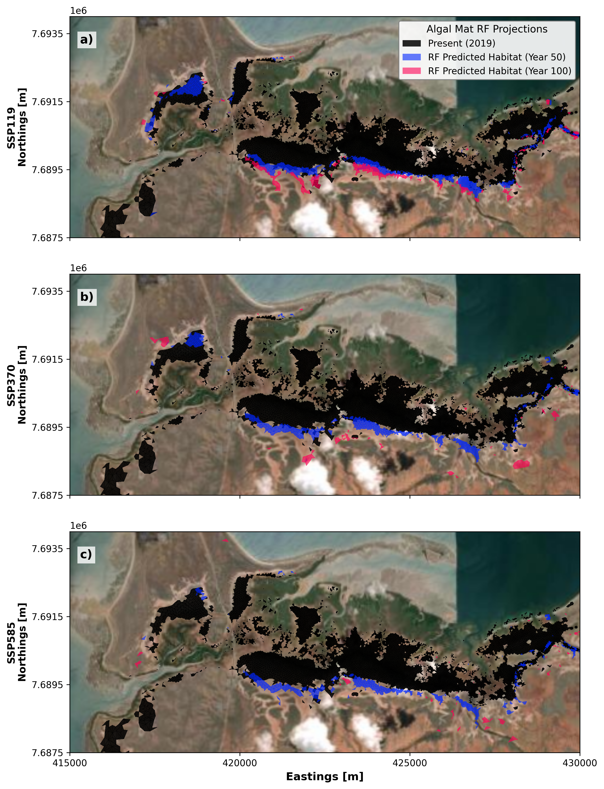
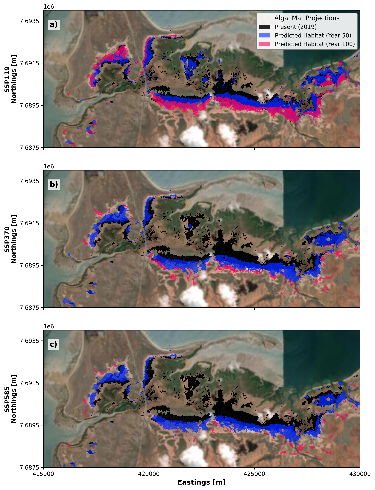
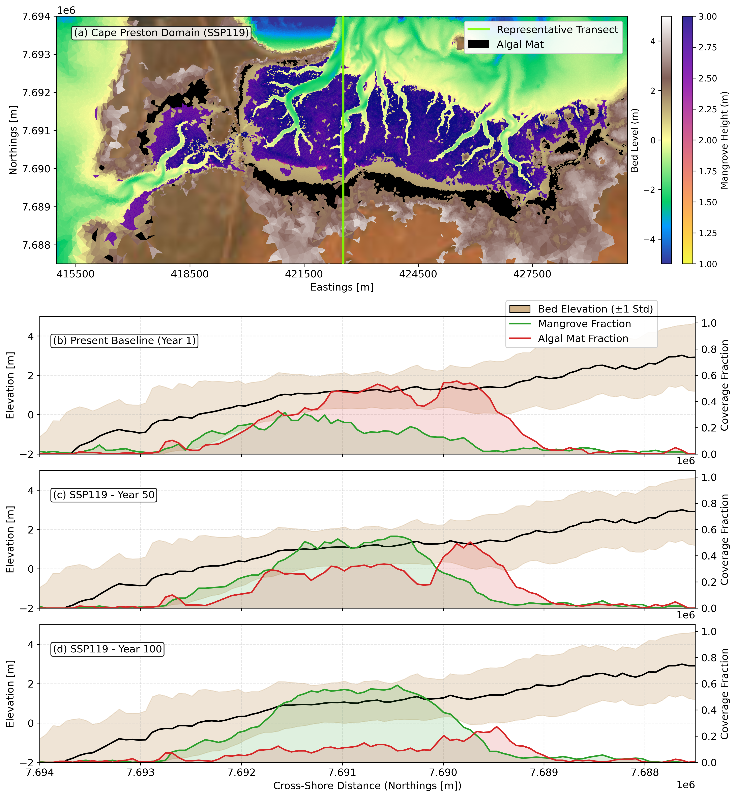
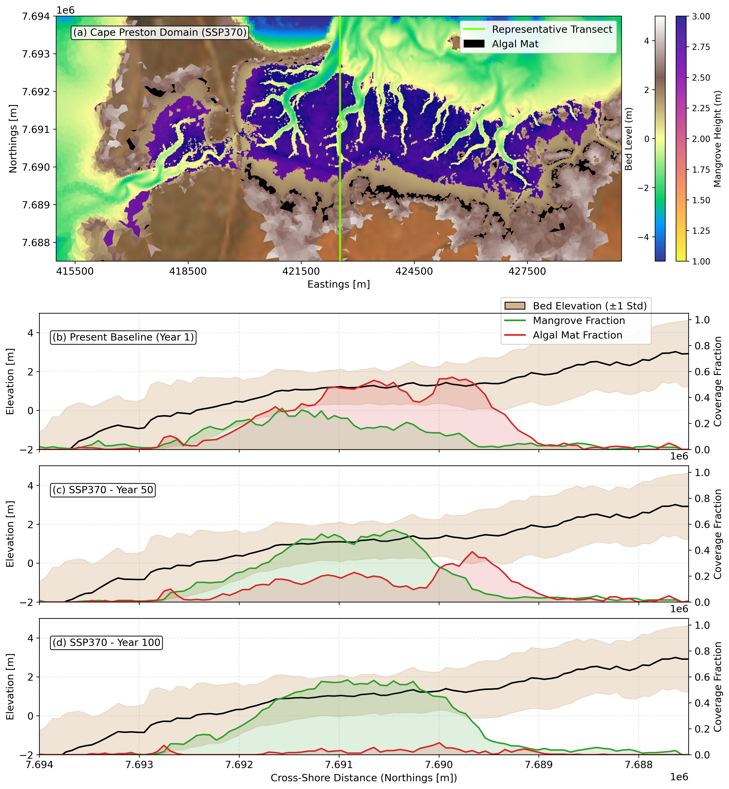
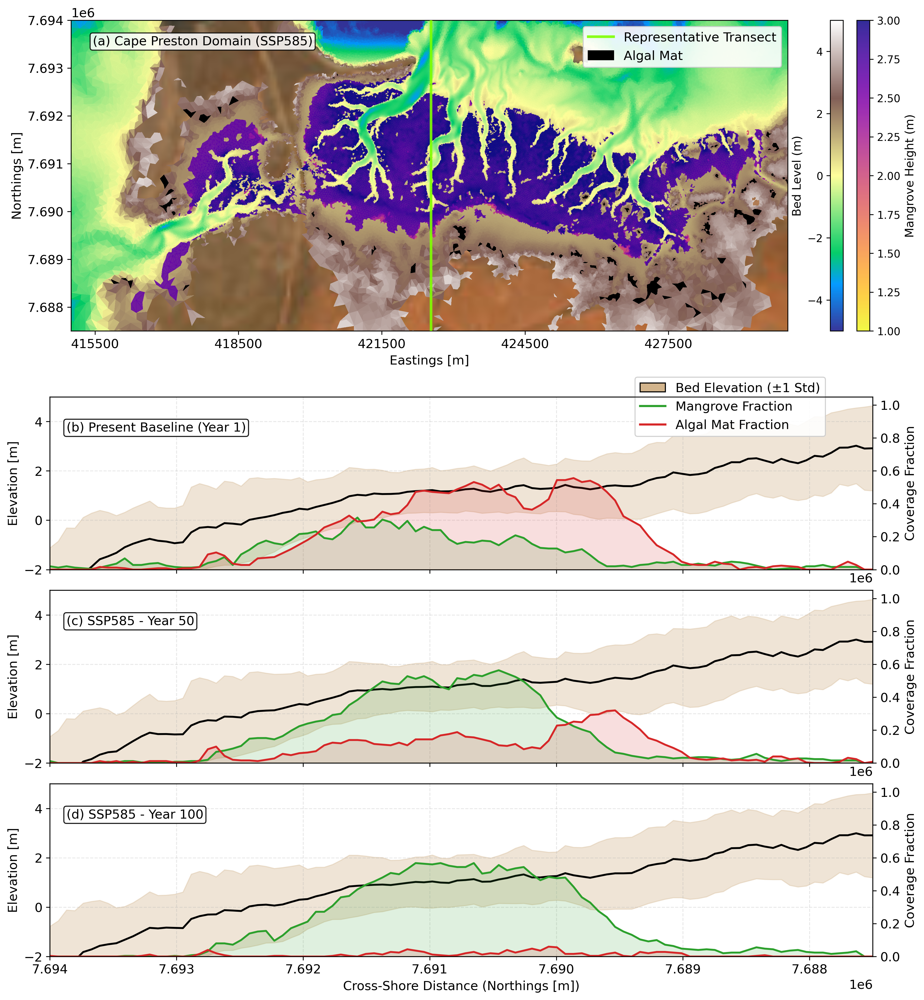

# Cyanobacterial mat Response to Sea Level Rise {#sec-cp-algalmat}

## Sea-Level Rise Response

Similar to Giralia, we carried out the hydrodynamic runs for discrete time intervals with the mangroves, bedlevels information from the mangrove projection runs and carried out the algal mat runs for static increase of water level at respective time steps. Using the hydrodynamic data, we project the algal mat response using two different data-driven approaches as described in @sec-approach.

::: {.panel-tabset}

### Random Forest (RF) Approach

{#fig-cp-algal-rf width="100%"}

### Threshold-based Optimisation Approach

{#fig-cp-algal-threshold width="100%"}

:::

Both modelling approaches predict changes in the distribution and spatial organisation of cyanobacterial mats across the Cape Preston intertidal domain over the 100 year projection period. However, the predicted spatial patterns differ considerably between the RF and threshold-based optimisation approaches.

The RF model predicts extensive and relatively continuous baseline coverage across the central intertidal flats. By Year 50 and Year 100, predicted future coverage is more spatially restricted, occurring predominantly along the southern margins and within western salt flat embayments. In contrast, the threshold-based optimisation model predicts a more dispersed distribution of future suitable areas, with patches extending towards the higher intertidal flats. These differences indicate that the two approaches represent the spatial redistribution of cyanobacterial mats differently under changing environmental conditions.

The influence of the SLR scenario also varies between the modelling approaches. Under the low emissions SSP119 scenario, both approaches predict changes in cyanobacterial mat distribution, including expansion into some areas of higher elevation. Under the moderate emissions SSP370 and high emissions SSP585 scenarios, the RF model predicts comparatively restricted future distributions, with much of the projected coverage concentrated along the margins of the existing mats. Conversely, the threshold-based optimisation model predicts a more dispersed pattern of potential future coverage across the intertidal domain. The differences between scenarios are particularly evident in the distribution of isolated patches and the extent of predicted expansion beyond the existing mat boundaries.

These projections reflect differences in the mathematical formulations and assumptions underlying the two approaches. The Random Forest classifier identifies statistical relationships between observed cyanobacterial mat distributions and environmental predictors, accounting for potentially complex and nonlinear interactions. In comparison, the threshold-based optimisation model determines suitable areas according to prescribed environmental thresholds, including inundation frequency and water depth limits. Consequently, its predictions are more directly influenced by the spatial distribution of hydrodynamic conditions and local topography. 

::: {.panel-tabset}

### Random Forest (RF) Approach

::: {.panel-tabset}

#### SSP119
{#fig-cp-ssp119-ml width=100%}

#### SSP370
{#fig-cp-ssp370-ml width=100%}

#### SSP585
{#fig-cp-ssp585-ml width=100%}

:::

### Threshold-Based Optimisation Approach

::: {.panel-tabset}

#### SSP119
{#fig-cp-ssp119-thresh width=100%}

#### SSP370
{#fig-cp-ssp370-thresh width=100%}

#### SSP585
{#fig-cp-ssp585-thresh width=100%}

:::

:::

The spatiotemporal projections reveal a marked response of cyanobacterial mats to sea-level rise across the Cape Preston intertidal domain. Under the low-emissions SSP119 scenario, algal mat coverage exhibits moderate resilience, experiencing a reduction of roughly 15% to 25% by Year 50 and up to 40% by Year 100 as wetting extends across the flats. Under moderate (SSP370) and high (SSP585) emissions scenarios, the rate of water level rise outpaces landward migration capacity, leading to severe habitat contraction with algal mat coverage reductions exceeding 65% by Year 50 and dropping by more than 85% to complete near-total submergence by Year 100. 

Comparing the two modelling paradigms, the Random Forest (RF) classifier captures smooth, broader spatial persistence across supratidal zones by relying on non-linear probabilistic associations among hydrodynamic drivers. In contrast, the threshold-based optimisation approach enforces strict physical envelope boundaries, predicting more sharply delineated zonation bands that explicitly highlight coastal squeeze and acute drowning thresholds under high-forcing scenarios. 

Regarding the mangrove communities evaluated alongside the algal dynamics, alongshore-averaged profiles show that mangrove fractions maintain a stable distribution across lower-to-middle intertidal elevations during the first 50 years, but experience compression and upward landward shifting by Year 100 as rising sea levels alter intertidal inundation frequencies and bed shear stress limits.

::: {.callout-note icon=false}
## Summary: Century-Scale Cyanobacterial Mat Trajectories at Cape Preston

Synthesising century-scale projections across different SLR scenarios (emission pathways) reveals that cyanobacterial mats at Cape Preston are highly sensitive to rising sea levels. While low-emissions forcing (SSP119) permits partial landward migration into wetted supratidal areas, accelerated sea-level rise under moderate (SSP370) and high (SSP585) emissions leads to progressive coastal squeeze. Because the narrower supratidal gradient at Cape Preston limits available landward accommodation space, rapid submergence quickly overwhelms the mats' inundation tolerance, resulting in critical habitat contraction exceeding 85% by Year 100.
:::