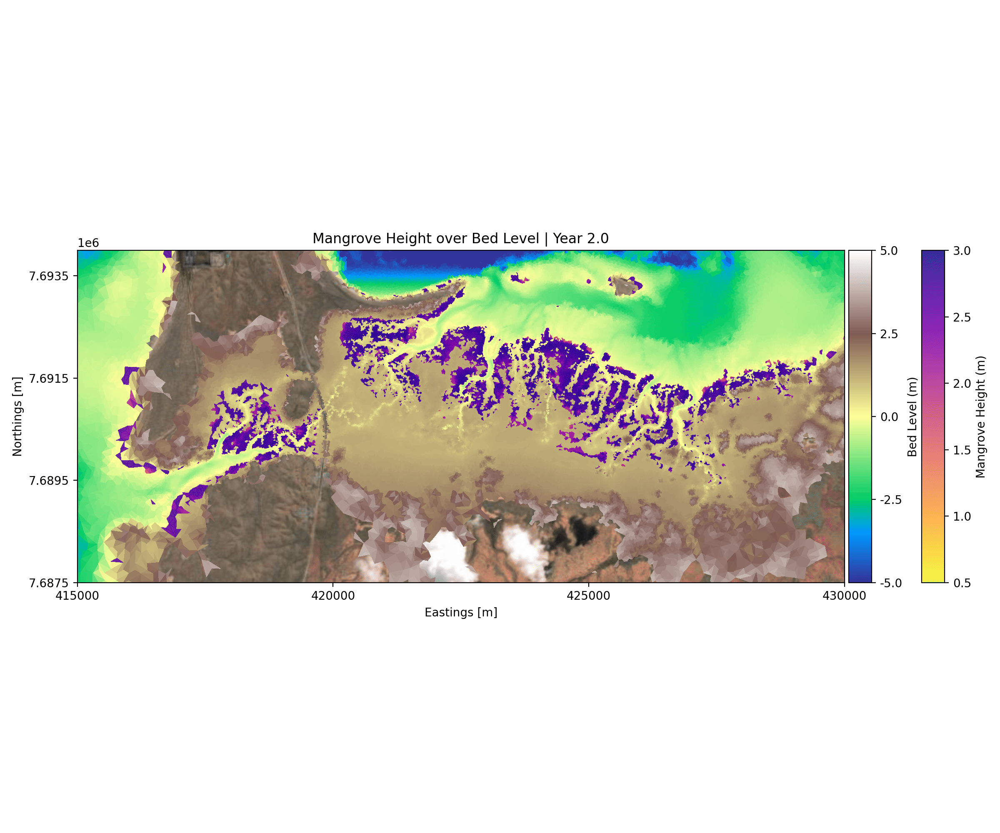
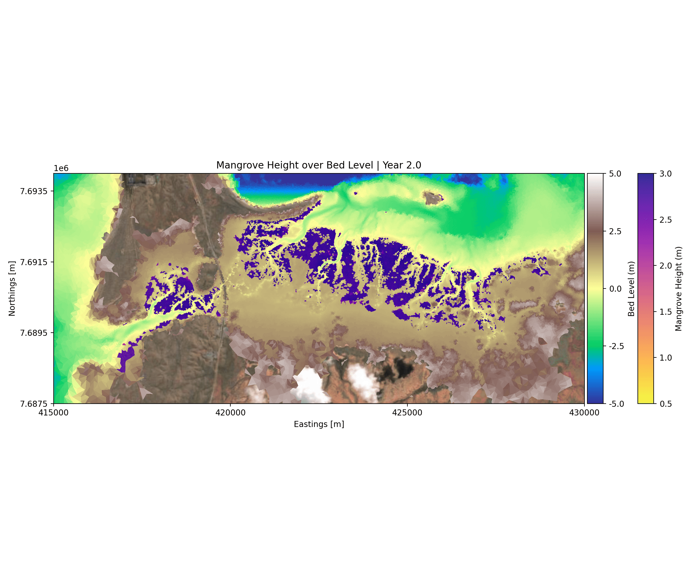
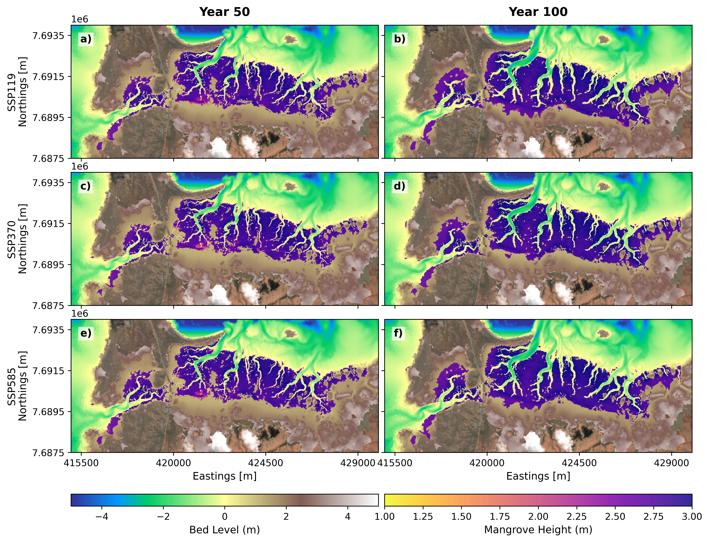
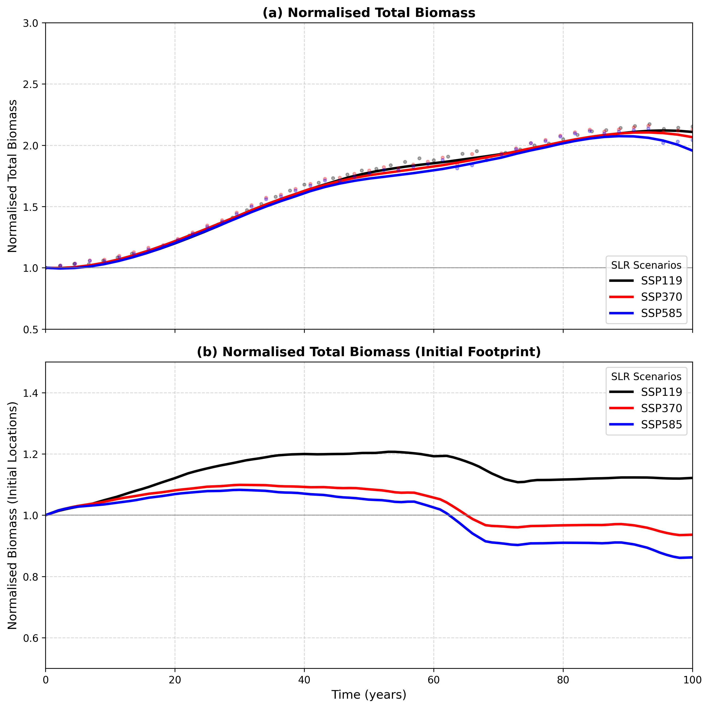
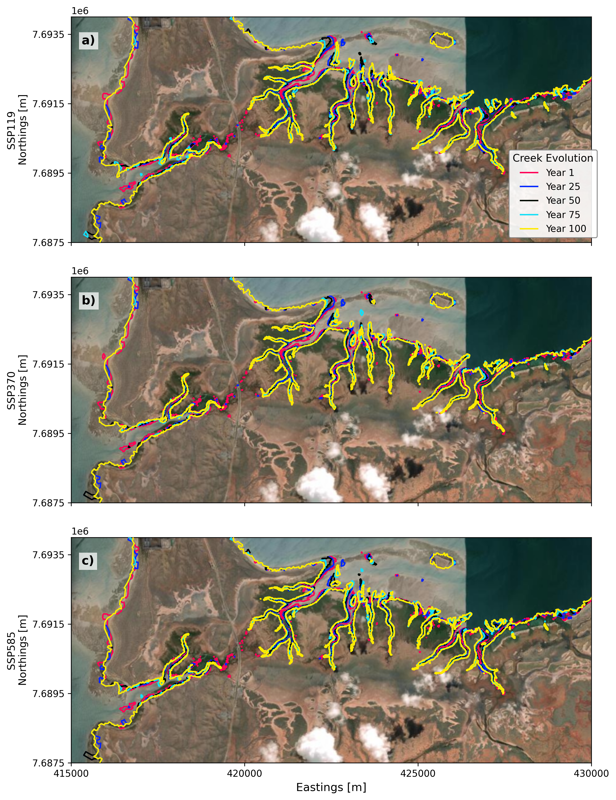
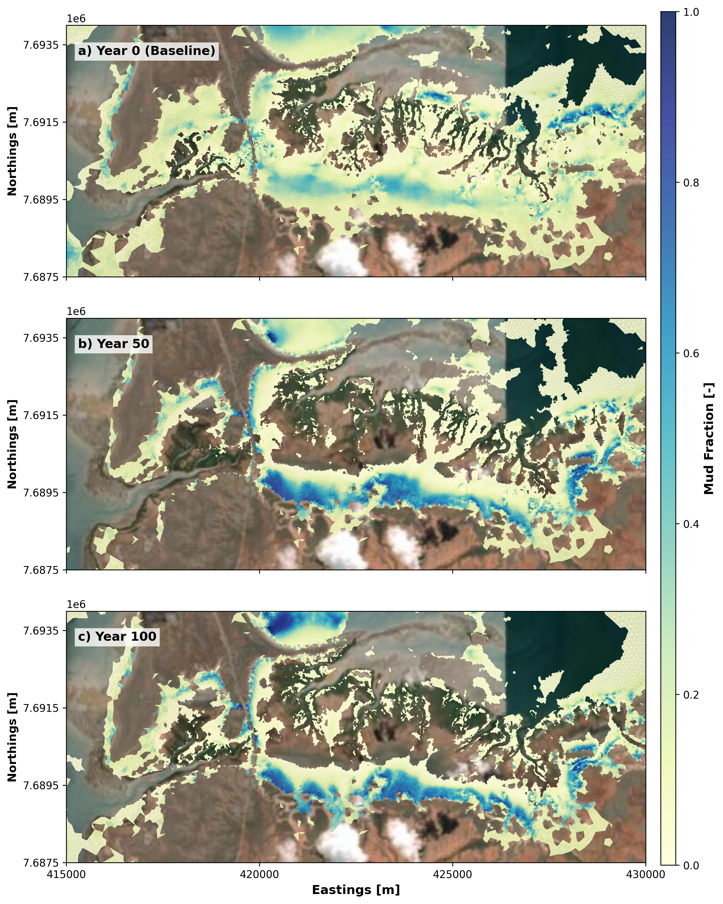
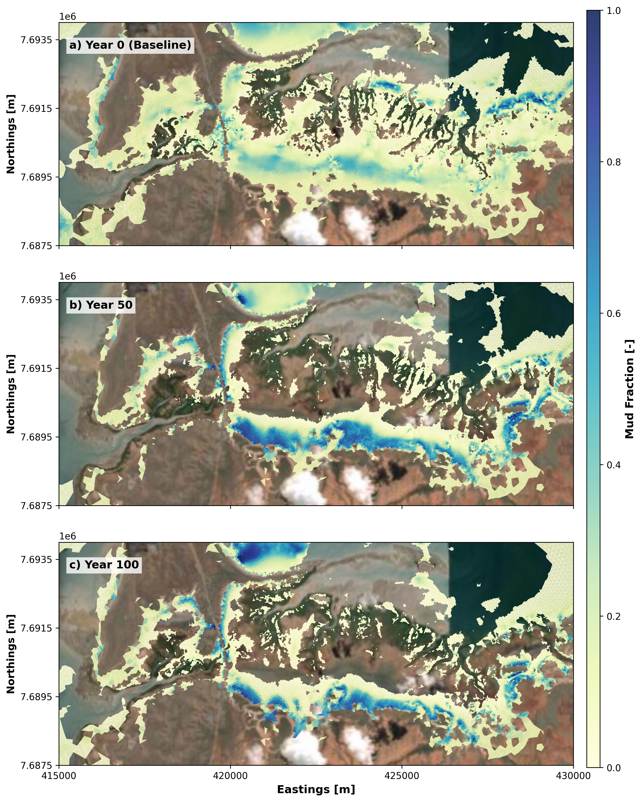
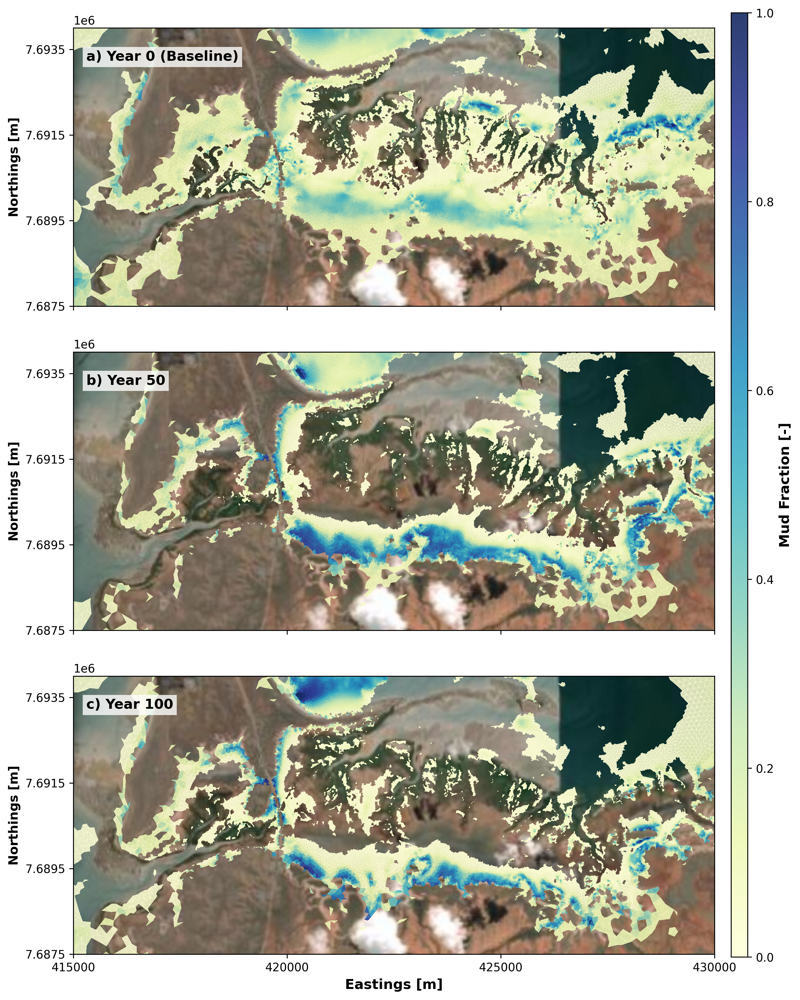

# Mangrove Response to Sea Level Rise {#sec-capepreston-mangrove}

## Sea Level Rise Response

In this chapter, we present the response of mangroves to different SLR scenarios at Cape Preston. As described in @sec-cape-preston-mangrove-val, the predicted mangrove extent under present-day environmental conditions was used as the initial baseline condition, and simulations were subsequently performed under a range of SLR scenarios representing low, medium, and high sea-level-rise conditions as discussed in @sec-approach. The SLR simulations were carried out over a 100-year projection period to assess the long-term response of the mangrove ecosystem to rising sea levels. The results were analysed to investigate changes in mangrove extent and biomass under each SLR scenario and to identify trends in mangrove migration, rates of habitat loss, and potential thresholds beyond which landward migration and ecosystem persistence are no longer possible.

::: {.panel-tabset}

### SSP119 (Low SLR)

::: {#fig-mangrove-slr-ssp119}

  

Temporal evolution of mangrove canopy height and bed elevation across the Cape Preston domain under the SSP119 sea-level-rise scenario over the 100-year simulation period.
:::

### SSP370 (Medium SLR)

::: {#fig-mangrove-slr-ssp370}

  

Temporal evolution of mangrove canopy height and bed elevation across the Cape Preston domain under the SSP370 sea-level-rise scenario over the 100-year simulation period.
:::

### SSP585 (High SLR)

::: {#fig-mangrove-slr-ssp585}

  

Temporal evolution of mangrove canopy height and bed elevation across the Cape Preston domain under the SSP585 sea-level-rise scenario over the 100-year simulation period.
:::

:::

Unlike the pronounced seaward edge drowning observed at Giralia and Urala, the response of mangroves at Cape Preston under SLR scenarios exhibits minimal drastic dieback along the seaward fringe. Instead, landward migration proceeds steadily and remains highly comparable across all three SLR scenarios (**SSP119**, **SSP370**, and **SSP585**). 

@fig-capepreston-spatial-comparison illustrates this spatial evolution at Years 50 and 100 across the scenarios, highlighting the progressive, stable landward encroachment into supratidal zones without significant seaward collapse as we observed for other sites (Giralia and Urala).

::: {#fig-capepreston-spatial-comparison}

  

Spatial comparison of mangrove canopy height and bed elevation across the Cape Preston domain at Year 50 and Year 100 under **(a–b)** SSP119, **(c–d)** SSP370, and **(e–f)** SSP585 sea-level-rise scenarios.
:::

## Ecosystem Biomass Dynamics and Initial Footprint Analysis

To quantify the broader ecological impact of these changing conditions, ecosystem performance was evaluated through domain-wide total biomass and localised dynamics restricted to the initial mangrove footprint. 

::: {#fig-capepreston-biomass}

  

Normalised total biomass dynamics over the 100-year simulation period for Cape Preston: **(a)** Total biomass across the entire domain, and **(b)** Biomass restricted strictly to the initial mangrove footprint under SSP119, SSP370, and SSP585 scenarios.
:::

As shown in @fig-capepreston-biomass (a), the **normalised total biomass across the entire domain** increases steadily over the first 60 to 70 years across all scenarios as new intertidal zones become available through landward migration, eventually stabilising or showing minor divergence depending on the severity of the SLR rate. 

Conversely, examining the **initial footprint biomass** (@fig-capepreston-biomass b) isolates the performance of the pre-existing mangrove stands. Under the low SLR scenario (**SSP119**), the initial footprint experiences sustained growth, peaking at roughly 1.2 times its original baseline before stabilising. However, under medium (**SSP370**) and high (**SSP585**) SLR rates, the biomass within the initial footprint experiences a noticeable decline after year 60—dropping to approximately 0.93 (SSP370) and 0.86 (SSP585) of initial levels by Year 100. This indicates that while the overall ecosystem compensates via landward expansion, established stands under higher emission pathways undergo progressive submergence stress over multi-decadal timescales.

## Morphological Dynamics and Sediment Redistribution

To understand the physical drivers governing the stability of the Cape Preston mangrove ecosystem under varying SLR scenarios, long-term morphological adjustments were evaluated. 

Examining the creek network trajectory across the simulation period (@fig-capepreston-creek-evolution) reveals that channel migration and bank erosion are **marginal and highly constrained** across all three scenarios (**SSP119**, **SSP370**, and **SSP585**). Unlike environments prone to severe channel widening, Cape Preston exhibits a slightly stable tidal creek morphology, with minor shifts restricted primarily to active main-stem channels. 

::: {#fig-capepreston-creek-evolution}

Temporal evolution of tidal creeks from Year 1 to Year 100 across **(a)** SSP119, **(b)** SSP370, and **(c)** SSP585 scenarios, demonstrating minimal channel planform displacement.
:::

### Spatial Distribution of Surface Mud Fraction and Mangrove Extent Implications

The surface sediment composition specifically the distribution of the top-layer mud fraction plays a critical role in determining substrate suitability and nutrient availability for mangrove colonisation and landward migration. 

::: {.panel-tabset}

### SSP119 (Low SLR)

::: {#fig-mudfraction-ssp119}

  

Spatial distribution of top-layer mud fraction across the Cape Preston domain at Year 0 (Baseline), Year 50, and Year 100 under the **SSP119** sea-level-rise scenario.
:::

### SSP370 (Medium SLR)

::: {#fig-mudfraction-ssp370}

  

Spatial distribution of top-layer mud fraction across the Cape Preston domain at Year 0 (Baseline), Year 50, and Year 100 under the **SSP370** sea-level-rise scenario.
:::

### SSP585 (High SLR)

::: {#fig-mudfraction-ssp585}

  

Spatial distribution of top-layer mud fraction across the Cape Preston domain at Year 0 (Baseline), Year 50, and Year 100 under the **SSP585** sea-level-rise scenario.
:::

:::

As illustrated by the mud fraction projections across the scenarios (@fig-mudfraction-ssp119, @fig-mudfraction-ssp370, @fig-mudfraction-ssp585), fine sediment deposition progressively accumulates within newly inundated supratidal flats and upper intertidal transition zones over the 100-year timeframe. 

Crucially, this sediment trapping creates favorable muddy substrate conditions in areas newly reached by tidal wetting. This matches the observed ecological response: rather than undergoing widespread fringe collapse, the combination of stable creek configurations, adequate fine-sediment accretion, and gentle topographic gradients allows mangroves at Cape Preston to steadily colonise the rising water levels, facilitating successful landward encroachment across all emission pathways.

## Comparative Site Sensitivity and Hydrodynamic Controls

The differences in mangrove responses across sea level rise (SLR) scenarios at Cape Preston are less pronounced than those predicted for the Giralia and Urala study sites. This contrast suggests that mangrove sensitivity to SLR is strongly influenced by the prevailing tidal regime, local topography and the relationship between water level changes and the distribution of suitable elevations for mangrove establishment and persistence.

A key factor is the difference in tidal range between the study sites. Giralia and Urala experience tidal ranges of approximately 0.8 to 2.25 m, whereas Cape Preston is characterised by a substantially larger tidal range of approximately 1.5 to 4.2 m. At Cape Preston, the additional SLR increments considered in this study (0.5, 0.9 and 1.25 m) represent a smaller proportion of the overall tidal range than at the other sites. Consequently, although SLR raises mean water levels and modifies inundation frequency and duration, its relative influence on the existing tidal water level envelope may be less pronounced. This could contribute to the more similar mangrove responses predicted across the SLR scenarios at Cape Preston. However, tidal range alone does not determine mangrove sensitivity, as changes in inundation frequency, hydroperiod and exposure duration can still substantially alter the suitability of intertidal areas for mangrove establishment and persistence, even within a macrotidal system.

Topographic morphology provides a further explanation for the contrasting responses. Giralia and Urala contain extensive, low gradient upper intertidal surfaces, where relatively small changes in water level can produce substantial horizontal shifts in the inundation boundary. These surfaces can therefore amplify the spatial consequences of SLR, particularly where broad areas of terrain lie close to the elevation thresholds governing mangrove establishment and persistence. In contrast, the comparatively restricted high intertidal area at Cape Preston may limit the extent to which changes in water level translate into large horizontal expansions of suitable mangrove habitat. Where the available intertidal terrain is constrained by steeper elevation gradients or the configuration of existing landforms, similar vertical changes in water level may produce smaller changes in the area available for mangrove colonisation.

Together, these hydrodynamic and geomorphological characteristics provide a plausible explanation for the relatively consistent landward migration patterns predicted across the SLR scenarios at Cape Preston. The results indicate that mangrove responses depend not only on the magnitude of projected SLR, but also on the local elevation distribution, tidal inundation regime and availability of suitable land for colonisation. Nevertheless, the apparent similarity between scenarios should not be interpreted as evidence that Cape Preston is inherently less vulnerable to SLR. Mangrove responses may also depend on local elevation thresholds, sediment dynamics, establishment constraints and the potential for coastal infrastructure or other geomorphological barriers to restrict landward migration. These factors warrant consideration when interpreting the modelled projections and comparing mangrove sensitivity among sites.

::: {.callout-note icon=false}
## Summary: Century-Scale Ecological Trajectories at Cape Preston

Synthesising century scale eco-morphodynamic simulations reveals that mangrove responses across emission pathways at Cape Preston are remarkably uniform compared to other regional sites (Giralia and Urala). We think the local macro tidal environment features an immense tidal range spanning approximately 1.5 to 4.2 metres alongside a more restricted high intertidal area, additional sea level rise increments exert a proportionally smaller influence on overall habitat dynamics. Consequently, despite varying emission trajectories, Cape Preston demonstrates steady and highly comparable landward migration trends with minimal scenario divergence through to Year 100.
:::