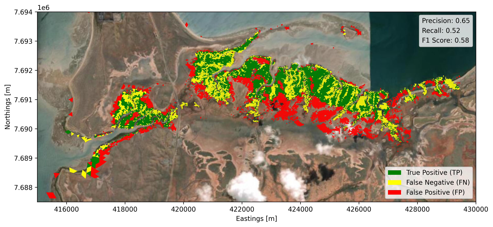
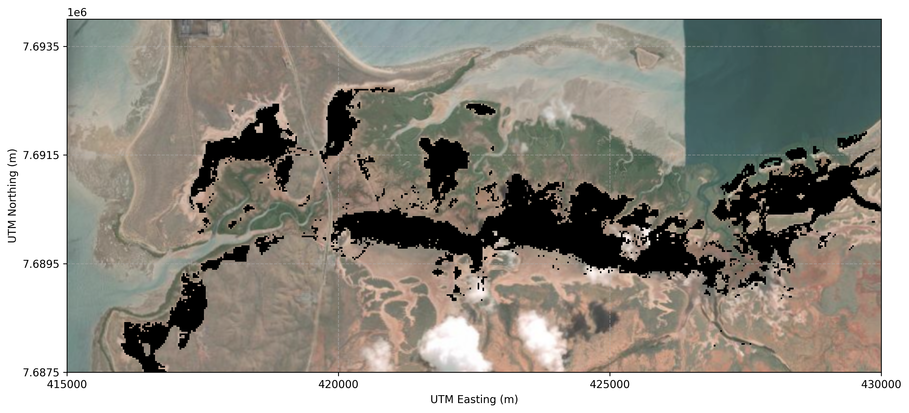
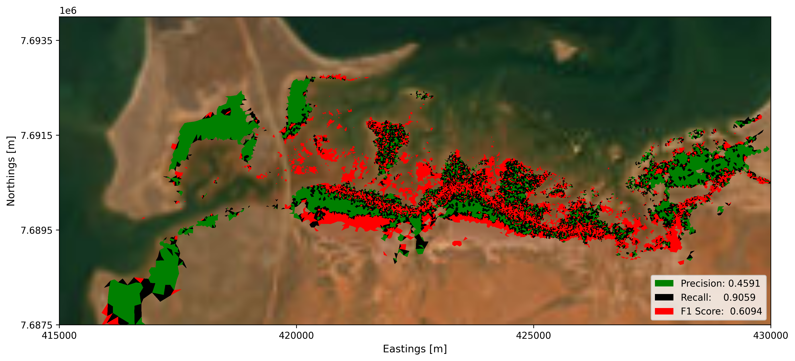
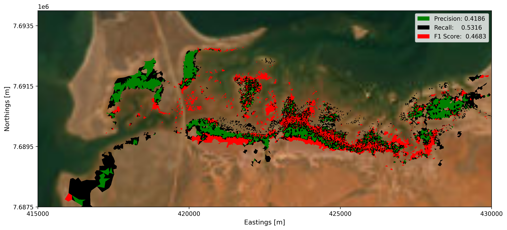

# Calibration and Validation {#sec-cape-preston-calibration}

## Overview

Cape Preston provides a demonstration of applying the framework to a slightly contrasting coastal setting, with different tidal conditions, shoreline morphology, and intertidal extent from Giralia and Urala. As a secondary focus of Projects A and C, it features a less comprehensive observational basis for model application. This allows the study to examine both the potential transferability of the framework and the practical consequences of applying it where supporting data are more limited. 

Greater uncertainty in bathymetry (offshore and creek), and available in situ observations affects model inputs and limits independent evaluation. Consequently, model outputs should be interpreted as exploratory, scenario based assessments of potential habitat change. Unlike Giralia and Urala, a dedicated hydrodynamic calibration was not undertaken due to the lack of sufficient validation data; however, the availability of satellite derived habitat maps from Project C provides a valuable opportunity to calibrate and evaluate the habitat prediction components directly. The application also helps identify the additional observations needed to strengthen predictions at this site.

This chapter presents the application and evaluation of the framework at Cape Preston across the following key areas:

1. **Hydrodynamic Context and Limitations:** Review of the numerical setup, acknowledging the constraints imposed by the absence of independent hydrodynamic validation data.
2. **Satellite Derived Habitat Baseline:** Utilising Landsat-derived observations from Project A (@Hickey2025) to establish baseline spatial distributions for calibrating and validating the mangrove and algal mat coverage models.

## Hydrodynamic model development {#sec-capepreston-hydro-dev}

As highlighted in @sec-capepreston-hydromodel, the developed model is used to simulate the present hydrodynamic conditions across the domain. @fig-capepreston-hydro shows an example animation of the Cape Preston hydrodynamic model, capturing spatial water depth distributions alongside temporal water level fluctuations at key representative locations (Nearshore, Mouth, Mud flat, Mangrove, and Upper Mat). The simulated period represents a spring to neap cycle using MSKO constituents. 

While formal water level calibration and internal validation were constrained by the **absence of independent hydrodynamic validation data** (such as high-resolution in-situ water level loggers distributed across the intertidal flats and mangrove creeks), the model is driven by realistic boundary forcings. This ensures that the simulated hydrodynamics remain physically consistent and representative of the region's broader tidal regime. Consequently, despite these observational constraints, this hydrodynamic baseline provides a reliable physical foundation that was subsequently utilised to calibrate the mangrove and algal dynamics models.

::: {#fig-capepreston-hydro}

  

Animation of the Cape Preston hydrodynamic model for a representative period using MSKO tidal constituents. **(a)** Water depth variations across the Cape Preston domain. **(b–f)** Simulated water depth time series at representative locations (Nearshore, Mouth, Mud flat, Mangrove, and Upper Mat) with the red dashed line indicating the corresponding animation timestep.
:::

## Mangrove Model Validation {#sec-cape-preston-mangrove-val}

### Historical Mangrove Observations (2000–2023)
Similar to the approach followed in other regional study areas (Giralia and Urala), we first examined the baseline mangrove dynamics at the Cape Preston site. We utilised monthly mangrove maps derived from Landsat imagery by @Hickey2025 (part of Project A of this Mardie Marine and Intertidal Research Offset Program) to analyse temporal variability in mangrove distribution. Although the dataset provides continuous monthly observations over the satellite record, mangrove extents from 2000 and 2023 are compared in @fig-cape-preston-obs to illustrate long-term distribution shifts alongside corresponding water level variability recorded at the Onslow tide gauge over the same period. 

The historical observation data demonstrates that mangrove extents in the Cape Preston region have remained remarkably stable over the past two decades, exhibiting minimal net change despite localised inter-annual fluctuations.

::: {#fig-cape-preston-obs}
{fig-align="center" width="95%"}

Water level observations and historical mangrove extent changes in the Cape Preston region. **(a)** Water level recorded at the Onslow tide gauge ([WA Data Catalogue](https://catalogue.data.wa.gov.au/dataset/tide-stations)) displaying monthly range and monthly mean. **(b)** Comparison of Landsat-derived mangrove extents between 2000 and 2023 [@Hickey2025], highlighting areas of no change, loss, and gain.
:::

We achieved a reasonable prediction evaluation using the hydrodynamic model setup for Cape Preston. Unlike the Urala site where we applied a proxy salt balance function to mimic the hyper-saline salinity regime the Cape Preston site features a distinctly different inundation pattern. Due to these differences in hydrodynamic and topographical characteristics, the proxy salinity mass balance function did not perform or work as expected. Consequently, to minimise uncertainties stemming from a calibration function with lower confidence, we decided to drop the proxy salinity functions entirely for the Cape Preston simulations.

The performance of the resulting spatial mangrove prediction and calibration is summarised in @fig-cape-preston-val, yielding a quantitative evaluation score of **Precision: 0.65, Recall: 0.52, and an F1 Score: 0.58**.

::: {#fig-cape-preston-val}
{fig-align="center" width="100%"}

Mangrove model validation and performance evaluation across the Cape Preston study area. **(a)** Spatial confusion map highlighting true positives (green), false negatives (yellow), and false positives (red) alongside quantitative performance metrics ($F_1$ score = 0.58, precision = 0.65, recall = 0.52).
:::

## Cyanobacterial Mat Calibration and Validation  {#sec-cape-preston-algal-val}

To evaluate cyanobacterial (algal) mat dynamics, similar to @#sec-giralia-algal-val and @sec-urala-algalmat, a dual data-driven approaches - the **Random Forest (RF) machine-learning classifier** (with full model details and algorithmic implementation described in @sec-algal-mat-model) and the **Threshold-Based Optimisation approach** were implemented to calibrate and validate the persistent habitat zone as described in @sec-approach. 

The persistent algal mat zone in the Cape Preston site is shown in @fig-algal-persitent. The persitent map is then utlised for the calibration and validation purposes.

::: {#fig-algal-persitent-cp}
{fig-align="center" width="100%"}

Persistent algal mat zone based on 2019 satellite derived probability maps [@Hickey2025].
:::

::: {.panel-tabset}

### Machine-Learning Approach (Random Forest)

{#fig-capepreston-ml width=100%}

### Threshold-Based Optimisation Approach

{#fig-capepreston-threshold width=100%}

:::

A comparison of the two modelling approaches reveals distinct performance trade-offs when applied to the Cape Preston intertidal domain. The machine-learning (Random Forest) approach achieves a substantially higher recall (0.9059) than the threshold-based optimisation approach (0.5316), indicating a greater ability to capture true habitat extents and reduce underprediction across complex intertidal zones. Both approaches exhibit moderate false-positive rates, potentially due to differences in the methodology for prediction. Nevertheless, the Random Forest approach achieves higher precision (0.4591) than the threshold-based approach (0.4186), resulting in a higher F1 score (0.6094 compared with 0.4683). Overall, despite the limitations imposed by the lack of formal hydrodynamic calibration data and the complexity of local microtopography, the Random Forest approach provides a slightly effective balance between habitat detection and prediction accuracy for mapping baseline habitat distributions at Cape Preston.

## Summary and Framework Transferability

Although formal hydrodynamic calibration was constrained by the absence of independent in-situ water level loggers, the successful calibration and validation of both the mangrove and cyanobacterial mat models demonstrate the **practical transferability** of the modelling framework. By relying on satellite-derived habitat maps from Project A [@Hickey2025] to directly calibrate ecological responses, the framework successfully adapted to Cape Preston’s distinct geomorphology, narrower intertidal zone, and differing tidal regime without requiring a fully tuned hydrodynamic baseline.

As highlighted in the @sec-intro, Cape Preston was not intended to provide an independently hydrodynamically validated prediction, but rather to serve as an exploratory test bed. The reasonable agreement achieved for present-day baseline conditions particularly through the Random Forest classifier ($F_1 = 0.6094$) proves that data-driven habitat mapping components can robustly translate across diverse arid coastlines. This successfully illustrates the broader transferability of the tools developed through this research, providing an adaptable framework that can be reliably applied to other coastal environments where in-situ hydrodynamic data are limited. @sec-capepreston-mangrove and @sec-cp-algalmat shows the mangrove and algal mat's response to the future SLR.