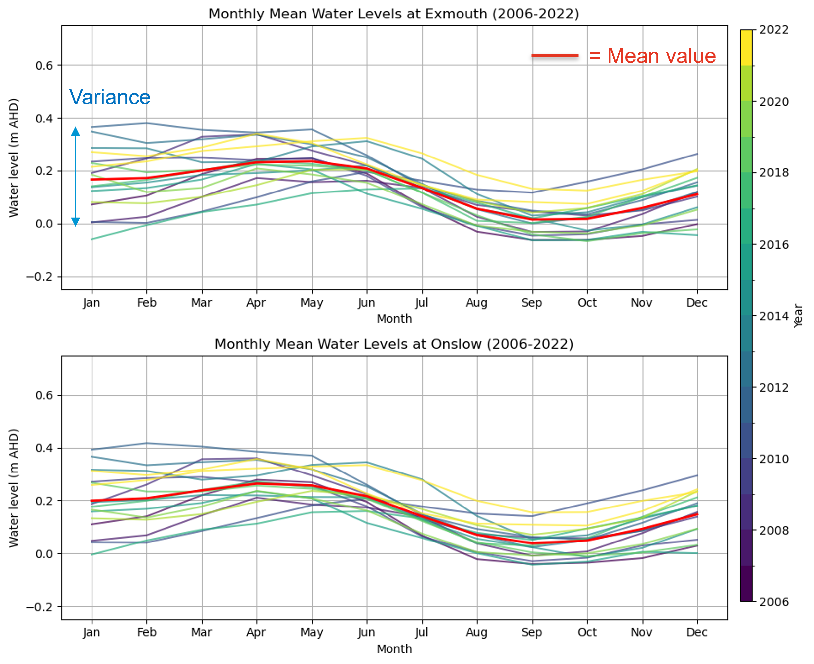
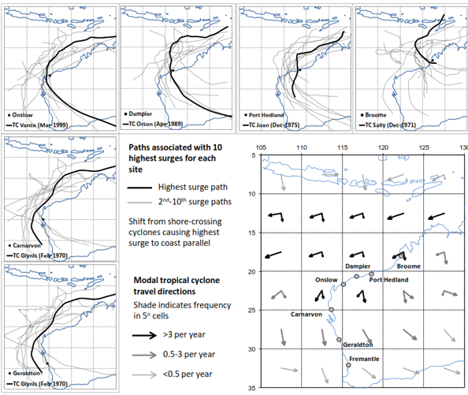
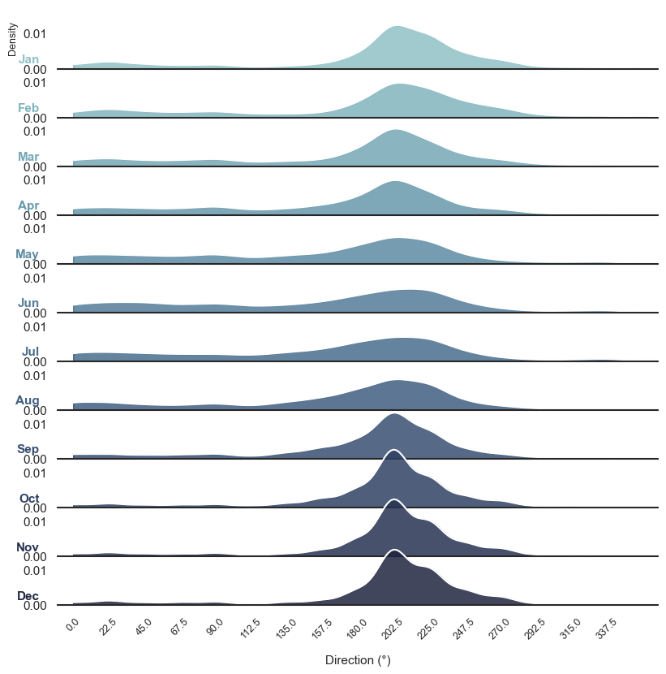

# Controls on Coastal Ecosystems in Pilbara {#sec-controls}

## Intertidal Habitats of the Pilbara Region

The intertidal habitats of the Pilbara region are outlined in @sec-intro. In parts of the north-western Pilbara, particularly around Exmouth Gulf, the intertidal zone extends several kilometres landward, supporting a heterogeneous mosaic of mangroves, samphire and saltmarsh vegetation, cyanobacterial mats, salt flats, tidal creeks, and unvegetated sandy surfaces. The relative extent and spatial arrangement of these habitats vary with surface elevation, coastal morphology, and hydrological connectivity [@Hickey2025].

Understanding the environmental controls on these habitats is important for interpreting their distribution and assessing how they may respond to future SLR. Water levels and salinity are two key controls on mangroves along with temperature for cyanobacterial mats, although their effects interact with substrate characteristics, sediment dynamics, and local geomorphology. For mangroves, elevation and hydroperiod (inundation frequency), duration, and depth of inundation strongly influence habitat distribution and persistence, while sediment accumulation and changes in surface elevation affect the capacity of mangrove environments to adjust to rising sea levels [@Krauss2014; @Woodroffe2016]. Cyanobacterial mats in arid intertidal environments are also influenced by the balance between inundation and exposure, desiccation, and the exchange of water and dissolved materials with surrounding environments [@Lovelock2010; @Adame2012; @Hickey2025].

Water levels in the Pilbara vary over several timescales. Astronomical tides produce regular inundation cycles, while seasonal and interannual variations in sea level alter the background water level on which these tides occur. These longer-term variations can be influenced by large-scale climate variability, including the El Niño–Southern Oscillation (ENSO), which affects regional atmospheric and oceanographic conditions. Atmospheric pressure and wind forcing, particularly during extreme weather events, can generate additional water-level anomalies through storm surges and coastally trapped waves. Wind also influences coastal hydrodynamics by contributing to water-level setup and generating waves, with the magnitude of these effects depending on wind strength and direction, coastal exposure, and local bathymetry. Together, these processes influence the frequency, depth, and spatial extent of inundation across the region's low-gradient intertidal flats.

Salinity is closely linked to the balance between evaporation, rainfall, tidal inundation, and drainage. Under the Pilbara's arid climate, high temperatures and strong solar radiation promote evaporation, which can concentrate salts in surface water and sediment porewater during prolonged exposure. Rainfall can temporarily dilute these salts and provide freshwater inputs, while tidal exchange can introduce seawater and flush accumulated salts from inundated surfaces. Consequently, the salinity experienced by mangroves and cyanobacterial mats depends not only on climatic conditions but also on the frequency of marine inundation, local hydrological connectivity, and the duration of exposure between inundation events.

The following sections examine these controls in the context of the Pilbara region, beginning with observed water-level variability and its tidal, seasonal, interannual, and event-scale components. Regional weather and climate conditions are then considered alongside storm-driven water-level anomalies and wave processes. This provides the environmental context needed to understand the physical conditions that shape intertidal habitat distribution and may influence habitat responses to future environmental change.

## Sea-Level Variability and Water-Level Decomposition

To characterise sea-level variability along the Pilbara coast, water-level observations from the Exmouth and Onslow tide-gauge stations were analysed. The analysis follows the decomposition framework described by Lowe et al. (2021), which separates observed water levels into contributions operating over different temporal scales. Applying this framework to the two stations provides a regional basis for examining the relative importance of astronomical tides, seasonal and interannual fluctuations, and higher-frequency water-level anomalies.

Observed coastal water levels reflect the combined influence of several processes, including astronomical tides, changes in the background sea level associated with oceanographic and climatic variability, and shorter-term anomalies associated with atmospheric forcing and coastal waves. These contributions operate simultaneously but differ in their characteristic timescales. Separating them allows the variability observed at Exmouth and Onslow to be examined in a consistent framework and provides context for understanding water-level fluctuations across the region's extensive intertidal environments.

### Water-Level Decomposition Method

Following Lowe et al. (2021), the observed water-level time series, $\eta(t)$, can be represented as the sum of a mean sea-level component, an astronomical tide, a seasonal contribution, an interannual contribution, and a higher-frequency residual:

$$
\eta(t) =
\eta_{\mathrm{MSL}}(t) +
\eta_{\mathrm{T}}(t) +
\eta_{\mathrm{A}}(t) +
\eta_{\mathrm{I}}(t) +
\eta_{\mathrm{SS}}(t)
$$ {#eq-water-level}

where $\eta_{\mathrm{MSL}}(t)$ represents the long-term mean sea-level trend, $\eta_{\mathrm{T}}(t)$ is the astronomical tide, $\eta_{\mathrm{A}}(t)$ is the seasonal contribution, $\eta_{\mathrm{I}}(t)$ represents interannual variability, and $\eta_{\mathrm{SS}}(t)$ represents the remaining higher-frequency variability, which may include storm surges and other short-term processes. These components are estimated sequentially from the observed records.

First, the astronomical tide is estimated using harmonic tidal analysis, which represents the predictable tidal signal as a combination of constituents with known frequencies and estimated amplitudes and phases. The mean sea-level trend and predicted astronomical tide are then removed from the observed water levels to obtain the non-tidal residual (NTR), $\eta_{\mathrm{NTR}}(t)$. The NTR represents water-level variability not explained by the fitted astronomical tide and mean sea-level trend.

The NTR is subsequently separated into seasonal and longer-term contributions. The seasonal signal is estimated by fitting annual and semiannual harmonic functions to the NTR time series. This approach captures the dominant annual cycle while allowing for an additional six-month component to represent departures from a purely sinusoidal annual pattern. The seasonal contribution is expressed as

$$
\begin{aligned}
\eta_{\mathrm{A}}(t) ={}&
A_1 \cos\left(\frac{2\pi t}{365.25}+\phi_1\right)\\
&+ A_2 \cos\left(\frac{4\pi t}{365.25}+\phi_2\right)+C
\end{aligned}
$$ {#eq-seasonal}

where $t$ is elapsed time in days, $A_1$ and $A_2$ are the annual and semiannual amplitudes, $\phi_1$ and $\phi_2$ are their respective phase offsets, and $C$ is a constant offset. The parameters are estimated by fitting the harmonic function to the NTR observations using nonlinear least-squares optimisation. The resulting fitted series represents the seasonal contribution to non-tidal water-level variability.

After estimating the seasonal component, the remaining NTR is calculated by subtracting the fitted seasonal signal from the original NTR. To distinguish longer-term interannual fluctuations from shorter-term variability, the remaining series is then averaged monthly. This suppresses much of the daily-to-weekly variability and provides an estimate of the interannual component. The higher-frequency contribution is obtained from the remaining variability after accounting for the seasonal and interannual components. It is interpreted as a high-frequency residual rather than a direct measurement of storm surge alone, because it may also contain other short-period processes and errors associated with the decomposition.

The same decomposition framework is applied to the Exmouth and Onslow tide-gauge records to compare water-level variability across different temporal scales. The resulting components are examined to characterise seasonal fluctuations, interannual variability, long-term sea-level change, and higher-frequency water-level anomalies along the Pilbara coast. This provides a basis for understanding how variations in regional water levels may influence the frequency, depth, and duration of inundation across low-gradient intertidal habitats.

The decomposition for Onslow is illustrated in @fig-onslow-decomposition. The figure brings together the observed water-level record, the estimated components of variability, tropical cyclone records, and the Southern Oscillation Index (SOI). This enables the different temporal contributions to be examined alongside potential climatic and meteorological influences.

 and [SOI monitoring page](https://www.bom.gov.au/climate/enso/soi/), respectively.](images/Onslow_detrended_components.png){#fig-onslow-decomposition fig-cap="Decomposition of water-level variability at Onslow, Western Australia. Panel (a) shows monthly maximum water levels, tidal range, and tropical cyclone events. Panel (b) shows the estimated interannual contribution and long-term sea-level trend. Panel (c) shows the seasonal contribution estimated using annual and semiannual harmonics. Panel (d) shows the remaining high-frequency residual. Panel (e) shows the predicted astronomical tide. Panel (f) shows the Southern Oscillation Index (SOI), an indicator of the atmospheric component of the El Niño–Southern Oscillation (ENSO). Tropical cyclone records and SOI data are from the [Australian Bureau of Meteorology](https://www.bom.gov.au/cyclone/tropical-cyclone-knowledge-centre/history/past-tropical-cyclones/) and [SOI monitoring page](https://www.bom.gov.au/climate/enso/soi/), respectively."}

The decomposition distinguishes the recurring seasonal cycle from interannual fluctuations and longer-term sea-level change. The seasonal component (@fig-onslow-decomposition c) captures predictable annual and semiannual variations remaining after the fitted astronomical tide and long-term trend have been removed. The interannual component (@fig-onslow-decomposition b), in contrast, represents multi-year fluctuations that reflect large-scale oceanographic and atmospheric variability. Comparing this component with the Southern Oscillation Index (SOI; @fig-onslow-decomposition f) illustrates a strong link to the El Niño–Southern Oscillation (ENSO). Positive SOI phases (La Niña conditions, shaded red, such as in 1999–2000, 2008, and 2010–2012) correspond to pronounced peaks in interannual water level (>0.2–0.3 m). Conversely, strong negative SOI phases (El Niño events, shaded blue, such as in 1997–1998 and 2015–2016) align with distinct drops in interannual baseline levels (reaching below -0.1 m).

The high-frequency residual (@fig-onslow-decomposition d) represents short-term water-level anomalies driven by atmospheric pressure drops, wind forcing, and storm surges. Comparing these surge anomalies against documented tropical cyclones (TCs; @fig-onslow-decomposition a) reveals major surge spikes corresponding directly to severe weather events, such as TC Vincent (~1990; storm surge peak exceeding 0.7 m) and TC Quang (~2015; storm surge peak ~0.6 m). However, the total water level experienced at the coastline depends on the additive combination and phase alignment of all components simultaneously.

The observed water level reflects the additive combination of the estimated components. When positive contributions coincide, they can reinforce one another and produce elevated total water levels; when contributions have opposing signs, they can partially offset one another. Consequently, the same astronomical tide can occur under different background water-level conditions, resulting in different maximum water levels and inundation extents. This is particularly relevant to the Pilbara's extensive, low-gradient intertidal flats, where relatively small changes in water level may alter the areas reached by high tides and the duration of inundation near habitat elevation thresholds.

When positive contributions coincide, constructive alignment amplifies total water levels. For instance, during TC Elaine & Vance (1999), a moderate storm surge contribution (~0.31 m) coincided with a positive interannual sea-level anomaly (~0.18 m) driven by La Niña conditions (SOI > +1.0). Earlier around 1990 (TC Tina & Vincent), the highest individual storm surge peak in the record was observed (~0.72 m). 

Conversely, when components have opposing signs or lack constructive alignment across all timescales, total water levels are moderated. During TC Frank & Jacob (1996), a substantial storm surge contribution (~0.52 m) coincided with a strong positive interannual anomaly (>0.20 m). However, because the seasonal contribution was essentially neutral and the storm occurred during a neap cycle, the resulting total water level in panel a did not exceed 1.6m. Similarly, during TC Quang (2015), although a major storm surge spike occurred (~0.60 m), it coincided with an El Niño-driven negative interannual anomaly and a lower phase of the seasonal cycle, which partially offset the surge contribution and prevented overall total water levels from reaching potential extremes.

Consequently, identical astronomical tide or storm surge magnitude can produce vastly different total water levels and inundation extents depending on the background state of interannual and seasonal components. This non-linear outcome is particularly critical across the Pilbara's low-gradient intertidal flats, where minor shifts in net background water level substantially alter the spatial extent and duration of inundation near ecological elevation thresholds.

## Tides
Water levels in the Pilbara region are predominantly controlled by mixed, mainly semi-diurnal tides with meso- to macro-tidal ranges that increase from west to east. These tidal processes generate cyclical variations across multiple temporal scales, including fortnightly spring–neap cycles, biannual cycles driven by the Earth's latitudinal tilt, 4.4-year cycles associated with lunar orbital variations, and the 18.6-year lunar nodal cycle. While the 18.6-year modulation is pronounced in south-west Western Australia—altering tidal ranges by up to approximately 10 cm (20–30% of the mean tidal range)—its relative impact is less significant in the north-west [@Eliot2012; @Lowe2021]. Nevertheless, even minor variations in tidal range strongly influence coastal processes and intertidal ecosystem dynamics.

@tbl-water-levels outlines the key tidal datums relative to Mean Sea Level (MSL) across Exmouth, Onslow, and Cape Preston, establishing the reference framework for intertidal habitat exposure and vertical inundation dynamics across the region.

| Water Level Tidal Datum | Exmouth [m] | Onslow [m] | Cape Preston [m] |
|:---|:---:|:---:|:---:|
| **HAT** | 1.43 | 1.30 | 2.25 |
| **MHWS** | 0.91 | 0.85 | 1.71 |
| **MHWN** | 0.32 | 0.26 | 0.38 |
| **MSL** | 0.00 | 0.00 | 0.00 |
| **MLWN** | -0.04 | -0.25 | -0.38 |
| **MLWS** | -0.28 | -0.84 | -0.94 |
| **LAT** | -0.89 | -1.29 | -1.33 |

: Summary of tidal datums relative to mean sea level (MSL) at Exmouth, Onslow and Cape Preston. HAT = Highest Astronomical Tide; MHWS = Mean High Water Springs; MHWN = Mean High Water Neaps; MLWN = Mean Low Water Neaps; MLWS = Mean Low Water Springs; LAT = Lowest Astronomical Tide. {#tbl-water-levels}
  
Although astronomical tides provide the regular background pattern of inundation, the water level at any given time can differ from the predicted tide because of non-tidal processes. Wind stress and atmospheric pressure can modify coastal water levels, while storm surges and coastally trapped waves can produce larger anomalies during some weather events. These processes are considered separately below.

## Seasonal and Interannual Variability

In addition to astronomical tides, water levels along the Western Australian coast vary seasonally and between years. Off the coast of Western Australia in the southeast Indian Ocean, regional surface circulation is dominated by the unique poleward-flowing, downwelling-favourable Leeuwin Current [@Lowe2012]. Large seasonal and interannual mean sea level variations are driven by steric effects (thermal expansion and contraction) and Ekman setup associated with alongshelf Leeuwin Current transport [@Eliot2010]. Non-tidal water level fluctuations contribute up to ~0.2 m in seasonal amplitude and ~0.3 m in interannual variance, superimposed onto astronomical tides.

{#fig-tide-variance}

@fig-tide-variance shows the measured monthly mean water level variations from 2006 to 2022 at the Exmouth (panel a) and Onslow (panel b) tide stations, plotted year-wise. Both locations exhibit a clear, synchronised seasonal signal: mean water levels peak during autumn (April–May) at values reaching up to ~0.25 to 0.30 m AHD on average (solid red line), driven by seasonal shifts in Leeuwin Current intensity, before falling to a seasonal minimum in late winter and early spring (August–September) at approximately 0.0 to 0.05 m AHD [@SeashoreEngineering2022]. 

In addition to this annual cycle, @fig-tide-variance highlights substantial interannual variability across individual years (indicated by the spread of colored lines). The vertical variance band (up to ~0.4 m during early months like January and February) demonstrates how climate oscillations such as El Niño–Southern Oscillation (ENSO) phases drive multi-year sea level variability above and below the baseline mean. Notably, Exmouth and Onslow track each other closely in terms of seasonal timing, multi-year means, and overall variance envelope, reflecting strong regional coherence across the West Pilbara Coast.

## Storm surge and coastally-trapped waves

Storm surge refers to deviations in mean sea level driven by atmospheric forcing, primarily associated with changes in barometric pressure and wind stress. These weather-induced fluctuations occur over time scales ranging from minutes to several days and can significantly elevate coastal water levels. The most substantial surges are typically generated by intense weather systems characterised by low atmospheric pressure and strong winds, and are therefore commonly referred to as storm surges.

In addition to locally generated surge, free surge responses can propagate beyond the region of direct atmospheric forcing. These include surface gravity waves, Kelvin waves, and coastally-trapped waves, which are generated by synoptic-scale systems and travel along the coastline [@Trenberth1991]. As these waves approach the coast, boundary constraints and decreasing water depth modify their behaviour. Shallowing conditions reduce propagation speeds and enhance water level responses, leading to the amplification of surge through shoaling processes. In semi-enclosed coastal environments, these boundary effects may also give rise to oscillatory motions such as seiches [@SeashoreEngineering2016].

Tropical cyclones are a major driver of extreme storm surge events in the Pilbara region. These systems are characterised by intense low-pressure centres and high wind speeds, with cyclone classification beginning at sustained winds of 63 km/h and reaching up to 276 km/h in extreme cases along the Western Australian coastline [@SeashoreEngineering2016]. Tropical cyclones generate both large waves and significant storm surges, particularly as they approach and cross the coastline.

An important characteristic of cyclone-driven surge in this region is the role of coastally-trapped waves, which enable water level anomalies to propagate alongshore over large distances. As a result, cyclone-induced water level fluctuations can affect coastal areas far removed from the point of landfall. The magnitude and spatial distribution of surge are strongly influenced by cyclone track orientation. In the Pilbara, the highest surge events are typically associated with coast-crossing cyclones that generate strong onshore winds. Further west along the coast, however, extreme surge events are more commonly linked to cyclones travelling parallel to the coastline, which enhance the generation of coastally-trapped waves.

These processes are illustrated in @fig-cyclone-paths, which shows the tracks of tropical cyclones responsible for the highest observed surges along the Western Australian coast. Understanding the combined influence of atmospheric forcing, coastal geometry, and wave dynamics is critical for accurately assessing extreme water levels and their impacts on coastal ecosystems.

{#fig-cyclone-paths fig-cap="Tropical cyclone tracks associated with the highest observed storm surge events along the Western Australian coastline, highlighting the influence of storm trajectory on surge generation (Seashore Engineering, 2016)."}

## Wave Climate

### Ambient Wave Conditions

The hydrodynamic energy across the West Pilbara coast and Exmouth Gulf is overwhelmingly dominated by tidal and wind-driven processes, with ambient wave energy playing a minor, secondary role under normal conditions. Open ocean swell waves originating from the Southern Ocean and Indian Ocean are effectively blocked and sheltered by the landmass of the Exmouth. 

![Mean significant wave height ($H_s$) across the West Pilbara region derived from the Australian Climate Service Wave Hindcast (WHACS) dataset (1980–2023) [@Smith2025]. White contours denote mean $H_s$ intervals (m), highlighting severe wave energy attenuation moving from deep offshore waters into sheltered embayments.](images/pilbara_wave_climate.png){#fig-wave-climate}

@fig-wave-climate illustrates the long-term regional mean significant wave height ($H_s$) derived from the Wave Hindcast for Australian Coastal Seas (WHACS) dataset (1980–2023) [@Smith2025]. The spatial distribution clearly highlights the extreme wave energy gradients across the region:

* **Offshore and Western Margins:** Moderate mean wave heights of 1.5 to >2.0 m persist in exposed deepwater areas west of the Exmouth Peninsula.
* **Sheltered Embayments and Nearshore Lands:** As waves propagate past the peninsula into Exmouth Gulf and along the low-gradient inner shelf near Giralia, Urala, and Cape Preston, depth-induced breaking and fetch constraints reduce mean significant wave heights to $<0.5$ m (dark purple zone in @fig-wave-climate).

Ambient wave conditions within Exmouth Gulf and adjacent coastal flats are primarily locally generated wind-sea waves. Driven by seasonal wind regimes across the available fetches of the Gulf, these short-period ambient waves typically reach significant wave heights of less than 1.5 m. Consequently, regular, day-to-day ambient waves are not a dominant physical driver shaping the intertidal coastal landforms of this region.

### Extreme Wave Conditions

While ambient wave energy is low, wave processes become highly significant during rare, extreme meteorological events. Long-term offshore waverider buoy deployments (2006–2012) recorded extreme wave events directly linked to severe tropical cyclones, such as TC Nicholas (February 2008), which generated offshore significant wave heights of 5.7 m with peak periods of 12 seconds [@SeashoreEngineering2022]. 

During severe tropical storms, extreme gale-force winds aligned with the north-facing mouth of Exmouth Gulf can drive substantial wave energy directly into the inner Gulf. Numerical modelling suggests cyclone-generated waves within the Gulf can reach 2.0–4.0 m significant height. However, the actual impact of extreme wave energy at inner-shelf locations (such as Giralia and Urala) is heavily modulated and attenuated by broad, shallow intertidal bathymetry and complex fringing reef/flat systems.

## Weather and climate variability

The Pilbara has an arid to semi-arid climate characterised by high temperatures, low and variable rainfall, and strong seasonal variation in wind conditions. Rainfall is episodic, with important contributions from tropical cyclones, convective storms and, in some coastal areas, winter weather systems. Temperature and rainfall influence the terrestrial water balance and evaporative demand, while winds influence coastal hydrodynamics through surface stress, local wave generation and, under suitable conditions, changes in coastal water levels [@Charles2015; @SeashoreEngineering2022].

### Rainfall

Mean annual rainfall across the Pilbara varies spatially, generally decreasing from the north towards the south. Regional climate assessments report annual totals of approximately 300–350 mm in parts of the north, declining to below 250 mm in some southern areas, while elevated inland areas such as the Hamersley Ranges can receive more than 500 mm annually [@Charles2015](@fig-pilbara-annual-rainfall). Topography and the occurrence of convective and cyclonic systems contribute to this spatial variability.

![Mean annual rainfall (mm/year) across the Assessment area for the period 1911–2012, highlighting the spatial gradient and elevated inland precipitation [@Charles2015].](images/pilbara_mean_annual_rainfall.png){#fig-pilbara-annual-rainfall}

Rainfall near the coast is also strongly seasonal and variable between years. At Onslow, the monthly rainfall distribution shows contributions from early-summer rainfall events and, in some years, early-winter systems, separated by a comparatively dry period. The long-term monthly distribution and the 20th–80th percentile range are presented in @fig-onslow-monthly-rainfall.

![Monthly rainfall distribution at Onslow Airport (Station 5017) spanning 1911 to 2012, illustrating the mean monthly values and the 20th–80th percentile range [@Charles2015].](images/onslow_monthly_rainfall.png){#fig-onslow-monthly-rainfall}

The distribution illustrates (@fig-onslow-monthly-rainfall) that rainfall is episodic rather than evenly distributed throughout the year. Consequently, monthly or annual averages do not fully represent the timing or duration of individual rainfall events. The timing of rainfall relative to tidal inundation and periods of surface exposure is particularly relevant when considering freshwater inputs and the salinity of intertidal surface water and sediment porewater.

### Temperature

High temperatures and strong solar radiation characterise much of the Pilbara, particularly during the summer months. Regional climate data indicate that January is generally among the hottest months, although the timing of peak temperatures can vary between coastal and inland locations. Coastal sea breezes can moderate daytime temperatures relative to inland areas, while heat extremes remain an important feature of the regional climate [@Charles2015] (@fig-pilbara-temp-cycle).

![Monthly means of daily minimum ($T_{min}$), mean ($T_{mean}$), and maximum ($T_{max}$) temperatures across the Assessment area for the period 1911–2012 [@Charles2015].](images/pilbara_monthly_temperatures.png){#fig-pilbara-temp-cycle}

The regional temperature profile highlighted in @fig-pilbara-temp-cycle is defined by the following characteristics:

* **Summer Maximums:** Monthly mean daily maximums in January exceed 39°C across southwestern and eastern sectors, peaking at an average of 41°C at Marble Bar. Near-coastal sites near Onslow experience lower maximums due to sea-breeze moderation, though temperatures consistently exceed 35°C.
* **Extreme Records:** Maximums above 45°C occur regularly between November and February. The state maximum temperature record of 50.5°C was recorded locally along the coast at Mardie on 19 February 1998.
* **Winter Minimums:** July is the coldest month, with mean daily minimums ranging from 5–6°C in the south to 13–15°C along the northern coast. Sub-zero temperatures remain confined to inland southern areas (e.g., Nullagine recording -2.2°C).

### Wind Regime

The baseline wind climate in the vicinity of Learmonth and the Onslow region transitions between seasonal trade wind systems and localised coastal circulations throughout the year.

* **Prevailing Direction:** The region is anchored by a persistent southerly-to-southwesterly wind vector year-round. Across all 12 months, the dominant wind directions fall between **202.5° (SSW)** and **225° (SW)**, which consistently record the highest directional frequencies in the dataset.
* **Spring to Late Summer Peak (October–March):** As the inland heat low develops during warmer months, this southerly-to-southwesterly flow intensifies, reinforced by strong afternoon sea breezes. The dominance of 202.5° winds peaks sharply in **October (37.2%)** and **November (36.3%)**, remaining exceptionally high through December (35.7%) and January (30.5%).
* **Winter Shift (May–August):** During cooler months, the trade wind regime exerts a stronger influence, introducing a secondary peak from the easterly to southeasterly sector (**135°–180°**). From May through August, frequencies across 135°, 157.5°, and 180° increase significantly (e.g., 180° reaches 12.5%–13.1% in July–August), reflecting morning trade wind surges before shifting around to the south-southwest later in the day.
* **Transition Months (April & September):** April and September represent transitional periods. April exhibits a broader spread across east, south, and south-southwest directions as summer sea breezes decline, while September marks the rapid re-establishment of the dominant south-southwesterly flow (31.7% at 202.5°).

{#fig-learmonth-wind-dir}

As illustrated in @fig-learmonth-wind-dir, while the overall wind regime is dominated by a year-round southerly-to-southwesterly corridor, the 12-month evolution is characterised by strong late-spring/summer amplification from coastal sea breezes and a secondary easterly trade component during winter.

## Implications for Intertidal Habitats

The distribution and condition of intertidal habitats along the Pilbara coast reflect the combined influence of water-level variability, inundation and exposure, sediment dynamics, temperature, rainfall and wind. These drivers interact across different timescales: tides govern regular inundation cycles, seasonal and interannual fluctuations alter the background water level, and extreme weather events can produce short-lived departures from typical conditions. The resulting ecological effects depend on habitat elevation, local geomorphology, hydrological connectivity, substrate properties and the tolerance of individual organisms.

### Mangroves

For mangroves, particularly Avicennia marina, tidal inundation determines the frequency, depth and duration of flooding, collectively described as the hydroperiod. Hydroperiod interacts with elevation, sediment conditions and drainage to influence mangrove establishment, growth and persistence [@Krauss2014; @Woodroffe2016]. Changes in background sea level can alter the inundation experienced at a given elevation, while changes in sediment elevation and sediment supply affect the capacity of mangrove surfaces to keep pace with relative sea-level rise.

Seasonal and interannual water-level fluctuations can modify inundation even without a change in the elevation of the land surface. Periods of lower background water level may lengthen the exposure of upper-intertidal mangroves, while higher water levels can increase inundation frequency or extend flooding into areas that are only intermittently reached under typical conditions. The ecological outcome depends on the magnitude and duration of the change and on the availability of suitable landward accommodation space.

Temperature and rainfall influence the water and salt balance of mangrove environments. High temperatures and solar radiation increase evaporative demand, potentially increasing salinity in sediment porewater where freshwater inputs and tidal flushing are limited. Rainfall can temporarily dilute surface water and porewater salinity, although the effect depends on the amount and duration of rainfall, subsequent evaporation, drainage and the degree of connection with the sea. High temperature and hypersalinity can impose physiological stress, but mangrove responses should not be inferred from temperature or water level alone without considering local hydrological and substrate conditions.

Wind influences mangroves through several pathways. Sustained winds can modify coastal water levels, while wind-generated waves can increase sediment mobility and hydrodynamic stress along exposed shorelines. During extreme events, the combination of elevated water levels and wave action can contribute to erosion, sediment redistribution or damage to seedlings and vegetation. The magnitude of these effects depends on storm conditions, local exposure and the protection provided by shallow flats and coastal morphology.

### Cyanobacterial Mats and Upper-Intertidal Flats

Cyanobacterial mats occupy intertidal and upper-intertidal surfaces where the balance between inundation and exposure differs from that of lower-elevation mangrove habitats. Their distribution and persistence are influenced by surface elevation, sediment characteristics, hydrological connectivity, salinity and the duration of wetting and drying. In arid settings, prolonged exposure and high evaporation can concentrate salts, while marine inundation and rainfall can temporarily alter surface-water and porewater conditions [@Lovelock2010; @Adame2012].

The timing and depth of tidal inundation determine how frequently mats are wetted and how often they exchange water and dissolved materials with adjacent environments. Seasonal and interannual water-level fluctuations can modify these wetting and drying intervals. Higher background water levels may increase the frequency or extent of inundation across some upper-intertidal surfaces, whereas lower water levels may prolong exposure. These changes do not necessarily produce the same response across all mat communities because local elevation, substrate permeability, drainage and salinity differ spatially.

Rainfall can provide a short-lived freshwater input, dilute accumulated salts and wet exposed mat surfaces. Under hot, dry conditions, however, evaporation can rapidly remove surface moisture and concentrate salts again. The ecological response therefore depends not only on total rainfall but also on event timing, rainfall intensity, the duration of subsequent exposure and the frequency of marine inundation. Temperature affects evaporation and the thermal conditions experienced by mat organisms; its effects on microbial activity and mat integrity depend on moisture availability and the temperature tolerance of the organisms present.