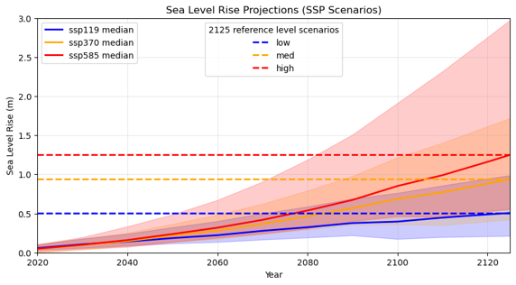

# Approach: Dynamic Modelling Framework {#sec-approach}

## Overview

To predict the spatial distribution, long-term persistence, and resilience of key intertidal habitats specifically mangrove forests and cyanobacterial (algal) mats it is essential to understand the primary physical and ecological drivers governing their dynamics. As established in @sec-controls, coastal ecosystem controls across the Pilbara region include complex interactions between hydrodynamics (water levels, flow velocities, and bed shear stress), salinity, surface temperature, light availability, microtopography, rainfall, and sedimentation rates. All of these factors interact to determine habitat suitability, colonisation boundaries, and ecological persistence. 

Evaluating how these intertidal environments will respond over long-term (decadal-to-centennial) timescales under sea-level rise (SLR) requires robust predictive methodologies. Broadly, predictive approaches in coastal geomorphology and ecology fall into two main categories: observational/empirical methods (e.g., field monitoring, historical aerial photography, and satellite remote sensing) and numerical modelling frameworks. 

Direct field measurements and satellite-derived remote sensing provide high-resolution spatial mapping of contemporary habitat extent and short-term baseline trends [@Hickey2025]. However, observational and empirical approaches alone cannot accurately project coastal ecosystem configurations 50 to 100 years into the future. Empirical extrapolations inherently assume that past environmental relationships will remain stationary. Under accelerating rates of SLR, coastal systems experience non-linear threshold behaviours, altered tidal prism dynamics, and unprecedented shifts in hydroperiod and sediment supply [@Kirwan2013; @Passeri2015]. Furthermore, observational data cannot capture complex two-way eco-morphodynamic feedbacks—such as how shifting vegetation coverage continuously alters flow resistance, sediment trapping, and local bed elevation [@Fagherazzi2012; @Xie2022].

Consequently, numerical modelling provides a means of investigating the long-term responses of intertidal habitats to sea-level rise and other environmental changes. Hydrodynamic and morphodynamic models resolve the physical processes governing water movement, sediment transport and changes in bed elevation, while ecological models represent vegetation dynamics and their responses to environmental conditions [@Lesser2004;@Kernkamp2011;@Piercy2024]. Integrating these processes can help investigate feedbacks between hydrodynamics, sediment dynamics and habitat development, and assess potential responses to future climate change and coastal development scenarios beyond those represented in historical observations. However, the extent to which these interactions are captured depends on the processes included in the model, and comprehensive ecological and physical modelling remains computationally and methodologically challenging [@Woodroffe2016;@Fanous2023;@Piercy2024].

When evaluating long-term ecosystem responses to SLR through numerical models, accounting for morphodynamic adjustments becomes critical. Long-term changes in inundation duration and depth are not solely dictated by the rate of SLR, but also depend on intertidal topography and eco-morphological feedbacks, which are in turn governed by hydro-sedimentary boundary forcings including tidal range, wave action, and sediment supply [@FitzGerald2008; @Passeri2015; @Xie2022]. Mangrove forests and algal mats can only tolerate specific durations and frequencies of tidal submersion [@Woodroffe2016]. Because hydrodynamic shifts under SLR continuously reshape intertidal morphodynamics, these physical (relevant forcings) and biological processes must be modelled in a dynamically coupled, two-way manner.

## Advances and Limitations in Habitat Modelling Approaches {#sec-approach-review}

Predicting long-term changes in intertidal habitats under sea-level rise (SLR) requires approaches that account for the interactions between biological processes, hydrodynamic forcing and coastal morphology. Previous studies have used a range of methods, from empirical relationships between vegetation distribution and tidal elevation to individual-based ecological models and coupled hydro-morphodynamic simulations. These approaches differ in their ability to represent habitat establishment, expansion, retreat and persistence, as well as their suitability for applications extending from individual sites to entire coastal landscapes. The following sections review these approaches for mangrove forests and cyanobacterial mats, with particular attention to their ability to predict long-term spatial changes under evolving environmental conditions.

### Mangrove forests

Mangrove forests are among the most extensively modelled intertidal ecosystems. Their response to sea-level rise (SLR) depends not only on changes in inundation frequency and duration, but also on sediment availability, surface elevation, salinity, propagule dispersal and the capacity of vegetation to establish and persist under changing environmental conditions. These interacting processes have motivated modelling approaches ranging from empirical habitat-distribution methods to individual-based ecological models and coupled eco-morphodynamic frameworks. A central distinction is whether models estimate potential habitat distribution from environmental relationships, simulate mangrove life-cycle processes explicitly, or represent feedbacks between vegetation, hydrodynamics and morphological evolution.

**Elevation-based and statistical approaches** relate the present-day distribution of mangroves to tidal elevation, hydroperiod or other environmental characteristics. These methods are computationally efficient and can provide first-order estimates of potential habitat redistribution under SLR. However, they generally provide limited representation of the processes that determine whether mangroves can colonise newly suitable areas, persist under changing environmental conditions or modify the physical environment through vegetation-mediated sediment trapping and surface-elevation change. Their predictions may therefore be sensitive to assumptions that present-day relationships between vegetation and the physical environment remain applicable under future conditions.

Recent applications have extended habitat-distribution modelling to incorporate both SLR and human constraints on landward migration. @Ding2026, for example, used a multi-scenario framework based on the Sea Level Affecting Marsh Model (SLAMM), incorporating high-resolution elevation data, land-use dynamics and regional hydrological parameters to assess mangrove loss and migration under different climate and development scenarios [@Ding2026]. Their analysis considered barriers such as seawalls and restrictions associated with coastal development. This type of approach is particularly relevant to coastal planning because it can identify areas where potential landward migration is constrained by infrastructure or land use. However, scenario-based habitat-transition models do not necessarily resolve the detailed biological processes of mangrove establishment, growth and mortality or dynamically simulate the feedbacks between vegetation and sediment transport.

**Individual-based models (IBMs)** provide a more detailed representation of mangrove dynamics by simulating individual trees or cohorts and their responses to environmental conditions. Examples include MesoFON and its applications and extensions [@Grueters2014; @Grueters2019], modular modelling platforms such as MANGA and pyMANGA [@Wimmler2024], and earlier frameworks including KiWi, FORMAN and MANGRO  [@Berger2008]. Depending on their formulation, these models can represent growth, mortality, competition, forest structure and selected interactions between individual plants and their environment. Their principal advantage is the ability to resolve ecological processes that are difficult to capture using empirical vegetation–elevation relationships. However, their application across extensive coastal domains can be computationally demanding, and their predictions depend on appropriate ecological parameterisation and environmental forcing. An IBM does not necessarily simulate hydrodynamics or landscape evolution mechanistically unless it is coupled to a suitable physical model.

A related development is the **mangrove Lifecycle Ecosystem Analysis and Forecasting (LEAF) model**, developed by @Dunlop2025. LEAF represents mangrove dynamics across life stages, from seedlings to senescence, using relationships describing establishment, growth, stress, recovery and mortality. In its published application, LEAF was coupled with Delft3D Flexible Mesh to investigate how hydrodynamic and morphological conditions influence mangrove development and to assess forest attributes and responses to extreme events. This life-cycle representation helps distinguish the environmental requirements of recruitment and establishment from those of established trees. It also provides a framework for examining restoration trajectories and the potential effects of stressors on forest persistence. Nevertheless, predictions remain dependent on the ecological relationships and species characteristics used to parameterise the model, and the coupling of ecological and physical components adds implementation and calibration requirements. Furthermore, the approach is limited to idealised domains or small sites as not implemented for parallel computation across large coastal landscapes. Nevertherless, the LEAF model represents a significant advance in mechanistic mangrove modelling and provides a foundation for future development of coupled eco-morphodynamic frameworks.

**Process-based hydrodynamic and morphodynamic models** resolve physical processes controlling intertidal habitat conditions, including tidal propagation, water levels, currents, sediment transport and changes in bed elevation. Modelling systems such as Delft3D Flexible Mesh (DFM), MIKE and BASEMENT can be used to investigate how hydrodynamic forcing and sediment availability influence inundation and intertidal morphology [@Lesser2004; @Fagherazzi2012]. However, a hydrodynamic model used on its own does not inherently predict mangrove presence or represent the biological processes governing establishment, growth and mortality. Ecological responses must be represented through additional model components or assessed using a separate predictive approach.

An alternative is to use the hydrodynamic model to characterise the physical environment and then apply a statistical or machine-learning model to estimate habitat occurrence. In the modelling workflow described in this report (@sec-appendix-b), DFM is used as a standalone hydrodynamic tool combined with a Random Forest classifier [@Breiman2001] is used to predict the presence of mangroves and cyanobacterial mats from environmental predictors. This approach separates physical-process simulation from habitat classification rather than implementing a fully coupled vegetation–morphodynamic model. It provides a practical means of combining hydrodynamic information with observed habitat distributions, while allowing habitat prediction to be applied across the model domain. The Random Forest approach, predictor variables, training data and evaluation procedures are described in @sec-appendix-b. As with other statistical classifiers, predictions depend on the representativeness of the training data and the environmental conditions captured by the predictors; the workflow does not explicitly simulate mangrove demography or vegetation-driven morphological feedbacks.

**Coupled eco-morphodynamic models** seek to represent interactions between vegetation and the physical environment more explicitly. @Xie2022 developed a bio-morphodynamic modelling approach to investigate how tidal range, small wind waves, sediment supply and coastal slope influence mangrove development and vulnerability under SLR. Their numerical experiments demonstrated that mangrove responses depend on the combined effects of coastal conditions and bio-morphodynamic feedbacks, rather than SLR alone. In particular, the interaction between sediment supply and the development of the coastal profile influenced the capacity of mangroves to maintain their position as sea level increased. This approach highlights the importance of considering site-specific hydrodynamics and sediment dynamics when evaluating mangrove vulnerability. Similar to the LEAF model, the @Xie2022 framework was applied to idealised domains and required substantial further development to support studies across larger spatial and temporal scales.

@Kumbier2022 developed a transferable eco-morphodynamic framework by dynamically coupling the depth-averaged TELEMAC-2D hydrodynamic model with an empirical wetland elevation model. The framework was applied to assess mangrove and saltmarsh distribution under SLR in a southeast Australian estuary. It represented spatial variations in tidal inundation and feedbacks between wetland surface-elevation change and estuarine hydrodynamics. Their results showed that the response of intertidal wetlands depended on SLR rates and assumptions about sediment accretion. The study also demonstrated that changes in wetland extent and substrate elevation can influence tidal dynamics, reinforcing the importance of representing interactions between physical processes and wetland development. However, the wetland elevation component was empirical, and the framework did not explicitly simulate all ecological processes governing individual mangrove life stages.

@Beselly2023 developed DFMFON by coupling the individual-based MesoFON mangrove model with Delft3D-FM. The framework represents mangrove life stages, propagule dispersal, salinity and other environmental forcing and feedbacks between vegetation and morphological development. Applied to a mangrove–mudflat system inspired by the Porong Delta, Indonesia, it demonstrated how coupled models can investigate forest expansion, retreat and colonisation under changing physical conditions. Compared with a workflow that uses hydrodynamic outputs as predictors in a separate habitat classifier, this type of model provides a more mechanistic representation of ecological and morphological feedbacks. Its framework is theoretically transferable to other environments; however, scaling it up to regional applications with parallel computation is challenging due to the complexity of the model and the Java-based implementation of MesoFON (which also limits its user-friendliness across HPCs).

Related developments in salt-marsh modelling also provide useful methodological insights, although their ecological formulations should not be assumed to apply directly to mangroves. @Alizad2016 developed the Hydro-MEM model by coupling two-dimensional hydrodynamics with the Marsh Equilibrium Model to represent interactions between tidal inundation, *Spartina alterniflora* biomass, platform accretion and bottom friction. The model demonstrated how biological feedbacks can alter the spatial distribution of marsh biomass and the evolution of the marsh platform under different sea-level rise (SLR) scenarios. The study also highlighted the importance of selecting an appropriate coupling time step: while a 50-year interval provided reasonable approximations of marsh productivity under low and approximately linear SLR, shorter intervals were necessary to achieve convergence under more rapid SLR, with a 5-year interval required for the high-SLR scenario. This indicates that long coupling intervals may overlook important feedbacks when environmental conditions change rapidly, although shorter intervals increase computational demands. Consequently, the coupling interval should be selected based on convergence testing and the rate of environmental change rather than adopting a fixed interval across scenarios. Furthermore, because the ecological component was developed for salt-marsh vegetation, direct application to mangrove forests would require an appropriate representation of mangrove-specific life stages, environmental tolerances and vegetation–sediment interactions.

@Willemsen2022 similarly used a coupled hydrodynamic, morphodynamic and vegetation-growth framework to investigate salt-marsh development over several decades. Their results showed that wave forcing and sediment availability influence whether the marsh edge expands seaward or retreats landward. Although salt marshes differ from mangroves in vegetation structure and ecological requirements, these studies demonstrate the value of integrating hydrodynamic forcing, sediment dynamics and vegetation response when assessing long-term changes in intertidal habitat extent.

| Modelling approach                                                     | Model examples                                                                                                                                     | Main processes represented                                                                                                                                                                                            | References                                                           |
| :--------------------------------------------------------------------- | :------------------------------------------------------------------------------------------------------------------------------------------------- | :-------------------------------------------------------------------------------------------------------------------------------------------------------------------------------------------------------------------- | :------------------------------------------------------------------- |
| Elevation- and threshold-based habitat models                          | Tidal-plane and vegetation–elevation relationships; lifecycle-threshold approach of Henderson and Glamore (2024)                                   | Habitat suitability based on elevation, tidal inundation and environmental thresholds; the lifecycle-based approach additionally represents reproductive development, propagule dispersal, establishment and survival | @Henderson2024                                                       |
| Scenario-based habitat-transition models                               | SLAMM                                                                                                                                              | Habitat transitions under sea-level rise, changes in elevation and hydrological setting, land-use constraints and barriers to landward migration                                                                      | @Ding2026                                                            |
| Individual-based and modular vegetation models                         | FORMAN; KiWi; MANGRO; BETTINA; MesoFON; MANGA; pyMANGA                                                                                             | Individual-tree growth, mortality, competition, forest structure and environmental interactions; specific models also represent plant–soil feedbacks and interactions with groundwater and porewater salinity         | @Berger2000; @Peters2020; @Grueters2014; @Grueters2019; @Wimmler2024 |
| Coupled mangrove bio-hydro-morphodynamic models                        | LEAF; Xie et al. (2022); DFMFON (MesoFON coupled with Delft3D-FM)                                                                                  | Mangrove establishment, growth and mortality interacting with hydrodynamics, inundation, sediment transport, bed-level evolution and vegetation–morphology feedbacks; the processes represented vary among models     | @Dunlop2025; @Xie2022; @Beselly2023                                  |
| Coupled wetland and riparian vegetation–physical-system models         | TELEMAC-2D coupled with an empirical wetland-elevation model; Hydro-MEM; salt-marsh vegetation–morphodynamic models; BASEMENT coupled with BASEveg | Interactions between hydrodynamics, inundation, vegetation growth, platform accretion, flow resistance, sediment transport and morphological evolution, depending on the model formulation                            | @Kumbier2022; @Alizad2016; @Willemsen2022; @Caponi2023               |
| Hydrodynamic modelling coupled with statistical habitat classification | DFM coupled with Random Forest habitat prediction in this study                                                                                    | Hydrodynamic and inundation conditions used as predictors of habitat presence; statistical relationships between environmental variables and observed mangrove and cyanobacterial mat distributions                   | @sec-appendix-b                                                           |
: 
Summarises the principal modelling approaches used to predict mangrove distribution and change, grouped according to their underlying modelling structure and the processes represented. {#tbl-mangrove-models}

*Note:* The categories describe the principal modelling approaches rather than mutually exclusive model types. Individual-based models may also be coupled to hydrological or morphodynamic models. The wetland and riparian frameworks are included as related methodological developments, not as mangrove-specific models. In the DFM–Random Forest workflow used in this study, habitat presence is predicted statistically rather than through explicit simulation of vegetation growth and vegetation-driven morphological feedbacks.

### Cyanobacterial mats

In contrast to mangrove forests, cyanobacterial mats have received comparatively limited attention in predictive modelling of long-term intertidal habitat change. These microbial communities commonly occur on upper intertidal and supratidal surfaces, including salt flats, mudflats and shallow depressions that experience intermittent tidal inundation, rainfall or local ponding. Their distribution is influenced by hydroperiod, salinity, surface elevation, temperature, light availability, sediment characteristics and hydrodynamic disturbance [@Taukulis2018; @SeashoreEngineering2021; @SeashoreEngineering2022;@Hickey2023].

An important distinction between cyanobacterial mats and mangrove forests is the timescale of their biological response. Whereas mangrove establishment and forest development generally involve recruitment and growth over longer periods, cyanobacterial mats can respond rapidly to changes in hydration, desiccation and salinity. Depending on the constituent organisms and their physiological adaptations, mat communities can persist through unfavourable conditions in dormant or metabolically reduced states and resume activity when moisture and other environmental conditions become favourable. Consequently, the presence of a mat at a particular location does not necessarily indicate that the location continuously provides optimal growth conditions. Instead, observed distributions may reflect repeated cycles of inundation, drying, salinity stress and reactivation.

These characteristics are particularly relevant to the semi-arid Pilbara, where upper intertidal surfaces are exceptionally flat, evaporation is high and inundation may be infrequent. Small differences in elevation and microtopography can produce substantial spatial variation in ponding, drainage and evaporative concentration. Local sediment ridges, swash lines and shallow depressions may therefore create contrasting conditions over short distances, influencing both the persistence of existing mats and the suitability of adjacent surfaces for colonisation. Changes in tidal inundation under SLR may alter these conditions, but the resulting habitat response will not necessarily follow a simple, linear shift in elevation.

Previous approaches to predicting cyanobacterial mat redistribution have relied largely on mapped habitat distributions and their relationships with tidal elevation or inundation conditions [@SeashoreEngineering2021]. Such approaches can provide useful first-order estimates of potential changes in the area exposed to suitable hydroperiods. However, they do not necessarily resolve the effects of microtopography, local ponding, changing drainage pathways or the biological responses of mats to repeated wetting and drying. Nor do they explicitly account for feedbacks between mat development and sediment properties, including changes in surface stability and permeability.

The distinction between short-term biological responses and long-term spatial redistribution is therefore important. Rapid reactivation following favourable conditions does not, by itself, establish whether a mat will persist at a location over decades. Long-term predictions require an assessment of how frequently and for how long suitable environmental conditions occur, how those conditions change as sea level rises, and whether local surface morphology continues to support mat persistence. Compared with mangrove modelling, the literature reviewed here indicates a more limited development of dedicated, spatially explicit numerical approaches for predicting cyanobacterial mat growth, colonisation and migration with feedbacks to coastal morphology. This limitation should be interpreted as a gap in the modelling approaches reviewed rather than proof that no relevant process-based models exist.

### Synthesis and implications for coastal-scale prediction

Previous modelling studies demonstrate the value of integrating environmental forcing, ecological requirements and morphological change when predicting the long-term distribution of intertidal habitats. Empirical and threshold-based approaches provide a basis for identifying potential habitat limits, while individual-based and coupled models offer ways to represent ecological dynamics and physical–biological feedbacks. As discussed in @sec-modelling-gap, important knowledge gaps remain in predicting the long-term redistribution of mangrove forests and cyanobacterial mats across the hyper-arid West Pilbara coast. Addressing these gaps requires a modelling approach that can represent the physical processes controlling habitat suitability across a coastal domain and over long timescales, while accounting for relevant processes for each habitat. In particular, the approach should account for the coupled hydrodynamic, morphological and biological feedbacks that govern habitat dynamics and are essential for reliable long-term predictions of intertidal habitat change. The following section proposes the development of a modelling framework designed to address these knowledge gaps and support coastal-scale projections of future habitat change.

## The Dynamically Coupled Bio-Hydro-Morphodynamic Framework

Delft3D Flexible Mesh was selected as the core hydrodynamic–morphodynamic model for this study as it is an established, open-source (for academic) modelling platform for simulating coastal hydrodynamics, sediment transport and morphological evolution [@Kernkamp2011]. DFM has also been adopted in several studies coupling vegetation dynamics with hydrodynamic and morphological processes, including the frameworks developed by @Xie2022; @Willemsen2022; @Beselly2023; @Dunlop2025. These developments provided a methodological basis for selecting DFM as the physical modelling component of the framework developed here.

Building on this approach, we developed a dynamically coupled bio-hydro-morphodynamic modelling framework integrating DFM with a vegetation module based on NBSDynamics (Nature-Based Solutions Dynamics) [@Deltares2022], incorporating ecological parameterisation strategies adapted from @Xie2022, @Berger2000 and @VanMaanen2015. A custom Python coupling interface manages information exchange between the hydro-morphodynamic model and the vegetation module, enabling the framework to run on high-performance computing (HPC) clusters and support spatially extensive simulations.

### Model integration and information exchange

As illustrated in @fig-coupling-framework, the framework represents interactions between hydrodynamic conditions, vegetation dynamics and morphological evolution through a two-way coupling process. DFM resolves hydrodynamics and sediment transport, while the vegetation module evaluates mangrove establishment, growth and mortality in response to environmental conditions. The resulting changes in vegetation properties are then returned to DFM to update spatially varying flow resistance and bed roughness.

The coupling operates through the following sequence at defined coupling intervals:

1. **Hydrodynamic and morphodynamic simulation:** DFM concurrently simulates hydrodynamics and sediment transport, calculating spatially distributed water levels, flow velocities, bed shear stresses, and bed level changes across the intertidal domain. These variables define the physical and morphological environment experienced by the vegetation.

2. **Environmental output transfer:** The Python coupling interface extracts and transfers the integrated hydrodynamic and morphodynamic outputs (water levels, bed shear stresses, and updated bed elevations) to the vegetation module.

3. **Vegetation response and updates:** At designated vegetation time steps, the vegetation module evaluates mangrove colonisation, growth, and mortality based on the updated environmental conditions and ecological thresholds. It then updates spatially distributed vegetation properties, including stem height, stem diameter, and stem density.

4. **Feedback to hydro-morphodynamics:** Updated vegetation parameters are converted into spatially varying flow resistance and drag parameters within DFM. This allows the evolving canopy and root structures to alter flow patterns and sediment transport in subsequent coupling steps.

This iterative exchange enables the framework to represent feedbacks between hydrodynamics, sediment transport, morphological evolution and mangrove development. Rather than prescribing vegetation as a static source of flow resistance, the framework allows vegetation properties and the physical environment to evolve in response to one another.

Unlike the mangrove component, cyanobacterial mats are represented using decoupled, data-driven habitat-suitability approaches. Although developing a mechanistic model of cyanobacterial mat dynamics coupled to hydrodynamics and sediment transport is technically feasible, such an approach would require substantial development, calibration, and validation. In particular, reliable numerical representation of mat dynamics requires a more comprehensive understanding of their responses to environmental forcing, including light availability, temperature, salinity, and hydrodynamic conditions, as well as sufficient observational data to parameterise and validate these relationships. Developing and validating such a model would extend beyond the timeframe of this project.

We therefore adopted two complementary data-driven approaches [@sec-algal-mat-model] that use the outcomes of the mangrove modelling framework to inform the hydrodynamic simulations from which potential cyanobacterial mat habitats are assessed. Specifically, the mangrove predictions provide the evolving vegetation distribution used to update the hydrodynamic representation, while cyanobacterial mat suitability is evaluated separately using the resulting hydrodynamic conditions. 

To account for methodological uncertainty and evaluate different response characteristics, we implemented both a **Random Forest (RF) machine-learning classifier** with full model details and algorithmic implementation described in @sec-algal-mat-model and a **threshold-based optimisation approach**. These methods use eco-hydrodynamic thresholds and multi-dimensional envelopes derived from present-day satellite-based mat distributions to identify areas with physical conditions consistent with observed mat habitats [@Hickey2025]. This dual-method framework enables the potential redistribution of cyanobacterial mats to be assessed under changing physical conditions without explicitly simulating microbial growth, mat biomass, or mat-driven morphological feedbacks. The comprehensive data-driven methods and their implementations are detailed in @sec-algal-mat-model.

{#fig-coupling-framework}

### Accelerating long-term simulations

The primary objective of the framework is to investigate intertidal habitat changes over centennial timescales across coastal-scale domains. Explicitly simulating every hydrodynamic and morphodynamic process over hundreds of years, while repeatedly updating vegetation, would impose substantial computational demands. We therefore employed the morphological acceleration factor ($f_{\mathrm{mor}}$) in DFM to accelerate bed-level evolution relative to the simulated hydrodynamic time.

A morphological acceleration factor of $f_{\mathrm{mor}} = 50$ was adopted, such that approximately two years of hydrodynamic simulation could represent 100 years of morphological evolution under the accelerated-morphology assumption. This approach reduces the computational burden of long-term simulations while retaining spatially explicit hydrodynamic and sediment-transport calculations. Existing studies have also employed a similar morphological acceleration in coupled vegetation and morphodynamic studies, including those by @Willemsen2022; @Xie2022; @Beselly2023; @Dunlop2025.

However, accelerating morphological evolution does not automatically ensure that ecological processes remain consistent with the accelerated simulation timescale. Vegetation growth, establishment and mortality must be treated consistently with the temporal scaling applied to the physical processes; otherwise, the relative rates of vegetation development and morphological adjustment may become unrealistic. The coupling configuration and temporal treatment of the model components are described in more detail in @sec-model-overview.

Morphological acceleration also has implications for the interpretation of environmental forcing. In particular, transient water-level events, such as storm surges, should not necessarily be treated as representative of the long-term conditions experienced over the accelerated morphological timescale. The selection of hydrodynamic forcing therefore required consideration of the dominant tidal constituents and the broader water-level variability characteristic of the West Pilbara coast.

### Derivation of representative tidal forcing

As discussed in @sec-controls, the West Pilbara coast experiences substantial water-level variability arising from astronomical tides, seasonal and interannual fluctuations, tropical cyclones and other meteorological processes. These variations influence inundation frequency and duration, sediment transport and the environmental conditions experienced by intertidal vegetation. Although such variability can affect long-term habitat trajectories, directly imposing the complete observed water-level record within a morphologically accelerated simulation may disproportionately amplify transient events relative to the timescale of morphological evolution.

To establish a representative tidal forcing for the long-term simulations, we therefore performed harmonic analysis of water-level observations from the Exmouth and Onslow tide gauges. The analysis was conducted using the Python implementation of UTide [@Codiga2011], which estimates the amplitudes and phases of astronomical tidal constituents from observed water-level time series. The extracted constituents were ranked according to their contribution to the reconstructed tidal signal, and the four dominant constituents were selected to represent the principal tidal variability.

The four selected constituents were M2, S2, K1, and O1. Together, these account for approximately over 90% of the reported tidal energy across both analysis sites. Their frequencies, amplitudes, phases, and percentage energy contributions are summarised in @tbl-tidal-constituents.

| Constituent | Frequency (cycles/day) | Exmouth Amplitude (m) | Onslow Amplitude (m) | Exmouth Phase (°) | Onslow Phase (°) | Exmouth Energy (%) | Onslow Energy (%) |
| :---------- | :--------------------: | -------------------: | -------------------: | ---------------: | ---------------: | ----------------: | ----------------: |
| **M2**      | 1.932                  | 0.5826               | 0.5941               | 78.68            | 68.92            | 68.03             | 68.13             |
| **S2**      | 2.000                  | 0.3088               | 0.3231               | 144.54           | 131.60           | 19.11             | 20.16             |
| **K1**      | 1.000                  | 0.2126               | 0.2081               | 177.09           | 172.69           | 9.06              | 8.36              |
| **O1**      | 0.929                  | 0.1376               | 0.1320               | 167.19           | 163.94           | 3.80              | 3.36              |

: Dominant astronomical tidal constituents selected for the representative long-term water-level forcing based on Exmouth and Onslow tide gauge observations. {#tbl-tidal-constituents}

The analysis of both tide gauges provided a basis for characterising the tidal regime across the study region. For simplicity, however, a single representative water-level forcing was applied across all study sites, as described in @tbl-tidal-constituents and @sec-aims_and_study_sites. This provides a consistent basis for comparing habitat responses between sites, although it does not capture all local differences in tidal amplitude, phase and water-level variability.

It it important to highlight that the use of the four dominant constituents also represents a deliberate simplification of the observed water-level regime. Seasonal and interannual variability, including variations associated with the El Niño–Southern Oscillation (ENSO), can influence inundation patterns and sediment dynamics. The duration and timing of these variations may affect vegetation establishment, mortality and morphological adjustment, potentially producing different habitat trajectories even under the same long-term mean sea-level trend. The selected harmonic constituents do not explicitly reproduce these seasonal, interannual or event-driven variations.

Nevertheless, the purpose of the representative forcing is to establish a consistent baseline for investigating long-term habitat changes under the principal astronomical tidal controls, rather than to reproduce every short-term fluctuation in observed water levels. The resulting predictions should therefore be interpreted in the context of this forcing assumption, with the potential influence of omitted seasonal, interannual and extreme-event variability recognised as a source of uncertainty.

### Salinity representation and model limitations

Salinity is an important environmental control on mangrove establishment, growth and survival, particularly in the hyper-arid West Pilbara, where evaporation, limited freshwater input and restricted tidal exchange can produce hypersaline conditions. Field observations indicate that salinity is approximately 35–55 ppt near creek mouths, increases towards the landward intertidal zone and can exceed 140 ppt across salt-flat environments. These spatial gradients suggest that salinity may constrain mangrove colonisation even where inundation and elevation conditions become physically suitable.

During initial sensitivity testing, we encountered two difficulties when attempting to represent salinity in the modelling framework. First, stable simulations (short term runs) did not reproduce the high salinity concentrations observed in the landward intertidal and salt-flat environments, with modelled values generally remaining below approximately 55 ppt. Second, longer simulations exhibited numerical instability associated with wetting and drying transitions. In some runs, salinity increased sharply in cells undergoing wetting and drying, eventually reaching the model's upper limit of 500 ppt. These extreme values (instability) subsequently spread across the computational domain, causing the simulation to crash.

These behaviours may be associated with the numerical treatment of salt during wetting and drying, including the handling of accumulated salt as cells become dry. However, the underlying cause was not investigated further, and the observed instability cannot be attributed conclusively to a particular numerical mechanism.

Consequently, salinity was excluded from the predictive framework. However, it is possible to indirectly represent the influence of salinity through other variables, such as the timing and duration of inundation events, the inundation fittness curve of the mangrove growth (see also @sec-urala-mangrove where we attempt to include the influence). It is noteworthy to mention that several existing studies have also omitted salinity in their approach e.g., @Xie2022; @VanMaanen2015; @Willemsen2022; @Dunlop2025. The omission reflects a modelling constraint rather than an assumption that salinity is ecologically unimportant.

This simplification has important implications for interpreting the predictions. Even with the indirect representation of salinity, the framework can identify locations where the modelled physical conditions are consistent with mangrove establishment, but it cannot independently determine whether salinity would permit successful establishment or sustained growth. Consequently, some locations predicted to be suitable may remain unsuitable under actual hypersaline conditions, particularly in the upper intertidal zone and on salt flats. The resulting predictions should therefore be interpreted as potential habitat distributions under the represented physical and ecological processes, rather than definitive forecasts of realised mangrove distribution.

## Sea-Level Rise (SLR) Scenarios

To evaluate the future response of intertidal ecosystems to accelerating environmental change, we examine three Shared Socioeconomic Pathway (SSP) scenarios from the Intergovernmental Panel on Climate Change [@Calvin2023; @ONeill2016; @FoxKemper2021; @Garner2021]: **SSP119**, **SSP370**, and **SSP585**. 

### Rationale and Objectives of the Three-Tiered Approach
Choosing a multi-tiered scenario approach rather than a single projection is critical for risk-informed coastal management. By bracketing future greenhouse gas emissions from aggressive mitigation to high-emission trajectories, these scenarios allow us to test the non-linear boundaries of habitat survival:
- **SSP119 (Low SLR, $\approx 0.5\text{ m}$ by 2125):** Represents a sustainability-focused, low-emission future ($1.5^\circ\text{C}$ warming). This scenario intends to show whether intertidal habitats can comfortably keep pace with slow, predictable sedimentation and vertical accretion under minimal stress.
- **SSP370 (Medium SLR, $\approx 0.95\text{ m}$ by 2125):** Models a medium-to-high emission pathway featuring regional rivalry. This scenario tests transitional tipping points where landward migration pathways may begin to encounter physical or anthropogenic barriers (e.g., infrastructure or steep coastal topography).
- **SSP585 (High SLR, $\approx 1.25\text{ m}$ by 2125):** Projects a fossil-fuel-intensive development strategy. This scenario is designed to test extreme stress limits, identifying thresholds of severe coastal drowning, rapid habitat contraction, or total ecosystem collapse.

Implementing this spectrum establishes a robust envelope of potential future outcomes (@fig-slr-projections).

::: {#fig-slr-projections}
{fig-align="center" width="90%"}

Sea level rise (SLR) projections based on Shared Socioeconomic Pathway (SSP) scenarios (SSP119, SSP370, and SSP585), representing low, medium, and high sea-level rise trajectories projected through 2125.
:::

As detailed in the overarching methodology, these scenarios are incorporated into the regional hydrodynamic models by superimposing the scenario-specific SLR increments onto the baseline MSKO tidal constituents, forcing the offshore open boundaries with adjusted water-level time series. 

While climate change encompasses multiple interconnected environmental drivers—including shifting wind regimes, warming temperatures, varying atmospheric humidity, intensified storm frequency, and complex root-zone salinity dynamics—this study intentionally **isolates sea level rise**. Other environmental and meteorological forcings are maintained at contemporary ambient conditions for the long-term simulations while salinity and storm conditions are not considered. Decoupling SLR from these confounding variables allows us to isolate and evaluate its direct physical and hydrodynamic impacts on intertidal inundation, bed-shear stress evolution, and landward mangrove and algal mat migration.

## Summary of Model Application and Analysis Objectives

By integrating the dynamically coupled bio-hydro-morphodynamic framework with the three-tiered SLR scenarios, we aim to analyse the following key aspects of intertidal habitat dynamics across the three study sites (Giralia, Urala, and Cape Preston):

1. **Habitat Trajectories and Extent:** Quantifying spatial gains, losses, and net area changes for both mangrove forests and cyanobacterial mats across centennial timescales.
2. **Landward Migration and Constraints:** Identifying the capacity of habitats to migrate upslope and pinpointing where natural or anthropogenic barriers impede migration.
3. **Vulnerability and Thresholds:** Evaluating the critical SLR thresholds (between SSP119, SSP370, and SSP585) that trigger habitat contraction, severe coastal drowning, or structural ecological collapse.
4. **Site-Specific Responses:** Comparing these ecological resilience metrics across the distinct geomorphic settings of Giralia, Urala, and Cape Preston to inform risk-aware coastal management.