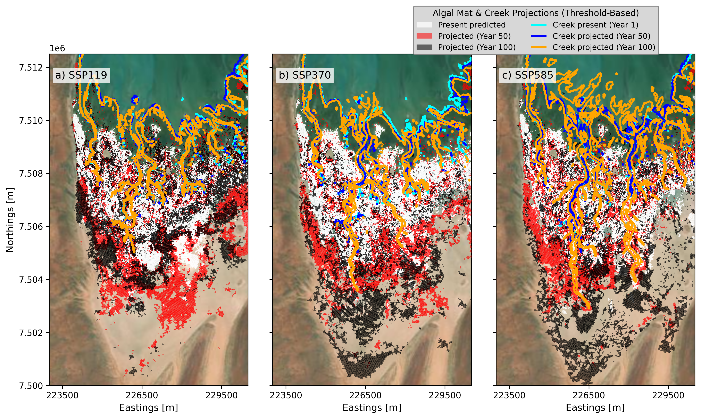
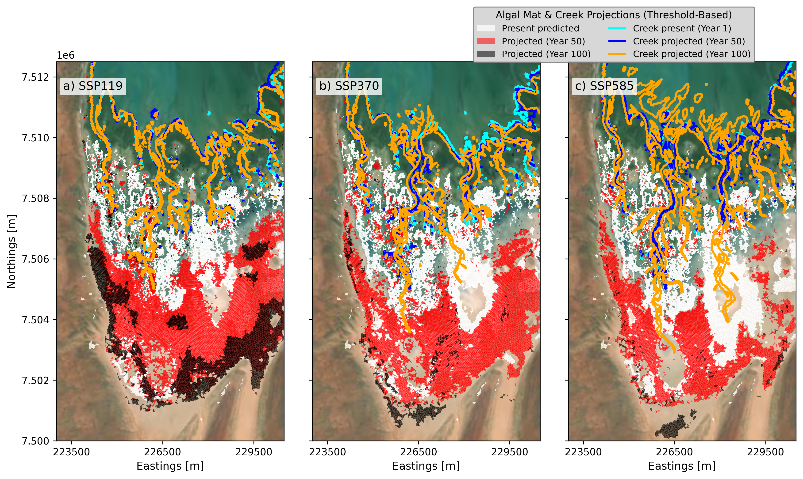
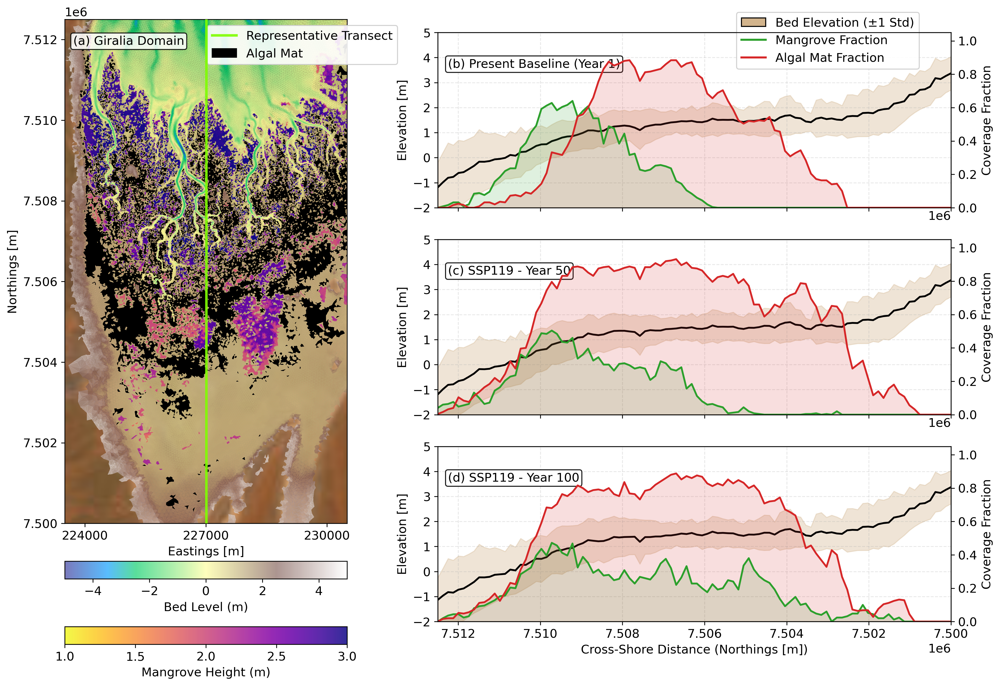
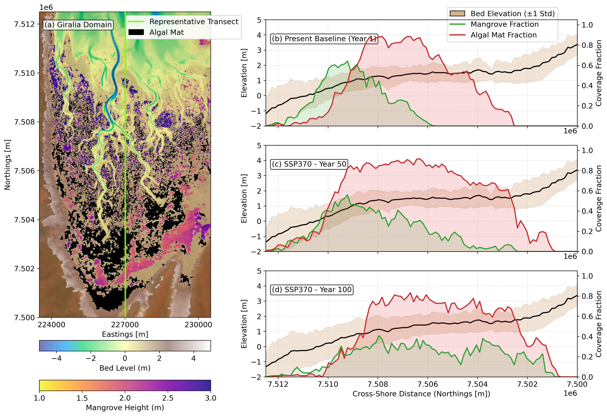
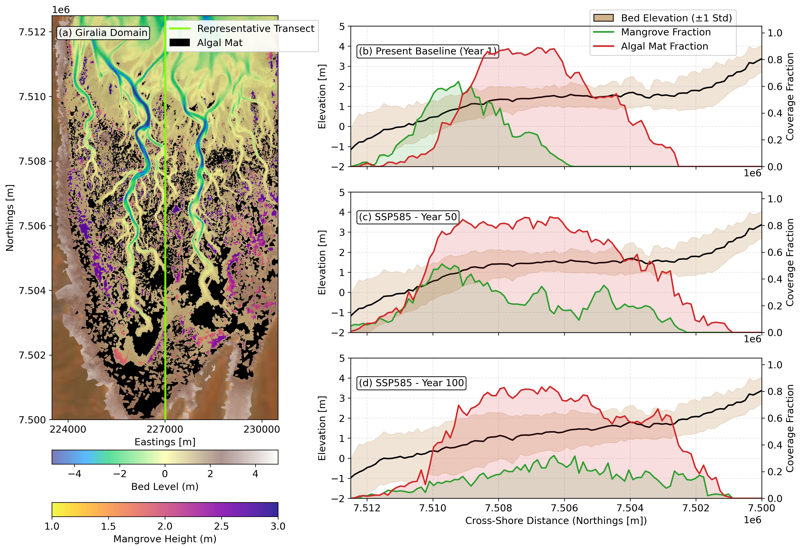
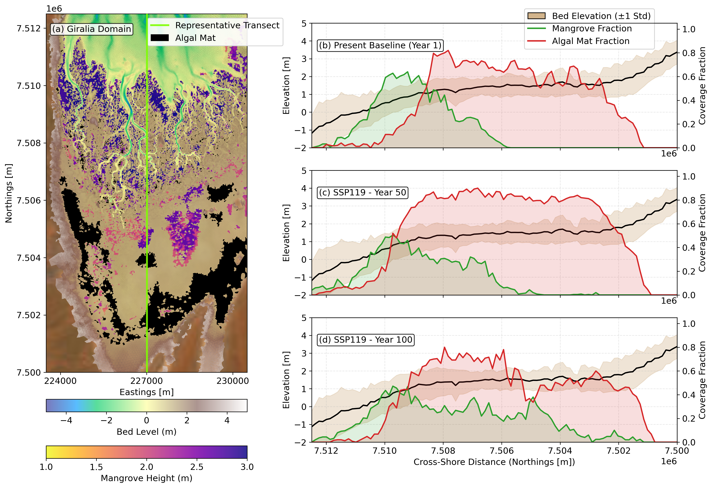
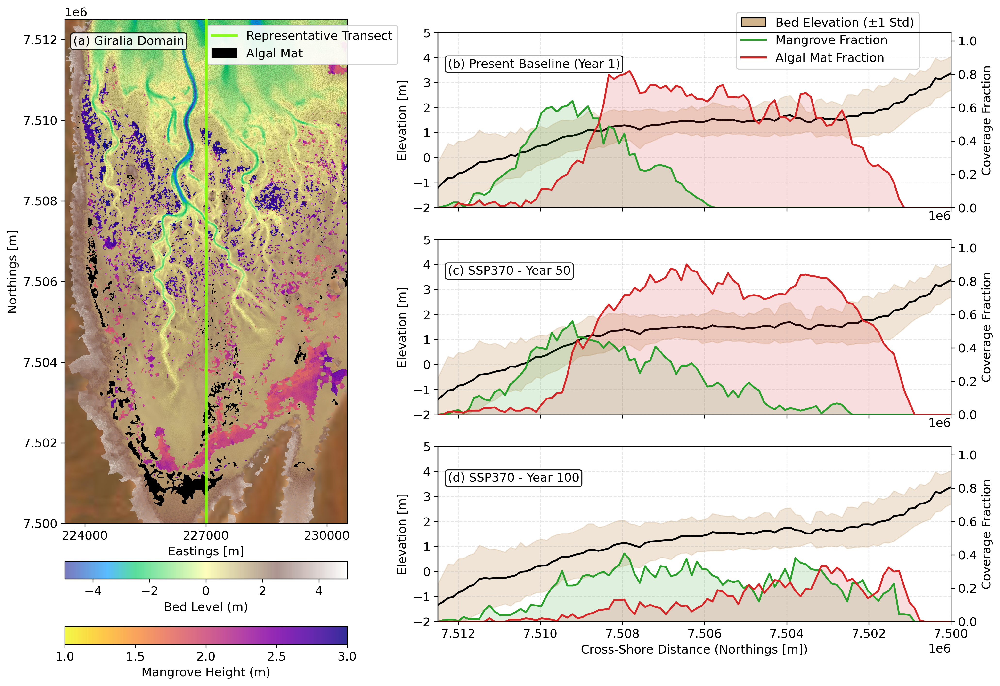
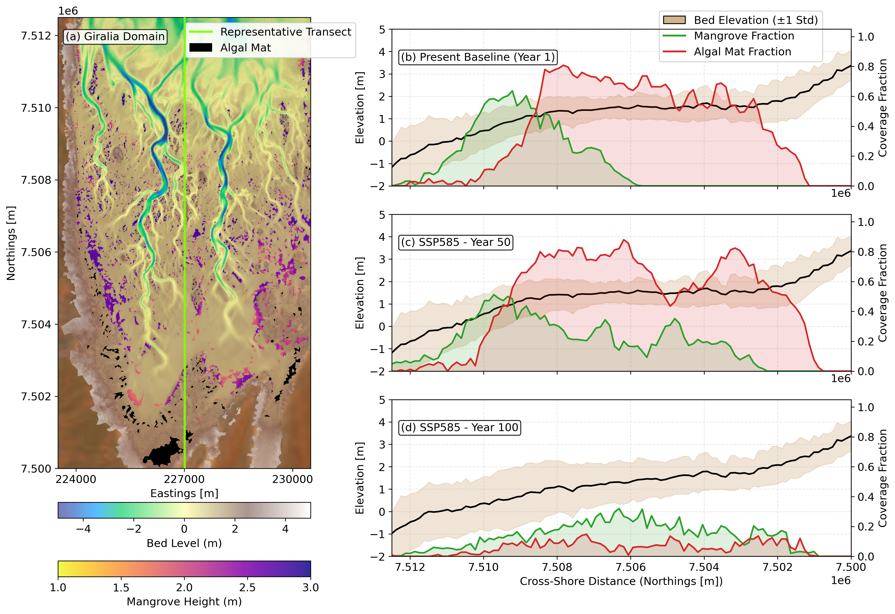

# Cyanobacterial mat Response to Sea Level Rise {#sec-gir-algalmat}

## Sea-Level Rise Response

In this chapter, we present the response of cyanobacterial mats to different sea-level-rise (SLR) scenarios across the Giralia Bay intertidal domain. As described in @sec-giralia-algal-val, cyanobacterial mat distributions were predicted using two complementary data-driven approaches: the **Random Forest (RF) machine-learning classifier** and the **Threshold-Based Optimisation approach**. The complete model architectures, parameterisation, and algorithmic implementations are detailed in @sec-algal-mat-model. 

Predictions were evaluated over a 100-year projection period at discrete intervals representing present-day baseline, Year 50, and Year 100 conditions to assess long-term structural and spatial adjustments to rising sea levels. Unlike the continuous biomass and canopy height metrics evaluated in the mangrove analysis (@sec-gir-mangrove), cyanobacterial mat distributions are evaluated as a binary spatial classification (i.e. presence or absence), delineating critical shifts in habitat suitability across the supratidal salt flat gradient.

As highlighted in @sec-giralia-algal-val, the calibrated models were used to predict algal mat responses across the projected sea-level rise scenarios. For illustrative purposes, active creek network extensions extracted using the $0.2\text{ m}$ bed elevation contour are overlaid on all projections to contextualise hydrodynamic changes relative to mat migration.

::: {.panel-tabset}

### Random Forest (RF) Approach

{#fig-algal-rf width=100%}

### Threshold-Based Optimisation Approach

{#fig-algal-threshold width=100%}

:::

Both the Random Forest (RF) approach and the threshold-based optimisation approach reveal a clear landward migration of cyanobacterial mats over the 100-year projection period, closely tracking the inland elongation of the tidal creek network. However, the two modelling paradigms capture distinct facets of spatial reorganisation. The Random Forest model predicts broader, highly continuous spatial coverage with smooth, non-linear transitions across the supratidal gradient, showing extensive Year 50 (red) and Year 100 (black) mat persistence stretching deep into the southern domain across all scenarios. In contrast, the threshold-based optimisation approach enforces strict hydrodynamic boundaries including inundation frequency, 98th percentile water depth, and bed shear stress limits producing sharply delineated spatial bands that more explicitly highlight habitat compression and drowning thresholds.

Zonation remains coherent and well-defined during the first 50 years across all projections, but divergence between the climate scenarios becomes more pronounced by Year 100. Under the low-emissions SSP119 scenario, both models project  extensive landward migration, with cyanobacterial mats establishing expansive cover across newly wetted supratidal flats in the southern sector. Under the moderate SSP370 scenario, migration remains progressive, though spatial continuity begins to fragment as tidal channels extend landward. However, under the high-emissions SSP585 scenario, the models reveal severe habitat degradation and divergence. While the RF model maintains moderate spatial persistence, the threshold-based model demonstrates a drastic contraction of the Year 100 mat footprint, where the rapid velocity of sea-level rise exceeds the landward migration capacity and inundation tolerance limits of the mats, resulting in severe coastal squeeze and permanent submergence of historical intertidal zones.

To further understand the evolution of the algal mat also in conjunction with the mangrove prediction, we combined the algal mat and mangrove predictions from both approaches. For illustrative purposes, we computed the alongshore average for the Giralia bay for algal mat (coverage fraction), and also the mangrove coverage fraction. We also did the alongshore mean of the bottom profile with plus or minus 1 std shown for each approach below.

::: {.panel-tabset}

### Random Forest (RF) Approach

::: {.panel-tabset}

#### SSP119
{#fig-giralia-ssp119-ml width=100%}

#### SSP370
{#fig-giralia-ssp370-ml width=100%}

#### SSP585
{#fig-giralia-ssp585-ml width=100%}

:::

### Threshold-Based Optimisation Approach

::: {.panel-tabset}

#### SSP119
{#fig-giralia-ssp119-thresh width=100%}

#### SSP370
{#fig-giralia-ssp370-thresh width=100%}

#### SSP585
{#fig-giralia-ssp585-thresh width=100%}

:::

:::

## Comparison Between Machine Learning (RF) and Threshold-Based Approaches
Both modelling approaches demonstrate a primary general trend: cyanobacterial mats migrate landward over the 100-year simulation window, tracking the inland extension of tidal creeks and rising intertidal wetting fronts. However, significant differences emerge in how each framework handles spatial continuity and physical boundaries.

The Random Forest (RF) approach captures broader, more persistent spatial coverage with smoother non-linear transitions. Because it is a data-driven machine learning classifier trained on hydrodynamic features, it predicts the persistence of algal mats even under moderate-to-high stress conditions. Conversely, the threshold-based optimisation approach enforces strict physical limits (such as precise inundation frequency, maximum depth thresholds, and bed shear stress boundaries). This causes the threshold-based model to produce sharper spatial zoning bands that are highly sensitive to rapid elevation changes and water-depth increases. As such, we noticed a significant decline in presistent algal mats for moderate-to-high stress scenarios (SSP370 and SSP585) compared to SSP119.

## Scenario-Wise Comparison

Evaluating performance across emission scenarios reveals diverging trajectories regarding long-term survival.

* SSP119 and SSP370: Under low (SSP119) and moderate (SSP370) emissions, both approaches indicate successful landward migration. Algal mats maintain high coverage fractions as they shift into newly created supratidal accommodation space.

* SSP585 (High Emissions): Under the high-emissions SSP585 scenario by Year 100, the models show starkly contrasting outcomes regarding mat survival. The threshold-based model projects complete or near-complete mortality (drowning) of the algal mat communities across the domain. This total die-back occurs because the rapid rate of sea-level rise under SSP585 exceeds the maximum vertical accretion capacity and physiological inundation tolerance limits enforced by the threshold parameters. Consequently, the intertidal zone experiences severe coastal squeeze, permanently submerging historical flats below the viable depth threshold. While the RF approach also shows substantial contraction under SSP585, its probabilistic classification allows for residual patches to persist in isolated high-intertidal niches.

An important methodological note is that simulations were executed independently for mangroves and algal mats without two-way biological competition feedback. As a result, overlaying the independent predictions reveals noticeable spatial overlaps instances where both mangroves and cyanobacterial mats occupy the same computational grid cell. In reality, mature mangrove expansion often induces shading, sediment modification, and root competition that can inhibit cyanobacterial mat development. Addressing these overlapping zones in future coupled iterations will help refine intertidal niche partitioning and competitive exclusion dynamics in eco-morphodynamic models.

::: {.callout-note icon=false}
## Summary: Trajectories of Algal Mats in Giralia Bay 

Synthesising multi-decadal predictions from our data-driven frameworks (Random Forest vs. Threshold-Based Optimisation) reveals critical distinctions in how Giralia Bay's cyanobacterial mat communities adapt to sea-level rise across emission pathways:

---

## Scenario Profiles & Ecosystem Trajectories

-   **SSP119 (Low SLR – 0.5 m): Expansive Supratidal Migration**
    *   *Ecosystem Regime:* Stable and expansive.
    *   *Trajectory:* Cyanobacterial mats steadily migrate landward onto newly wetted supratidal salt flats, closely tracking the inland elongation of active tidal creeks. High spatial continuity and overall habitat footprint are preserved across both modelling approaches throughout the 100-year period.

-   **SSP370 (Intermediate SLR – 0.9 m): Progressive Relocation & Spatial Fragmentation**
    *   *Ecosystem Regime:* High mobility accompanied by structural restructuring.
    *   *Trajectory:* Progressive landward shift into upper accommodation space maintains significant mat coverage. However, expanding tidal channels begin to fragment continuous mat sheets into localized supratidal patches, introducing minor divergence between machine learning persistence and hydro-dynamic threshold bounds.

-   **SSP585 (High SLR – 1.25 m): Threshold Exceedance & Habitat Collapse**
    *   *Ecosystem Regime:* Severe coastal squeeze and catastrophic drowning.
    *   *Trajectory:* An initial landward migration phase (Years 1–50) is abruptly halted as the rapid velocity of sea-level rise exceeds the physiological inundation tolerances and landward accommodation limits of the mats. Under the threshold-based model, near-total mortality occurs by Year 100 as historical flats are permanently submerged below viable water-depth limits.

---

> **Insight:** Cyanobacterial mats exhibit high landward migration potential under low-to-moderate SLR rates (SSP119 and SSP370) by capitalising on expanding supratidal wetting zones. However, under high-emission forcing (SSP585), rapid water-depth increases trigger widespread drowning and severe habitat contraction, highlighting critical physiological boundaries across the supratidal gradient.
:::