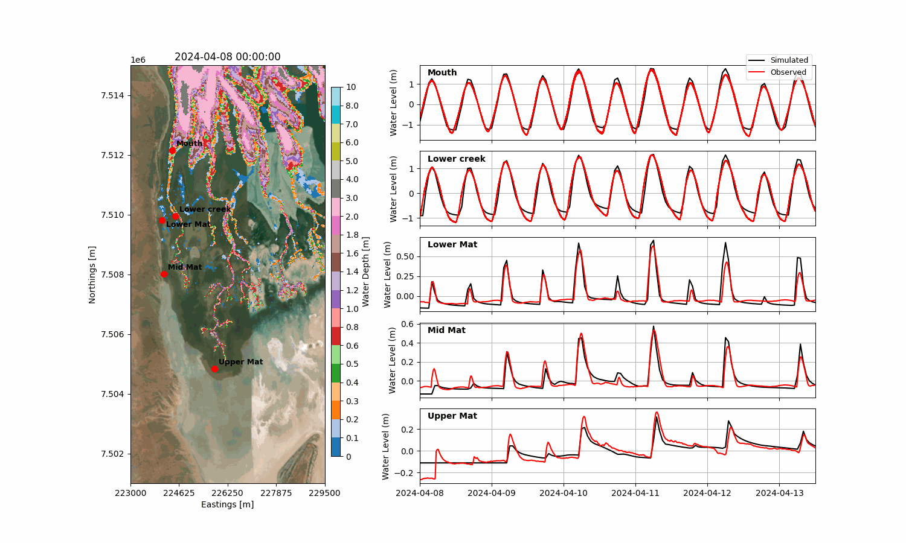
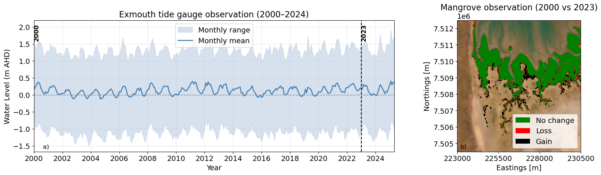
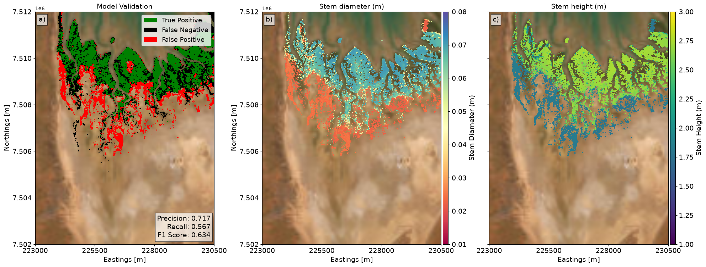
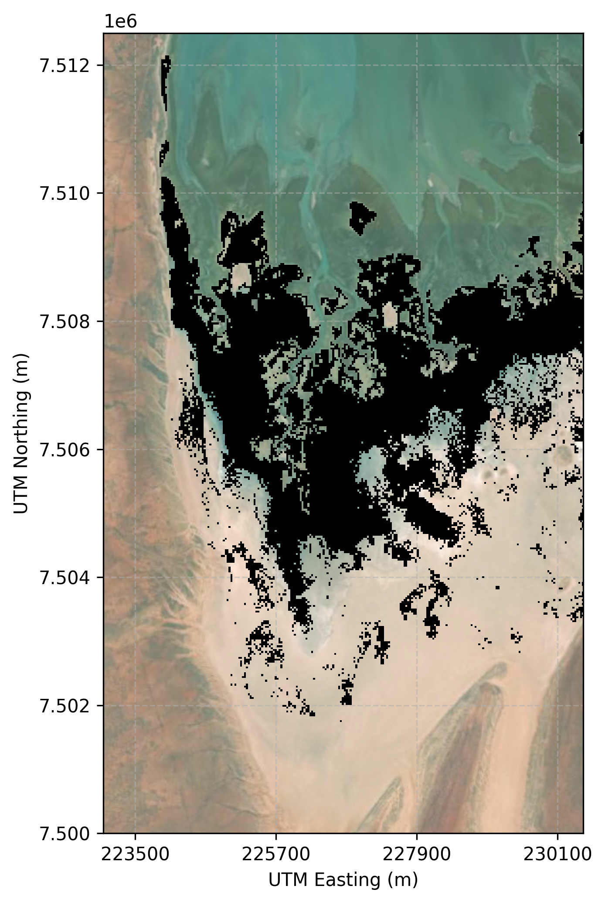
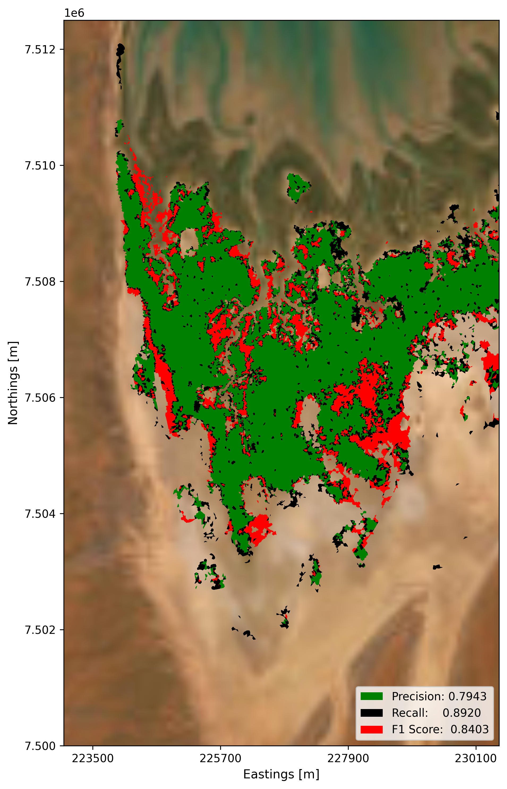
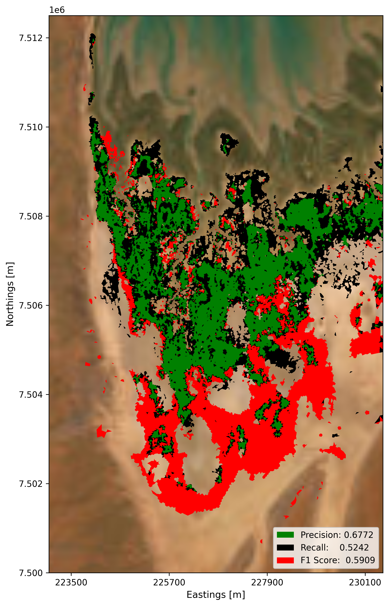

# Calibration and Validation {#sec-giralia-calibration}

## Overview

In order to predict the future distribution and persistence of intertidal habitats under sea level rise and coastal development, the numerical modelling framework must first be calibrated and validated against present-day environmental conditions. @sec-model-application described the multi-scale model development, grid configurations, bathymetric synthesis, and environmental forcing datasets. 

This chapter presents the comprehensive calibration and validation of the high-resolution Giralia domain model across three critical physical and ecological components:

1. **Hydrodynamic Calibration and Validation:** Evaluating simulated water levels and inundation dynamics against continuous field gauge observations.
2. **Mangrove Model Validation:** Comparing modelled mangrove spatial extents and canopy parameters (stem diameter and height) against long-term historical satellite observations (2000–2023).
3. **Cyanobacterial (Algal) Mat Validation:** Using a data-driven approach to calibrate and validate the persistent zone as outlined in @sec-approach.

---

## Hydrodynamic Calibration and Validation {#sec-giralia-hydro-cal}

Hydrodynamics serve as the fundamental physical driver governing tidal inundation, bed shear stress, and from water levels along with residence time and temperature, a proxy salinity gradients across the intertidal landscape can also be established. Achieving high predictive accuracy for water surface elevations and inundation timing is therefore essential prior to simulating ecological dynamics.

The Giralia hydrodynamic model was calibrated and validated using continuous field monitoring observations collected between **November 2023 and February 2025**. The monitoring network captured a wide range of hydrodynamic conditions, including ambient spring–neap tidal cycles, seasonal water level fluctuations, and episodic atmospheric disturbances. For detailed descriptions of sensor specifications, station coordinates, quality control, and data processing workflows, readers are referred to @sec-appendixA.

Model calibration was performed iteratively by tuning key friction, numerical, and boundary parameters:

* **Bottom Roughness:** Transitioned from a uniform bed roughness to spatially variable Manning’s roughness coefficients ($n$) assigned across benthic habitat classes (see also @sec-model-application for more details) to account for momentum dissipation across channels, mudflats, and vegetated zones.
* **Vegetation Drag:** Inundation resistance within mangrove stands was explicitly parameterised using the Baptist canopy formulation [@Baptist2007], incorporating field-measured tree heights and stem densities.
* **Time Step and CFL Sensitivity:** Various computational time steps ($dt$) ranging from 15 s to 300 s (specifically tested at 15, 30, 60, 120, 150, and 300 s) and Courant numbers (CFL between 0.7 and 0.9) were evaluated. Based on calibration performance, a time step of 60 s combined with a maximum CFL of 0.7 was selected to ensure computational efficiency without compromising accuracy.
* **Minimum Water Depth:** The threshold water depth for computation and wet/dry cell handling was set to $0.01\text{ m}$.
* **Process Inclusions and Exclusions:** The calibration testing process evaluated model sensitivity by excluding sediment transport and salinity dynamics, while incorporating the composite heat flux model to accurately capture thermodynamic and meteorological forcings.
* **Boundary Adjustments:** Lateral boundary configurations were evaluated testing Neumann conditions versus omitting explicitly defined boundary conditions (treated as closed walls). Based on these sensitivity tests, omitting explicit lateral boundary constraints (with open boundary forcing driven purely by water level time series) yielded the most stable and physically consistent results.

### Quantitative Performance Evaluation
Model accuracy was evaluated by comparing simulated water surface elevations directly against pressure sensor derived water level observations across key monitoring stations representing distinct intertidal zones (creek mouth, lower creek, mid-intertidal flat, and upper algal mat, see @fig-giralia-anim).

Performance across the monitoring network demonstrated strong statistical agreement:

* **Correlation ($R$):** Consistently high across all stations, exceeding **$R > 0.90$**, indicating excellent reproduction of water levels.
* **Regression Slope and Bias:** Regression slopes exceeded **$0.90$** at nearly all stations (with a slope of **$0.74$** retained at the upper intertidal boundary due to extreme shallow wetting–drying dynamics). Absolute water level bias remained minimal across the domain (**$< 0.007 \text{ m}$**).
* **Error Metrics:** Root Mean Square Error (**RMSE**) values remained below **$0.20 \text{ m}$** across all monitoring locations under both spring and neap regimes.

These metrics confirm that the model accurately captures the spatial attenuation, peak water levels, and drying thresholds across the intertidal gradient.

The spatial and temporal progression of the simulated water surface across Giralia Bay is illustrated in @fig-giralia-anim. The model accurately reproduces the asymmetric tidal wave propagation, characterised by prolonged ebb drainage within the intertidal creek network and rapid wetting during flood spring tides. We have also tested the model for various conditions e.g., ambinent and storm like conditions which all predicted with similar statistical metrics as above providing condifdence in the approach.

::: {#fig-giralia-anim}

  

Dynamic hydrodynamic simulation and water level time series comparison across monitoring stations in the Giralia domain.
:::

---

## Mangrove Model Validation {#sec-giralia-mangrove-val}

### Historical Mangrove Observations (2000–2023)

To establish a baseline for assessing future changes in mangrove ecosystems in the Giralia region, it is crucial to understand observed mangrove dynamics under present environmental conditions and to evaluate the model's ability to reproduce the current mangrove extent. 

We utilised monthly mangrove maps derived from Landsat imagery by @Hickey2025 (part of Project A of this Mardie Marine and Intertidal Research Offset Program) to examine temporal variability in mangrove distribution. Although the Landsat-derived dataset provides monthly observations over the available satellite record, the mangrove extents in 2000 and 2023 are compared in @fig-giralia-obs to illustrate any longer-term shifts in the mangrove distribution alongside corresponding water level variability recorded at the Exmouth tide station over the same period.

Overall, the Landsat observations indicate that mangrove extent in the Giralia region has remained relatively stable over the past two decades, with only minor changes in spatial distribution. Seasonal variations in water level did not result in substantial changes in mapped mangrove extent. However, a closer examination reveals that prolonged interannual environmental variations can produce more pronounced localised changes. For instance, mangrove dieback is evident in parts of the upper intertidal region during extended El Niño–Southern Oscillation (ENSO) periods [@Lovelock2017], suggesting that prolonged periods of lower inundation relative to typical hydrodynamic conditions can adversely influence mangrove survival. 

Despite these episodic changes, the overall mangrove extent has remained broadly consistent over the approximately 20-year observation period. This relative stability provides a suitable present-day baseline against which future changes under altered environmental conditions can be assessed.

::: {#fig-giralia-obs}
{fig-align="center" width="95%"}

Water level observations and historical mangrove extent in the Giralia region. **(a)** Water level recorded at the Exmouth tide station ([WA Data Catalogue](https://catalogue.data.wa.gov.au/dataset/tide-stations)) displaying monthly range and monthly mean. **(b)** Comparison of Landsat-derived mangrove extents between 2000 and 2023 [@Hickey2025].
:::

---

### Model Initialisation & Performance Evaluation 

@fig-giralia-val shows the modelled mangrove distribution under present environmental conditions. Because the objective was to reproduce the stable mangrove extent representative of the current environmental regime, model simulations were forced using the MSKO tidal constituents (optimised via harmonic analysis, see also @sec-approach for more details on how we arrive at this and @tbl-tidal-constituents for the amplitudes and phases). 

The spatial agreement between modelled and observed mangrove extents was evaluated using the approach described in @sec-model-overview by categorising grid cells:

* **True Positives (Green):** Correctly predicted mangrove areas.
* **False Negatives (Black):** Observed mangrove areas missed by the model.
* **False Positives (Red):** Areas predicted as mangrove where none were observed.

To quantitatively evaluate spatial performance, precision, recall, and the $F_1$ score were computed and shown in @tbl-gir-eval-stats:

| Statistic | Definition | Formula | Model Performance |
| :--- | :--- | :--- | :--- |
| **Precision** | Proportion of modelled mangrove cells corresponding to true observed mangroves | $\text{Precision} = \frac{TP}{TP + FP}$ | 0.717 (Moderate Agreement) |
| **Recall** | Proportion of observed mangrove cells correctly reproduced by the model | $\text{Recall} = \frac{TP}{TP + FN}$ | 0.567 (Moderate Agreement) |
| **$F_1$ Score** | Harmonic mean of precision and recall | $F_1 = 2 \cdot \frac{\text{Precision} \cdot \text{Recall}}{\text{Precision} + \text{Recall}}$ | 0.634 (Moderate Agreement) |

: Performance metrics for the Giralia mangrove model, indicating moderate agreement across all evaluated parameters. {#tbl-gir-eval-stats}

The resulting statistics indicate moderate agreement between modelled and observed mangrove distributions, demonstrating that the model accurately captures the spatial characteristics of present-day mangrove extent while retaining subtle spatial boundary differences.

In addition to spatial extent, the model predicts key structural attributes of the mangrove canopy:

* **Stem Diameter ($d$):** Predicted spatial distributions (@fig-giralia-val b) indicate relatively mature mangroves within the stable core of the mangrove distribution, characterised by larger stem diameters.
* **Stem Height ($h$):** Corresponding spatial distributions (@fig-giralia-val c) reflect taller individuals within core zones and smaller, shorter individuals transitioning toward the margins of the habitat.

This spatial gradient aligns with expected ecological development progressing from established, dense mangrove stands to less stable transition zones and confirms that the model captures both spatial extent and internal structural dynamics of the present-day mangrove ecosystem.

::: {#fig-giralia-val}
{fig-align="center" width="100%"}

Mangrove validation and vegetation structural parameter distributions across the Giralia study area. **(a)** Spatial confusion map highlighting true positives, false negatives, and false positives alongside quantitative performance metrics ($F_1$ score, precision, recall). **(b)** Spatial distribution of modelled stem diameter ($d$). **(c)** Spatial distribution of modelled stem height ($h$).
:::

---

## Cyanobacterial Mat Validation {#sec-giralia-algal-val}

To evaluate cyanobacterial (algal) mat dynamics, dual data-driven approaches—comprising the **Random Forest (RF) machine-learning classifier** (with full model details and algorithmic implementation described in @sec-algal-mat-model) and the **Threshold-Based Optimisation approach** were implemented to calibrate and validate the persistent habitat zone as described in @sec-approach. 

The persistent algal mat zone in the Giralia bay is shown in @fig-algal-persitent. The persitent map is then utlised for the calibration and validation.

::: {#fig-algal-persitent}
{fig-align="center" width="100%"}

Persistent algal mat zone based on 2019 satellite derived probability maps [@Hickey2025].
:::

Using this empirical framework, simulated inundation regimes, hydrodynamic envelopes, and high-intertidal elevation thresholds were evaluated against long-term remote sensing baselines to confirm that the models accurately capture the spatial boundaries and persistence of cyanobacterial mat communities across the upper intertidal landscape. 

The performance and spatial distribution of true positives (green), false negatives (black), and false positives (red) for both modelling approaches are compared below.

::: {.panel-tabset}

### Machine-Learning Approach (Random Forest)

{#fig-giralia-ml width=85%}

### Threshold-Based Optimisation Approach

{#fig-giralia-threshold width=85%}

:::

## Summary of Giralia Model Reliability {#sec-giralia-cal-summary}

The combined hydrodynamic, mangrove, and cyanobacterial mat calibration results demonstrate that the Giralia domain model reproduces the present-day physical and biological dynamics of the hyper-arid intertidal ecosystem with a reasonable accuracy. With verified hydrodynamic forcing, low water level errors ($RMSE < 0.20 \text{ m}$), and validated spatial extents for key habitats, this calibrated model provides confidence in the approach for predicting intertidal habitat migration and response under future Sea Level Rise (SLR). @sec-gir-mangrove and @sec-gir-algalmat shows the mangrove and algal mat responses to the future sea level rise.

