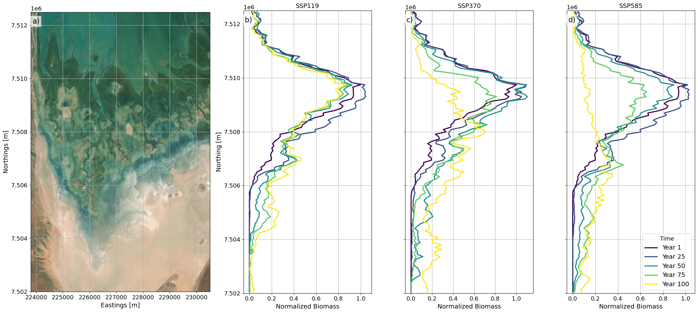
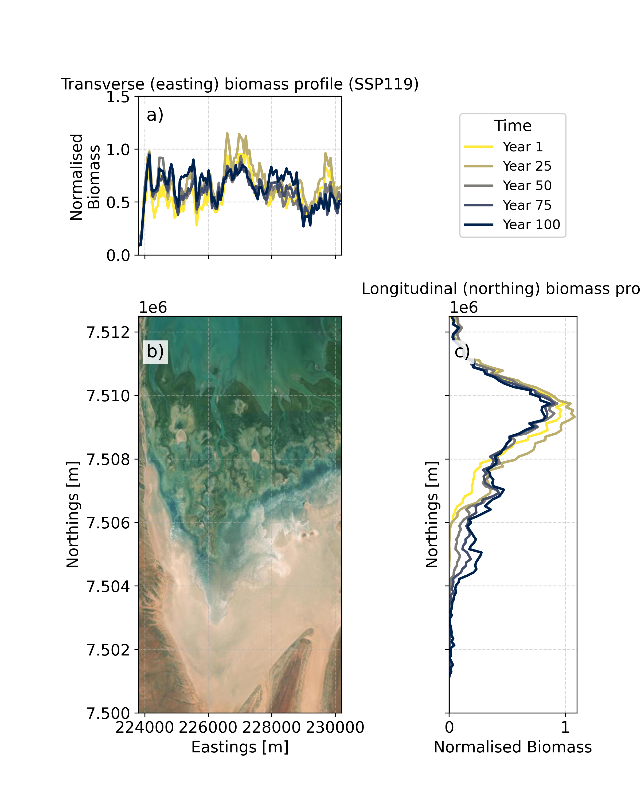
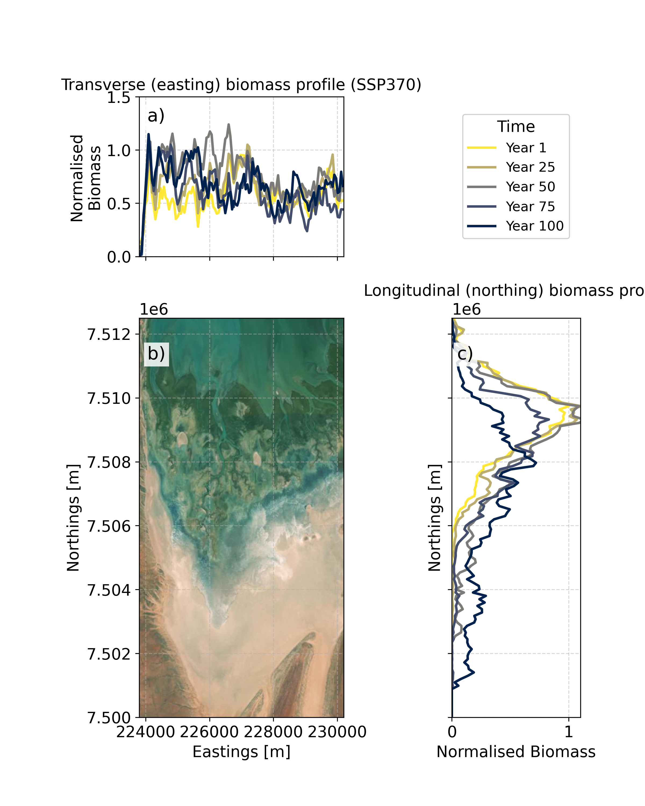
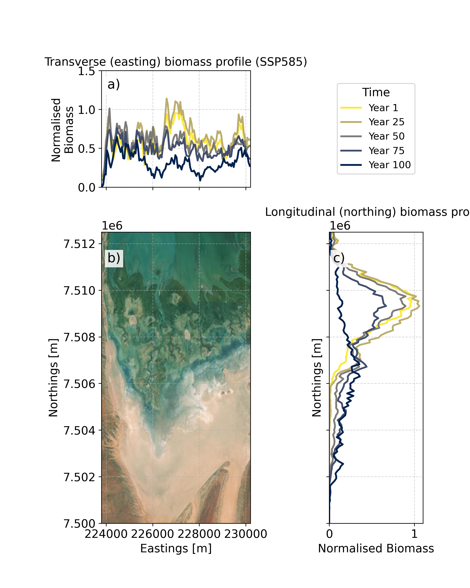
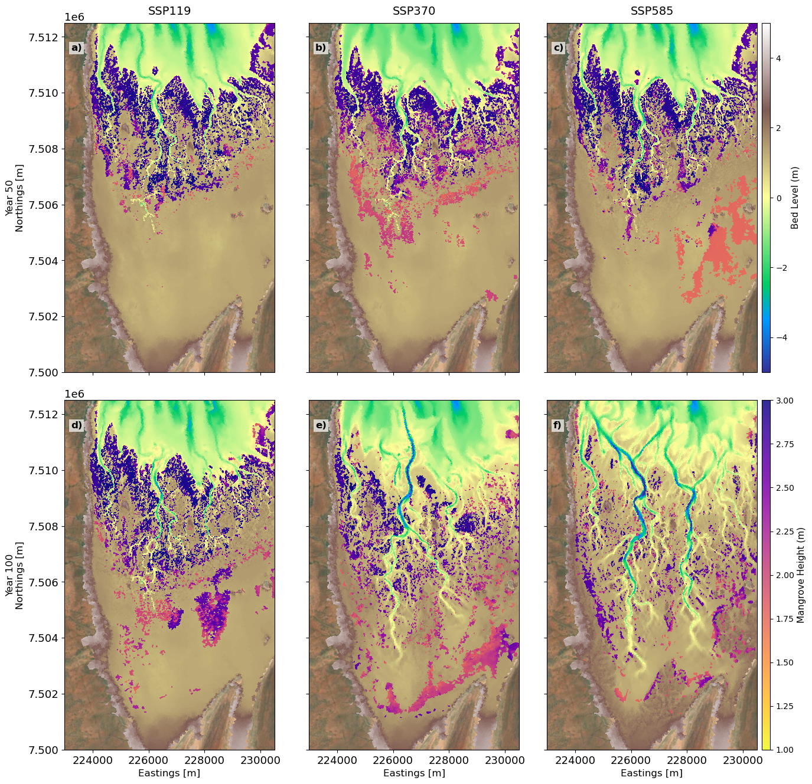
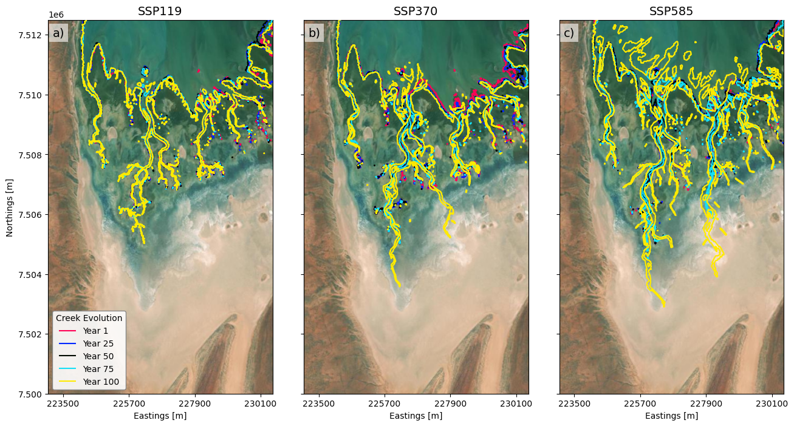
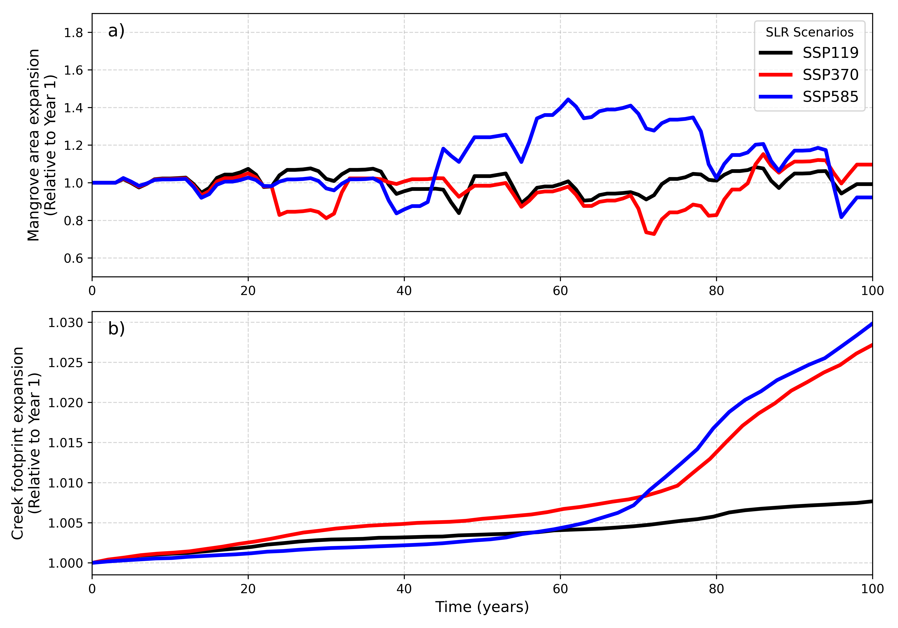
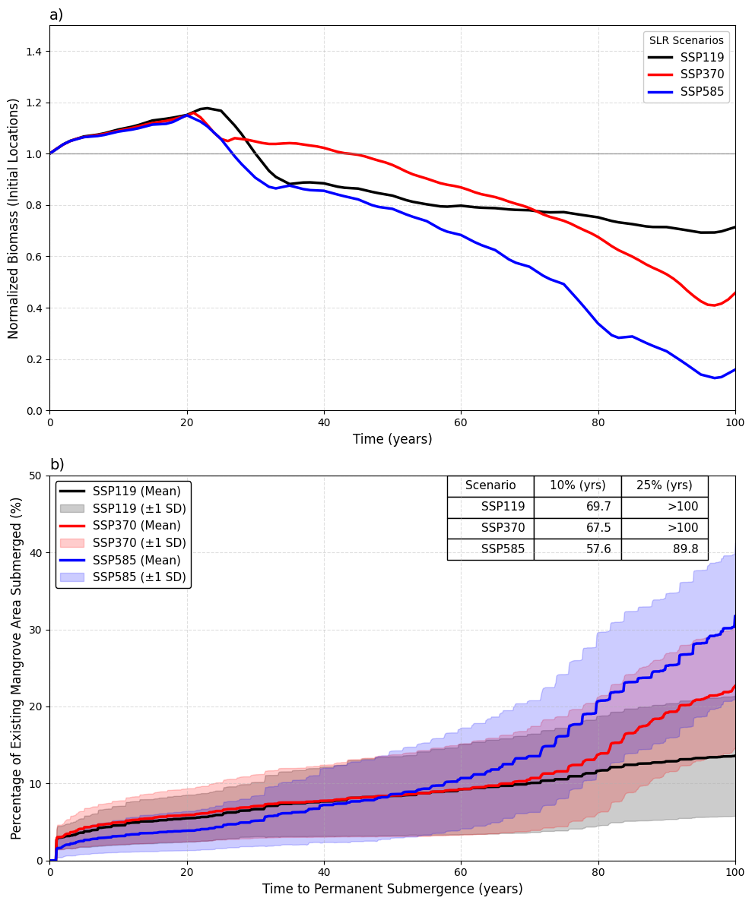
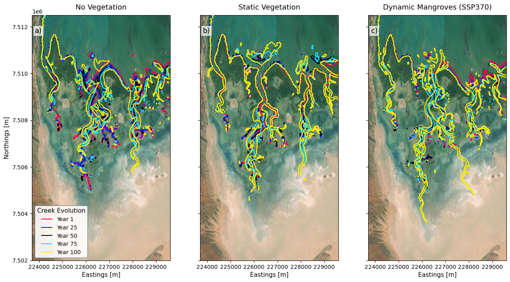

# Mangrove Response to Sea Level Rise {#sec-gir-mangrove}

## Sea Level Rise Response

In this chapter, we present the response of mangroves to different sea-level-rise (SLR) scenarios at Giralia Bay. As described in @sec-giralia-mangrove-val, the predicted mangrove extent under present-day environmental conditions was used as the initial condition, and simulations were subsequently performed under a range of SLR scenarios representing low, medium, and high sea-level-rise conditions as discussed in @sec-approach. The SLR simulations were carried out over a 100-year projection period to assess the long-term response of the mangrove ecosystem to rising sea levels. The results were analysed to investigate changes in mangrove extent and biomass under each SLR scenario and to identify trends in mangrove migration, rates of habitat loss, and potential thresholds beyond which landward migration and ecosystem persistence are no longer possible.

@fig-mangrove-slr-response-animation shows the temporal evolution of mangrove canopy height ($h$) and bed elevation ($z$) across the Giralia Bay study site under three SLR scenarios: **SSP119 (0.5 m SLR)**, **SSP370 (0.9 m SLR)**, and **SSP585 (1.25 m SLR)** over the 100-year simulation period. The animation illustrates the dynamic interplay between rising sea levels, tidal inundation regimes, and mangrove growth, highlighting spatial and temporal patterns of mangrove expansion, dieback, and landward migration.

As SLR progresses, increased hydroperiod and depth along lower-elevation seaward fringes exceed physiological tolerances, triggering dieback and seaward edge drowning—most prominently under high SLR rates. Concurrently, newly inundated supratidal zones create favorable hydrodynamic conditions, facilitating landward encroachment and redistribution of mangroves across the intertidal gradient.

::: {.callout-note}
## Key Findings: Mangrove SLR Response Dynamics
* **Low-SLR Scenario (SSP119 – 0.5 m):** Mangroves maintain dynamic equilibrium, showing localised expansion along tidal channels with minimal seaward dieback.
* **Moderate-SLR Scenario (SSP370 – 0.9 m):** Progressive drowning initiates along the lower seaward fringe, partially compensated by landward migration into newly flooded accommodation space.
* **High-SLR Scenario (SSP585 – 1.25 m):** Severe seaward fringe dieback and rapid landward retreat take place, resulting in substantial spatial shifts in canopy height ($h$) distribution across the Giralia Bay domain.
:::

::: {.content-visible when-format="html"}
::: {#fig-mangrove-slr-response-animation}
{fig-align="center" width="95%"}

Spatial and temporal evolution of mangrove canopy height ($h$, right colorbar) overlaid on bed level elevation ($z$, left colorbar) across the Giralia Bay study site for three Sea Level Rise scenarios: SSP119 (0.5 m), SSP370 (0.9 m), and SSP585 (1.25 m).
:::
:::

Mangrove biomass was calculated using the method described in @sec-model-overview. To examine spatial redistribution of biomass, longitudinal (northing) and transverse (easting) profiles were derived for Giralia Bay (@fig-biomass_norm and @fig-scenarios). @fig-biomass_norm shows the temporal evolution of the longitudinal (northing) mangrove biomass profiles, normalised relative to initial conditions ($\frac{B}{B_0}$), at 25-year intervals over the 100-year projection period. Initial biomass has a unimodal spatial distribution centred within the mid-to-fringing intertidal zone.

Under the **SSP119** scenario, the system undergoes a gradual transition characterised by a modest decline in seaward fringe biomass alongside a progressive landward migration driven by increased inundation frequency. 

Conversely, the medium to higher-emission scenarios (**SSP370** and **SSP585**) exhibit a two-phase response:

* **Phase 1 (Years 1–50):** Relative stability over the first 50 years.
* **Phase 2 (Years 50–100):** Rapid non-linear reorganisation. 

Beyond Year 50, extensive dieback is predicted to occur along the seaward fringe, accompanied by significant mangrove expansion into newly suitable landward high-intertidal habitats. Notably, by Year 100, landward biomass accumulation under **SSP370** exceeds that of **SSP585**. This divergence indicates that the rate of SLR under SSP585 outpaces the maximum physiological or ecological colonisation rate of the mangroves, leading to net mangrove loss despite available inland migration space.

::: {#fig-biomass_norm}
{fig-align="center" width="95%"}

Longitudinal (northing) profiles of normalised mangrove biomass under the three SLR scenarios. Panel (a) shows the basemap for spatial reference. Panels (b), (c) and (d) show the profiles for SSP119, SSP370 and SSP585, respectively.
:::

@fig-scenarios provides complementary transverse (easting) biomass profiles. Variability in these profiles is relatively small but increases with increasing SLR. Under both SSP119 and SSP585, biomass increases relative to the initial biomass in the central part of the domain. Under SSP370, the increase occurs at a slightly different transverse (easting) position.

The longitudinal (northing) biomass profiles in @fig-biomass_norm also indicate a landward shift in the location of peak biomass over time across all three scenarios. The magnitude of this shift differs between scenarios. Under SSP119 and SSP370, the landward displacement of the biomass peak is more pronounced. Under SSP585, the peak remains identifiable but is substantially lower, suggesting that biomass redistribution may not keep pace with the greater rate of SLR under this scenario.

::: {#fig-scenarios layout-ncol="1"}

::: {.panel-tabset}

### SSP119

{#fig-ssp119 width=85% fig-crop="10% 5% 10% 5%"}

### SSP370

{#fig-ssp370 width=85% fig-crop="10% 5% 10% 5%"}

### SSP585

{#fig-ssp585 width=85% fig-crop="10% 5% 10% 5%"}

:::

Biomass projections across different shared socioeconomic pathways (SSP119, SSP370, and SSP585) evaluated over the Giralia domain.
:::

@fig-Giralia_mangrove_evolution shows the spatial distributions of mangroves for Year 50 and Year 100, highlighting the diverging long-term trajectory of mangrove extent across SSP119, SSP370, and SSP585 scenarios. During the initial ~40 years of simulation across all climate projections, differences in predicted mangrove coverage remain relatively subtle, as SLR rates remain within thresholds that permit localised bed level equilibration and persistence along established intertidal zones.

Spatially, baseline mangrove distribution is heavily governed by tidal inundation limits and bed elevation, originally dominating the seaward and central channel networks. However, progressive SLR triggers a distinct landward transgression alongside substantial dieback along the seaward boundaries:

* **SSP119 (Low Emission):** At Year 50 (@fig-Giralia_mangrove_evolution a), the mangrove fringe maintains structural stability with negligible loss along the lower intertidal zone and initial establishment in the southern high-intertidal flats. By Year 100 (@fig-Giralia_mangrove_evolution d), a modest landward expansion occurs into high-elevation flats characterised by shorter, newly established mangrove foliage ($h < 1\text{ m}$), while the core seaward forest retains canopy heights exceeding $2\text{ m}$.
* **SSP370 (Intermediate Emission):** By Year 50 (@fig-Giralia_mangrove_evolution b), subtle fragmentation emerges along the seaward margin. By Year 100 (@fig-Giralia_mangrove_evolution e), rapid landward migration dominates the southern boundary, where extensive, tall mangrove stands ($h > 2\text{ m}$) establish across newly inundated supratidal areas. Concurrent expansion also tracks along newly widened inner tidal channels.
* **SSP585 (High Emission):** At Year 50 (@fig-Giralia_mangrove_evolution c), shows a similar pattern to SSP370. However, by Year 100 (@fig-Giralia_mangrove_evolution f), the system undergoes widespread coastal squeeze and seaward dieback. While mangroves colonise the far-southern landward fringe, the total footprint is diminished compared to SSP370. Higher inundation rates lead to channel drowning and permanent submergence of the seaward mudflats, causing significant loss of historical habitat without an equivalent gain in landward area.

::: {.callout-note}
## Key Findings: Non-Linear Tipping Points
Overall, the coupled eco-morphodynamic simulations highlight a **non-linear tipping point past Year 50** under moderate-to-high SLR. 

Landward expansion temporarily compensates for seaward loss; however, under extreme SLR (**SSP585**), the rate of sea-level rise outpaces landward colonisation capacity, resulting in net habitat contraction.
:::

::: {#fig-Giralia_mangrove_evolution}
{fig-align="center" width="95%"}

Modelled spatial evolution of bed elevation ($z$) and mangrove canopy height ($h$) across the study site at Year 50 (top row) and Year 100 (bottom row) under three climate projections: (a, d) SSP119, (b, e) SSP370, and (c, f) SSP585.
:::

---

### Morphological Response

To isolate and track the morphological response of the tidal network to SLR, the active creek network was extracted using the $0.2\text{ m}$ bed elevation contour at 25-year intervals (Years 1, 25, 50, 75, and 100) in @fig-Giralia_creek_evolution. Across all scenarios, increased tidal prism volumes driven by rising sea levels induce pronounced bed scour, channel widening, and headward erosion. This forces the main tidal channels to extend progressively landward into previously supratidal salt flats over time.

The magnitude of this landward channel extension varies significantly across climate forcings:

1. **SSP119:** Primary tidal channels experience limited headward migration, extending southward by approximately $0.5\text{ km}$ beyond their baseline position, with morphological changes mostly confined to localised lateral adjustments.
2. **SSP370:** Accelerated SLR drives substantial channel deepening and landward elongation, pushing the main creeks approximately $2.5\text{ km}$ southward by Year 100 alongside extensive secondary branching.
3. **SSP585:** Massive headward erosion causes the main creeks to extend $>4\text{ km}$ landward, accompanied by severe channel widening along the seaward reaches due to extreme estuarine drowning.

::: {#fig-Giralia_creek_evolution}
{fig-align="center" width="95%"}

Spatiotemporal evolution of the tidal creek network over 100 years under (a) SSP119, (b) SSP370, and (c) SSP585 scenarios. Channels are delineated by extracting the $0.2\text{ m}$ bed level contour at 25-year intervals (Years 1, 25, 50, 75, and 100).
:::
To assess the systemic morphological and ecological adjustments to SLR, the normalised time series of total mangrove area and tidal creek planform footprint relative to initial conditions were evaluated (@fig-Giralia_temporal_evolution). 

During the first 40–50 years, both metrics exhibit a relative lag phase characterised by subtle, near-baseline fluctuations (normalised values fluctuating near $1.0$). This initial stability reflects a meta-stable equilibrium, where early hydrodynamic forcing and sea-level increments remain within ecological tolerance limits and thresholds for localised bed shear stress. Consequently, vertical accretion and minimal horizontal reconfiguration suffice to maintain system stability across all scenarios (SSP119, SSP370, and SSP585).

Beyond Year 50–60, clear non-linear divergence occurs across the projections, particularly governing channel footprint expansion (@fig-Giralia_temporal_evolution b):

* **SSP585 Channel Expansion:** Under SSP585, the tidal creek expansion rate initially lags behind SSP370 up to approximately Year 60. Extreme early SLR in SSP585 increases the tidal prism volume and ebb-jet energy, causing channel responses to be dominated by vertical bed incision and cross-sectional deepening rather than rapid headward elongation. 
* **Post-Year 60 Inflection:** Past Year 60, an inflection point is reached as increased inundation frequency drowns intertidal margins, causing tidal shear stress to breach headward erosion thresholds. This initiates a sharp acceleration in landward channel extension and network branching through Year 100, reaching a relative footprint expansion $>2.5$, compared to more moderate trajectories under SSP119 ($<1.2$).

Similarly, normalised mangrove surface area (@fig-Giralia_temporal_evolution a) shows complex non-monotonic behaviour driven by competing mechanisms of seaward edge drowning and landward opportunistic colonisation:

* **SSP585 Surge & Collapse:** Under SSP585, mangrove footprint surges past Year 45, peaking at nearly $1.4\times$ initial coverage around Year 60 due to rapid inland expansion across previously dry supratidal flats. However, between Years 70 and 80, catastrophic seaward fringe dieback and channel drowning cause a rapid decline back toward baseline values ($1.0$). 
* **Spatial Displacement by Year 100:** By Year 100, while net normalised mangrove area under SSP585 rebounds close to $1.1$, a critical spatial displacement occurs: the historical low-intertidal forest is entirely lost to estuarine drowning, and survival is maintained solely because mangroves progressively climb the steeper, elevated terrain along the western margins of the basin.

::: {#fig-Giralia_temporal_evolution}
{fig-align="center" width="95%"}

Temporal evolution of normalised (a) total mangrove area and (b) tidal creek planform footprint relative to initial conditions over a 100-year simulation under SSP119 (black), SSP370 (red), and SSP585 (blue) scenarios.
:::
---

### Implications of Sea-Level Rise on the Present Mangrove Footprint

To evaluate the long-term viability of existing mangroves under different SLR scenarios, we restricted our analysis to the initial spatial footprint of mangroves and deliberately excluded landward migration. @fig-Giralia_temporal_evolution_existing_location shows the temporal trajectory of total normalised biomass retained strictly within the initial mangrove extent over a 100-year simulation period (@fig-Giralia_temporal_evolution_existing_location a) and the cumulative percentage of the initial mangrove footprint subjected to permanent inundation (@fig-Giralia_temporal_evolution_existing_location b). 

Permanent submergence is defined as continuous 14-day water depth exceeding site-specific tolerance thresholds:

$$z_{\text{submergence}} = \mu_{\text{threshold}} \pm 1\sigma$$

Across all three SLR scenarios, normalised biomass in original locations initially increases during the first two decades, reaching a peak near year 20 to 25 at approximately $1.1\text{–}1.2$ times the initial baseline (@fig-Giralia_temporal_evolution_existing_location a). This initial phase reflects early-stage canopy maturation and biomass accumulation in intertidal cells where water depth remains within tolerable physiological limits. During this same interval, permanent submergence remains low (@fig-Giralia_temporal_evolution_existing_location b), staying below $5\%$ across all scenarios.

Beyond year 25, a critical inflection point occurs as accelerating sea-level rise overwhelms intertidal elevations:

| Scenario | Submergence Trajectory (@fig-Giralia_temporal_evolution_existing_location b) | Biomass Retention Trajectory (@fig-Giralia_temporal_evolution_existing_location a) |
|:---|:---|:---|
| **SSP119** | Submergence reaches $5\%$ at Year 50; terminates at $\sim 15\%$ area loss by Year 100. | Normalised biomass stabilises around $0.85\times$ toward end of century. |
| **SSP370** | Habitat loss accelerates after Year 60. Submergence reaches $20\%$ at Year 75, rising to $\sim 45\%$ by Year 100. | Normalised biomass declines steadily, dropping to $0.45\times$ of initial value. |
| **SSP585** | Submergence reaches $25\%$ at Year 50, $60\%$ at Year 75, and exceeds $85\%$ (upper bounds near $95\%$) by Year 100. | Rapid inundation triggers steep decline; total biomass drops to $<0.1\times$ of initial levels. |

We found a strong inverse relationship exists between the rate of permanent submergence (@fig-Giralia_temporal_evolution_existing_location) and the retention of localised biomass (@fig-Giralia_temporal_evolution_existing_location a). The onset of rapid biomass decline across all scenarios directly mirrors the temporal acceleration of continuous drowning. While biomass loss exceeds the absolute percentage of drowned surface area, this could be due to environmental stress which reduces stem density and productivity prior to complete drowning. The relative divergence among climate scenarios follows an identical sequence in both metrics, with SSP585 showing severe degradation followed by moderate and partial degradation of SSP370 and SSP119. 

> **Summary:** Existing mangrove stands will experience widespread dieback and substantial standing biomass loss under moderate-to-high sea-level rise scenarios.

::: {#fig-Giralia_temporal_evolution_existing_location}
{fig-align="center" width="95%"}

The temporal trajectory of total normalised biomass retained within the initial mangrove extent over a 100-year simulation period in panel a) and the cumulative percentage of the initial mangrove footprint subjected to permanent inundation exceeding specific thresholds ranging from $0.2\text{--}0.8\text{ m}$ represented as $\text{mean} \pm 1\text{ standard deviation}$
:::
---

## Discussion

Our numerical modelling demonstrates that mangrove migration in response to sea-level rise (SLR) is an inherently non-linear process. Even under high SLR scenarios, mangroves within the fringing coast do not simply retreat uniformly; instead, they display spatial resilience, surviving and persisting within elevated coastal patches across the region. Crucially, this non-linear response can only be captured because our model incorporates the full, bi-directional coupling of hydro-morphodynamic and eco-vegetation feedbacks, allowing the landscape and vegetation to dynamically co-evolve rather than assuming passive inundation.

In this section, we discuss the broader implications of applying this fully coupled framework to sea-level rise predictions, compare its performance against traditional modelling paradigms, and evaluate the overall transferability of our Python-based workflow to other coastal systems. Finally, we address the key assumptions and limitations inherent to our modelling approach and outline critical future research directions to further refine regional-scale eco-morphodynamic forecasting.

---

### Implications of Hydro-Morphodynamic and Vegetation Feedbacks for Sea-Level Rise Predictions

In this study, we present a fully coupled approach that explicitly resolves the three-way, non-linear feedbacks between hydrodynamics, morphodynamics, and vegetation dynamics. While previous research has successfully demonstrated the significance of three-way dynamic coupling, existing frameworks have largely been restricted to idealised laboratory domains or localised site-specific applications on the order of hundreds of meters. Here, we scale up this coupled numerical framework to regional coastal scales spanning hundreds of kilometers, allowing us to evaluate multi-decadal landscape evolution under sea-level rise (SLR). 

Accounting for such a fully dynamic coupled system is paramount when predicting long-term coastal morphological response to SLR. Static or uncoupled models fail to capture the continuous bi-directional adjustments between fluid flow, sediment transport, bed level changes, and vegetation colonisation or mortality—feedbacks that fundamentally dictate channel network stability, sediment trapping, and inland marsh or mangrove migration pathways.

To demonstrate the critical necessity of this integrated framework, numerical simulations were executed under identical hydrodynamic forcing and initial topographic conditions across three distinct vegetation treatments:

1. **No Vegetation:** Unvegetated morphodynamics.
2. **Static Vegetation:** Spatially fixed, passive vegetation drag without temporal adaptation.
3. **Dynamic Mangroves (SSP370):** Explicit eco-morphodynamic feedback involving establishment, growth, and dieback.

@fig-Giralia_creek_evolution_veg_vs_no_veg highlights the long-term creek evolution across these three scenarios, where tidal creek channels were delineated by extracting contours corresponding to a bed elevation threshold of $0.2\text{ m}$ relative to datum across a 100-year simulation timeline (Year 1 to Year 100).

::: {#fig-Giralia_creek_evolution_veg_vs_no_veg}
{fig-align="center" width="95%"}

Long-term creek evolution across no vegetation (panel a), static vegetation (panel b) and dynamic vegetation (panel c) for a similar sea level rise forcing with identical initial conditions.
:::

The morphological progression of tidal creek networks exhibits fundamental differences across the three scenarios:

* **No Vegetation (@fig-Giralia_creek_evolution_veg_vs_no_veg a):** In the absence of vegetation, unconstrained flow drives widespread channel widening, severe headward incision, and erratic, unanchored creek migration over time. Lacking root-induced soil cohesion and vegetative flow resistance, channels bifurcate and avulse unpredictably, creating an over-extended, highly unstable drainage network that rapidly erodes under rising water levels.
* **Static Vegetation (@fig-Giralia_creek_evolution_veg_vs_no_veg b):** Incorporating non-adaptive, static drag element vegetation reduces local flow velocity, confining channel migration compared to the unvegetated case. However, because the vegetation cannot adaptively grow, die back, or recolonise in response to changing inundation regimes, channels become locked into fixed corridors. Sediment continuously accumulates within static drag fields without eco-morphodynamic relief, eventually forcing abrupt channel avulsions or localised drowning as the system fails to accommodate accelerating SLR.
* **Dynamic Mangroves (@fig-Giralia_creek_evolution_veg_vs_no_veg c):** The fully coupled dynamic mangrove model reveals a significantly more cohesive, resilient, and focused channel network. Dynamic feedbacks allow mangroves to continuously adjust their density and spatial distribution based on inundation frequency and bed shear stress. As mangroves colonise newly suitable elevated mudflats, flow is selectively funnelled into major drainage corridors, stabilising channel banks while promoting landward network elongation. By Year 100, the dynamic framework predicts organised, highly continuous creek systems extending farther inland to maintain hydrological equilibrium—a trajectory completely uncaptured by static or uncoupled assumptions.

::: {.callout-note icon=false}
## Summary: Century-Scale Ecological Trajectories in Giralia Bay

Synthesising multi-decadal predictions from our coupled eco-morphodynamic model reveals critical distinctions in how Giralia Bay's mangrove systems adapt to sea-level rise across emission pathways:

---

## Scenario Profiles & Ecosystem Trajectories

*   **SSP119 (Low SLR – 0.5 m): Dynamic Eco-morphodynamic Equilibrium**
    *   *Ecosystem Regime:* Stable and resilient.
    *   *Trajectory:* Minimal seaward edge drown-out, paired with steady, localised landward expansion. Intertidal zonation and core canopy architecture remain largely intact throughout the 100-year window.

*   **SSP370 (Intermediate SLR – 0.9 m): Non-linear Ecological Reorganisation**
    *   *Ecosystem Regime:* Spatial restructuring and regime shift past Year 50.
    *   *Trajectory:* Seaward fringe drown-out is substantial, but active creek elongation allows rapid landward colonisation into newly flooded accommodation space, preserving high net biomass.

*   **SSP585 (High SLR – 1.25 m): Threshold Exceedance & Habitat Collapse**
    *   *Ecosystem Regime:* Marine inundation outpaces ecological adaptation.
    *   *Trajectory:* An initial inland expansion surge (Years 40–60) is quickly truncated by severe estuarine drowning. Over **85% of the original mangrove footprint** is permanently submerged by Year 100, leaving survival restricted to a diminished landward fringe along elevated basin margins.

---

> **Insight:** Giralia Bay mangroves demonstrate high capacity for landward adaptation under low-to-moderate SLR rates. However, under high-emission forcing (SSP585), the pace of sea-level rise exceeds maximum ecological migration rates, triggering severe net habitat contraction and coastal squeeze.
:::