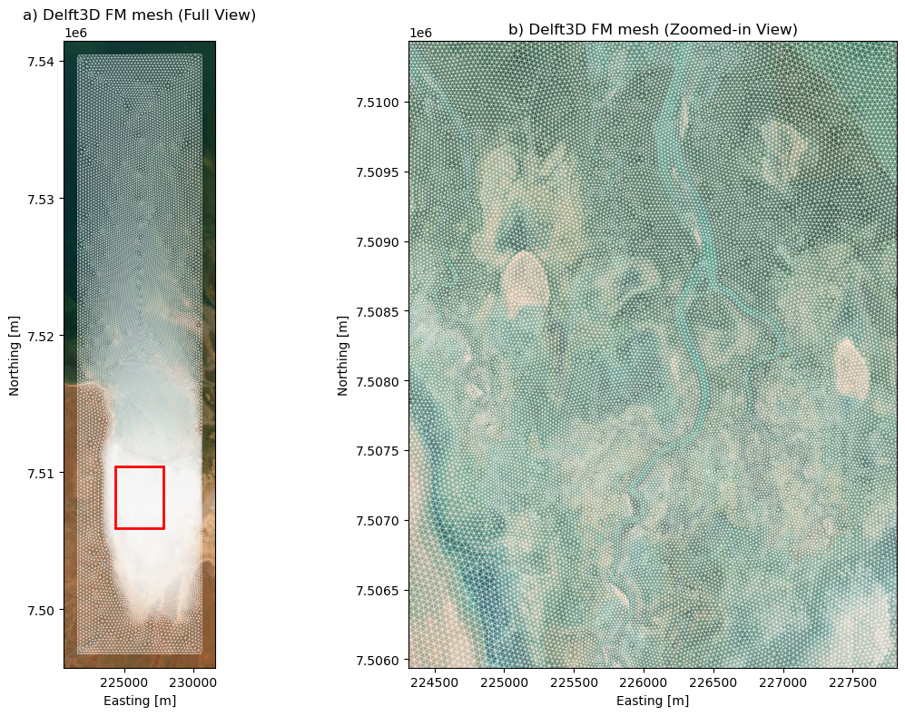
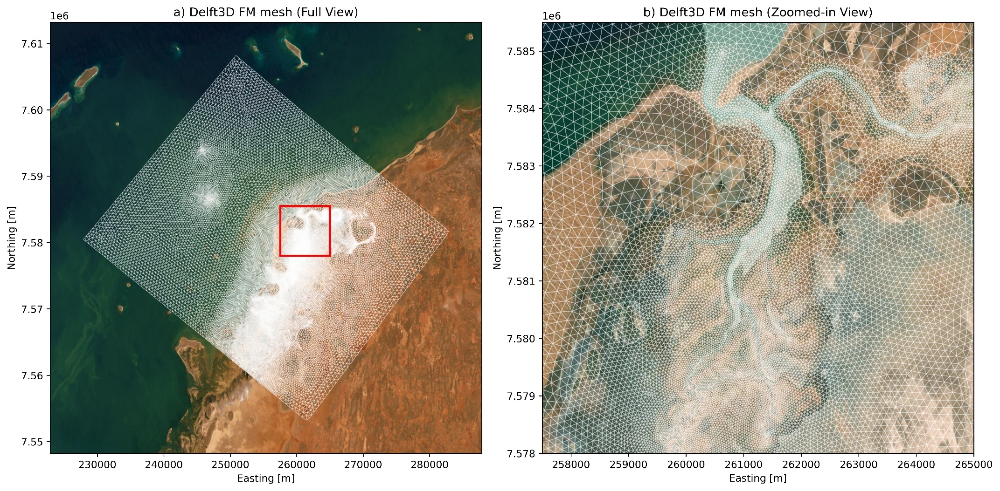
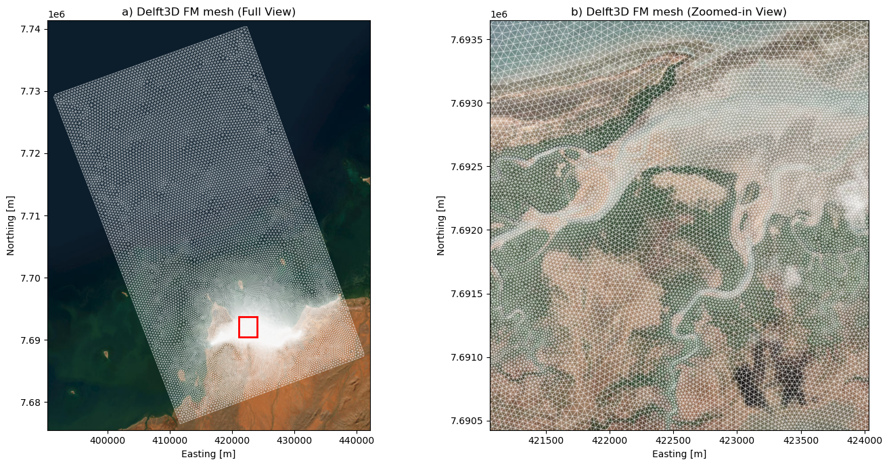
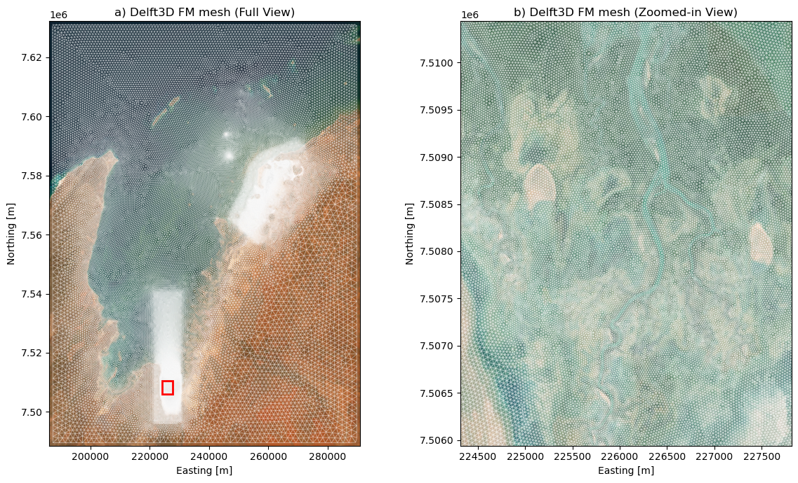
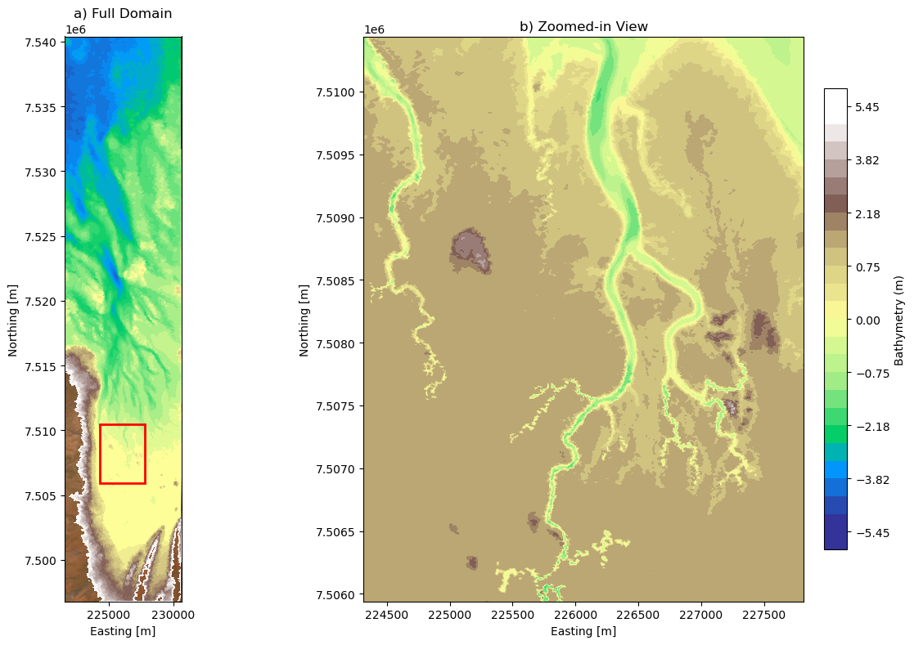
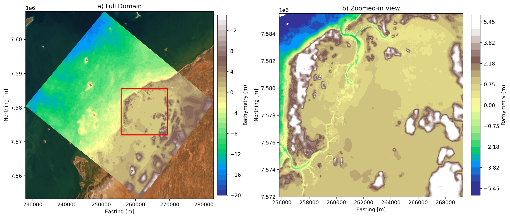
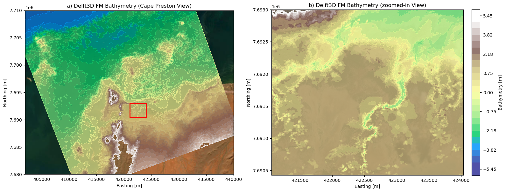
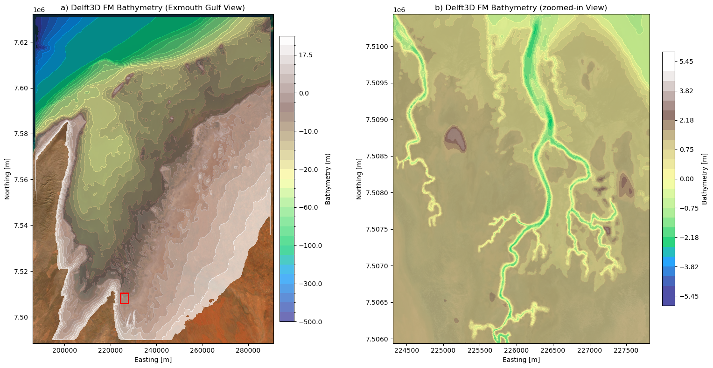
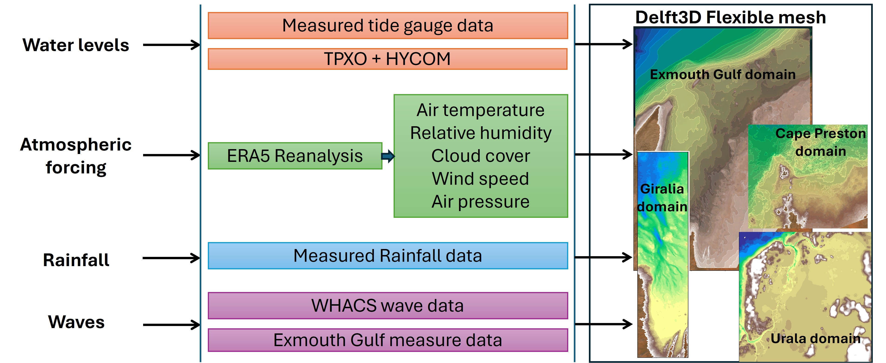

# Model Application to Study Sites {#sec-model-application}

## General

The sensitivity tests and idealised modelling presented in @sec-idealised-model demonstrated that local tidal forcing, ebb-dominant asymmetry, and initial bathymetric slope play a controlling role in governing morphodynamic evolution and habitat distribution across arid intertidal landscapes. To operationalise the insights gained from idealised modelling  and address the broader research objectives, this study adopts a staged strategy focused on three targeted sites along the West Pilbara coast: **Giralia**, **Urala**, and **Cape Preston**.

Each study site represents a distinct coastal environment and serves a specific role within the research design:

  **Giralia Domain:** Serves as the primary baseline domain for detailed model development, calibration, and baseline physical process evaluation in a relatively well-studied setting.

  **Urala Domain:** Provides a complex coastal setting with the proposed industrial footprint, serving as the core domain to investigate the hydrodynamic and ecological implications of coastal development.

  **Cape Preston Domain:** Serves as a test case to evaluate the transferability and robustness of the established modelling framework across different environmental characteristics.

While these site-specific models accurately capture ambient tidal dynamics, local creek incision, and intertidal inundation under typical conditions, understanding the long term persistence of arid intertidal habitats also requires evaluating their response to severe coastal hazards. To fully understand the broader regional marine dynamics, extreme weather phenomena (such as tropical cyclones), and open ocean wave current interactions, a standalone **Exmouth Gulf Regional Model** was developed. Coupled directly with a wave generation and propagation module (SWAN), this broader regional domain encompasses both the Giralia and Urala domains, enabling the simulation of wind wave growth, wave setup, and storm surge dynamics across the Gulf during extreme events. 

## Model Setup {#sec-model-setup}

The numerical grids were generated using the SMS grid generator and subsequently converted to the Delft3D Flexible Mesh unstructured grid format, following the UGRID convention. The resulting meshes use triangular elements with spatially variable resolution to balance computational efficiency against the need to resolve narrow tidal creeks, creek junctions, intertidal flats and complex shorelines.

Grid resolution was selected according to the spatial scales of the dominant hydrodynamic processes and the quality of the available elevation data. Coarser elements were used in open water, where water level variations generally occur over larger spatial scales. Finer elements were introduced in shallow coastal areas, creek networks and habitat transition zones, where small changes in bed elevation and channel geometry can alter flow pathways and inundation patterns.

The grid design also considered the expected future distribution of intertidal habitats under sea level rise. Areas that could become suitable for future mangrove or cyanobacterial mat development were included within the model domains, with finer resolution allocated where necessary to resolve potential migration pathways and changes in inundation. This reduces the risk of excluding potential future habitat areas from the computational domain or representing important habitat boundaries too coarsely.

The model extent was assessed against a sea level rise scenario of +1.25 m to check whether the domains included the areas potentially exposed to future inundation and habitat migration. This assessment was used to inform the domain extent and grid design. It does not, by itself, demonstrate that the model can predict future habitat migration accurately, because the reliability of those predictions also depends on the bathymetry, ecological parameterisation and future boundary conditions.

### Giralia Domain Model

#### Mesh and Setup
The grid design for the Giralia domain covers an area of approximately 44 km in length and 10 km in width. The grid consists entirely of triangular elements with variable resolutions, maintaining finer grid spacing near complex coastlines and creek systems to accurately resolve local hydrodynamic processes. Giralia is the principal model development site because of the extensive studies conducted in the area. The available high resolution topography, dedicated creek bathymetry and field observations provide a comparatively strong basis for evaluating the representation of local hydrodynamics. 

@fig-giralia-mesh a provides an overview of the full model domain, while @fig-giralia-mesh b presents a zoomed-in view of the variable-resolution mesh within the highlighted red box, highlighting the refined grid spacing in critical intertidal regions. 

{#fig-giralia-mesh}

---

### Urala Domain Model

#### Mesh and Setup
The Urala domain covers approximately 44 km in length and 35 km in width. The triangular mesh uses variable resolution, ranging from approximately 250 m in open water to 12 m near shorelines and important features such as creek mouths.

The finer resolution is required to represent the local creek network, intertidal topography and areas where proposed coastal development could change flow connectivity or restrict tidal exchange. The broader domain also provides sufficient spatial coverage to represent the local hydrodynamic response to water levels imposed at the model boundaries.

@fig-urala-mesh a provides an overview of the model domain, while @fig-urala-mesh b presents a zoomed-in view of the variable-resolution mesh within the highlighted red box, demonstrating finer grid spacing in critical regions. 

{#fig-urala-mesh}

---

### Cape Preston Domain Model

#### Mesh and Setup
The Cape Preston domain covers approximately 34 km in width and 58 km in length. As at Giralia and Urala, the grid consists of triangular elements with variable resolution. Finer elements are used around the nearshore environment, creek networks and intertidal regions where local topography influences tidal connectivity.

The principal limitation at Cape Preston is the lack of dedicated creek bathymetric survey data comparable to the Giralia survey. The channel geometry therefore cannot be constrained directly using equivalent field measurements. Instead, the creek bathymetry was idealised using the average creek width and depth derived from the Giralia bathymetric data. Satellite imagery was used to guide the representation of creek planform geometry.

This approach provides a consistent and physically informed initial representation of the creek network. However, it does not establish that the idealised channels reproduce the actual depths, cross sections or hydraulic conveyance of Cape Preston creeks. The resulting hydrodynamic and habitat predictions must therefore be interpreted in light of this uncertainty.

@fig-cp-mesh a provides an overview of the full model domain, while @fig-cp-mesh b presents a zoomed-in view of the variable-resolution mesh within the highlighted red box, showcasing the refined grid spacing across the nearshore and creek network.

{#fig-cp-mesh}

---

### Exmouth Gulf Regional Model

#### Mesh and Setup
The Exmouth Gulf regional model was developed to capture large-scale hydrodynamic processes, regional-scale tidal propagation, and extreme weather events (such as tropical cyclones and storm surges) affecting the broader regional footprint. Unlike the site-specific models focused on ambient intertidal dynamics, this regional domain spans approximately 110 km in width and 150 km in length, incorporating coupled wind-wave-current interaction modules.

The regional model's full coupled wave and hydrodynamic assessment is outside the detailed site specific calibration and future habitat prediction results presented in this report. The setup is documented here to clarify its role in the overall modelling framework.

@fig-eg-mesh a provides an overview of the full model domain, while @fig-eg-mesh b presents a zoomed-in view of the variable-resolution mesh within the highlighted red box, highlighting the refined grid spacing in shallow coastal regions.

{#fig-eg-mesh}

---

## Data Requirements and Model Forcings {#sec-data-forcings}

Reliable hydrodynamic and habitat predictions require suitable input data, appropriate physical parameterisation and boundary forcing that represents the conditions experienced by each model domain. This is especially important in the West Pilbara, where the intertidal landscape contains shallow channels, extensive exposed flats, hypersaline environments and relatively small elevation differences between habitat zones.

The principal data requirements are:

1. Continuous and spatially consistent bathymetry and topography to define the geometry of the computational domain.
2. Appropriate grid resolution to represent tidal creeks, intertidal surfaces and potential future habitat areas.
3. Time varying water level and meteorological forcing to reproduce the hydrodynamic conditions acting on each domain.
4. Bed roughness and vegetation properties to represent the resistance exerted by the seabed and vegetation on tidal flows.
5. Field observations to evaluate model performance and identify uncertainty in the simulated water levels and inundation patterns.
   
The following sections describe the data sources, explain why they were selected, and distinguish between directly measured information and model assumptions.

### Bathymetry and Topography
Bathymetry and topography across all domains were derived by integrating multiple spatial elevation datasets to ensure a smooth, physically consistent transition between terrestrial elevations and marine environments:

* **LiDAR Topography:** High-resolution elevation surveys for all sites were conducted by the University of Western Australia (UWA).
  
* **Creek Bathymetry Surveys:** Multibeam and single-beam bathymetry surveys dedicatedly conducted for the Giralia domains, alongside existing UWA survey data for Urala. Where dedicated surveys were unavailable (Cape Preston), creek bathymetry was idealised using planform geometry derived from satellite imagery and cross-sectional profiles scaled from the Giralia domain.
  
* **Satellite-Derived Bathymetry (SDB):** 30m resolution satellite-derived bathymetry from the @Blake2020 model was incorporated to provide additional coverage in areas where LiDAR and creek bathymetry were unavailable or incomplete.
  
* **Digital Earth Australia (DEA) Intertidal Bathymetry:** Satellite derived intertidal datasets (@Bishop-Taylor2019;@Bishop-Taylor2024) were incorporated to bridge terrestrial LiDAR and SDB within intertidal zones.

Integrated bathymetric surfaces for each domain are presented in @fig-giralia-bathy, @fig-urala-bathy, @fig-cp-bathy, and @fig-eg-bathy.

{#fig-giralia-bathy}

{#fig-urala-bathy}

{#fig-cp-bathy}

{#fig-eg-bathy}

The datasets differ in spatial resolution, acquisition method and the physical environments they represent. Their integration therefore requires attention to horizontal reference systems, vertical datums, elevation sign conventions, spatial coverage and the treatment of overlapping cells. A continuous gridded surface does not necessarily imply that all elevations have the same accuracy.

The fine resolution LiDAR and creek bathymetric data provide the principal constraints on local terrain and channel geometry. The coarser satellite derived datasets extend coverage into areas where equivalent high resolution survey data are unavailable. Where datasets overlap, their relative reliability and suitability for the local environment should guide the merging procedure.

The Cape Preston bathymetry introduces additional uncertainty because its creek dimensions are based on an analogue from Giralia rather than direct survey measurements. Differences in sediment composition, tidal range, creek evolution and channel morphology may result in different hydraulic behaviour at Cape Preston. The model therefore provides a scenario based application of the framework rather than a fully survey constrained representation of the local creek network.

The elevation datasets also have implications for future habitat prediction. Where the predicted migration of mangroves or cyanobacterial mats depends on subtle elevation differences, uncertainty in the merged surface can affect the simulated timing and spatial extent of habitat establishment. These limitations should be considered alongside the uncertainty associated with future water levels, roughness and vegetation representation.

### Model Forcings and Boundary Conditions

Hydrodynamic model performance depends on both the representation of the underlying bed and the forcing conditions imposed on the model. The forcing must reproduce the relevant variations in water level and atmospheric conditions over the simulation period. It is important to highlight that a detailed elevation model cannot compensate for inappropriate boundary conditions, while accurate forcing cannot compensate for unresolved creek geometry or incorrect habitat resistance.

The forcing strategy distinguishes between regional forcing, which establishes the large scale hydrodynamic conditions, and local forcing, which is used to represent the conditions acting on individual site models. The selection of each forcing dataset was guided by its ability to represent the relevant physical process, its temporal coverage and its suitability for the spatial scale of the model.

To accurately drive regional and local hydrodynamics, several physical boundary conditions and forcing parameters were incorporated.

#### Water level and tidal forcing

Water level forcing was treated differently for historical model calibration and future predictions. During the historical modelling period, measured water levels were used to force the model and to evaluate its performance against observations. The measured water level records were compared with simulated water levels at multiple locations within the Giralia and Urala domains. This approach allowed the model to be assessed against the observed tidal signal and its temporal variability across each domain, rather than relying solely on agreement at a single boundary location. The measurement locations and associated field data are described in Appendix A, while the calibration and validation procedures and results are presented in @sec-giralia-model and @sec-urala-model, respectively.

Measured water levels were particularly important for establishing confidence in the model's representation of local hydrodynamics. Unlike astronomical tide predictions alone, observed water levels can incorporate the combined effects of astronomical tides and non tidal variations present during the measurement period, including those associated with atmospheric pressure and wind. Using measured water levels during calibration therefore provided a basis for assessing whether the model could reproduce observed water level variations under the conditions represented by the field record.

Alternative water level products were also considered during the assessment of boundary forcing. These included the TPXO global ocean tide model and sea surface height (SSH) data from the Hybrid Coordinate Ocean Model (HYCOM). TPXO provides harmonic tidal constituents derived through inverse modelling and assimilation of observational data (@EgbertErofeeva2002). It is therefore useful for estimating the astronomical tidal signal where local observations are unavailable. However, its predicted astronomical tides do not, by themselves, reproduce the full non tidal water level variability recorded during individual weather events.

HYCOM provides modelled sea surface elevation as part of a broader ocean modelling system (@Chassignet2009). The SSH variable was considered as an alternative representation of time varying offshore water levels. Depending on the product and configuration, HYCOM SSH can represent ocean variability beyond the astronomical tide, but its spatial resolution, coastal representation and temporal characteristics may limit its ability to reproduce water levels within shallow, complex intertidal environments. TPXO and HYCOM SSH were therefore evaluated as alternative sources of water level information, rather than assumed to provide an equivalent representation of the local observed water levels.

The historical sensitivity evaluations indicated that measured water levels provided a better representation of the observed conditions than the tested TPXO and HYCOM SSH products. The measured records (Exmouth tide gauge data and Onslow tide gauge data) were consequently used to support historical calibration and model performance assessment. This comparison informed the selection of forcing for the historical simulations but did not mean that measured water levels were available or appropriate for future prediction periods.

For future predictions, the models were forced using the MSKO tidal constituent configuration described in @sec-approach. 

#### Atmospheric forcing

Atmospheric forcing was derived from the ERA5 reanalysis dataset described by @Hersbach2020. The meteorological variables used in the model include spatially varying wind speed and direction (represented as x and y direction), spatially uniform air temperature, relative humidity, and cloud cover, while for the regional model we also considered the atmospheric pressure.

#### Heat flux and evaporation

Heat exchange was represented using the meteorological variables supplied to the Delft3D Flexible Mesh heat flux formulation. Air temperature, relative humidity, cloud cover, atmospheric pressure and wind speed influence the exchange of heat and moisture between the water surface and the atmosphere.

Evaporation was calculated dynamically using bulk aerodynamic relationships (@Deltares2024) within the selected heat flux configuration. This approach allows evaporation to vary with the atmospheric conditions rather than prescribing a single constant rate throughout the simulation.

This treatment is relevant to the hyper arid West Pilbara environment, where high temperatures, strong solar heating and low humidity can contribute to substantial evaporative water loss which can influence the percentage of submergence and inundation frequencies that are used for habitat prediction purposes.

It is important to note that the use of a heat flux formulation does not mean that groundwater discharge, subsurface salt transport or hypersaline porewater dynamics are explicitly represented. Those processes require additional data and model components. The current setup should therefore not be interpreted as a complete simulation of the subsurface hydrological processes that may affect mangrove establishment on hypersaline salt flats.

#### Rainfall

Measured daily rainfall data from the learmonth airport and Onslow airport were incorporated during the calibration period. 

#### Wave forcing

Wave conditions were represented using outputs from WHACS wave modelling (@Smith2025), with local wave observations in Exmouth Gulf used where available. As highlighted in @sec-approach, we did not consider waves for the habitat future predictions however, included for extreme event case studies where waves can influence nearshore circulation and coastal water levels through wave driven setup, while wave generated bed stresses may affect sediment transport and intertidal morphology. 

Wave forcing is therefore relevant to the regional model's assessment of extreme coastal conditions. It also provides a basis for investigating how wave conditions interact with the tidal signal across the coastal domain.

An overview of the spatial domains and numerical model forcing datasets is illustrated in @fig-bc-2023.

{#fig-bc-2023}

### Field Data Collection Campaign
Field collected hydrodynamic data—primarily continuous water level time series—were utilised for model calibration and validation. A comprehensive monitoring campaign was conducted across the study regions from **November 2023 to February 2025**, capturing ambient, spring-neap, and extreme event dynamics. For detailed information regarding field campaign design, sensor specifications, deployment locations, and data processing methodologies, readers are referred to @sec-appendixA. 

### Bed Roughness and Vegetation Parameterisation

Flow resistance across diverse intertidal and benthic habitats was parameterised using baseline habitat mapping derived from Project A [@Hickey2025]. Habitat maps do not directly provide Manning's roughness coefficients. The mapped habitat classes must therefore be translated into numerical roughness classes that can be assigned to the hydrodynamic mesh. This translation is a model parameterisation step and involves assumptions about the hydraulic resistance associated with each habitat type. For calibration simulations, spatially varying Manning’s roughness coefficients ($n$) assigned by habitat type based on existing literatures [@Vulliet2023;@Kumbier2022;@Medeiros2023;@Arefin2026;@Rodriguez2017], as summarised in @tbl-roughness.

| Habitat / Topographic Type | Manning's Roughness Coefficient ($n$) |
|:---|:---:|
| **Water & Offshore Region** | 0.023 |
| **Cyanobacterial Mat** | 0.030 |
| **Salt Flat** | 0.045 |
| **High Intertidal Flat** | 0.050 |
| **Unvegetated Sand** | 0.060 |
| **Mangrove** | 0.120 |

: Adopted Manning's Roughness Coefficients across Habitat Types {#tbl-roughness}

For predictive future habitat simulations where habitat distributions evolve over time, a uniform baseline bed roughness of $n = 0.023 \text{ s m}^{-1/3}$ was applied across domains, with vegetation-induced flow resistance introduced dynamically via Baptist canopy formulations.

In addition to habitat mapping derived roughness, LiDAR derived vegetation properties were used to represent vegetation influences in the model. The vegetation data provide spatial information that can be used to characterise the structure of vegetated areas more explicitly than a habitat label alone. The relevant properties and processing procedures are documented in @sec-appendixA.

---

## Chapter Summary and Scope {#sec-chapter-summary}

This chapter established the multi-scale numerical modelling framework, computational mesh configurations, and data forcing inputs across the four study domains. 

To maintain clarity and alignment with project priorities, detailed hydrodynamic calibration, validation metrics, and habitat migration results presented in the remainder of this report focus exclusively on the three site-specific models (Giralia, Urala, and Cape Preston).
