# Idealised modelling {#sec-idealised-model}

## General

As the coupled flow, sediment transport, and vegetation modules involve numerous empirical parameters, direct calibration within a complex, site-specific domain introduces significant ambiguity. It is often difficult to distinguish whether variations in model performance stem from underlying physical settings or from confounding domain characteristics such as irregular bathymetry. 

To address this and support rigorous developmental purposes, exploratory models provide an effective framework for isolating and understanding these physical processes without site-specific noise. In this chapter, we use an **idealised model configuration** to systematically evaluate and optimise sediment transport formulations, boundary conditions, and vegetation settings through a three-stage approach.

First, we examine the effects of key environmental forcings on tidal-flat morphology using a simplified, constant-slope idealised domain to identify the hydrodynamic drivers most relevant for regional-scale representation. Next, we advance to a Giralia-based idealised model using site-derived boundary conditions to investigate the influence of sediment dynamics, with particular emphasis on sand–mud interactions, critical shear stress for mud erosion, and mud supply. Finally, following the framework described in @sec-approach and @sec-model-overview, we integrate an idealised ecomorphodynamic model based on Giralia conditions to assess how variations in mangrove biological properties influence long-term tidal-creek morphological evolution and also mangrove model properties

## Idealised hydromorphodynamic model

Intertidal flats form the transition between the ocean and the land and are periodically exposed between the lowest and highest astronomical tides. Their morphology is shaped by interactions among coastal hydrodynamics, sedimentary processes, and biological activity. The morphological evolution of tidal flats can be characterised in terms of profile shape, bed slope, and sediment properties, which vary systematically with sediment supply, wave conditions, and tidal forcing [@friedrichs2011]. When averaged over annual or longer timescales, tidal-flat morphology may approach a state of dynamic equilibrium with the prevailing external forcing. For example, tide-dominated environments generally favour convex-upward tidal-flat profiles, whereas wave-dominated environments tend to produce concave profiles [@Friedrichs2001]. @friedrichs2011 summarised the effects of different environmental drivers @fig-convex_concave_summary on tidal-flat profiles, showing that increased tidal range, decreased wave height, increased sediment supply and faster flooding tides tend to develop convex-up profiles, whereas decreased tidal range, increased wave, decreased sediment supply and faster ebbing tides are more likely to exhibit concave-up profiles, vice versa .

The Pilbara coast of Western Australia is characterised by considerable spatial variability in tidal forcing, bed profiles, sediment composition, and sediment availability. To support the development and interpretation of regional morphodynamic models for sites along the Pilbara coast, including Giralia, Urala, and Cape Preston, it is necessary to understand how tidal-flat morphology responds to these environmental drivers.

Understanding this morphological response is a crucial factor that requires careful model calibration. However, spatially varying sediment-related information along the region remains limited, despite the availability of localised point data at Giralia and Urala. Calibrating the morphodynamic model is therefore essential to ensure that simulated morphological responses to future sea-level rise can be trusted. To determine and justify these morphodynamic parameters on sound physical grounds, this study resorts to idealised modelling. Specifically, this chapter uses schematised bathymetry and tidal forcing to systematically investigate the morphological responses of tidal flats under different environmental conditions.

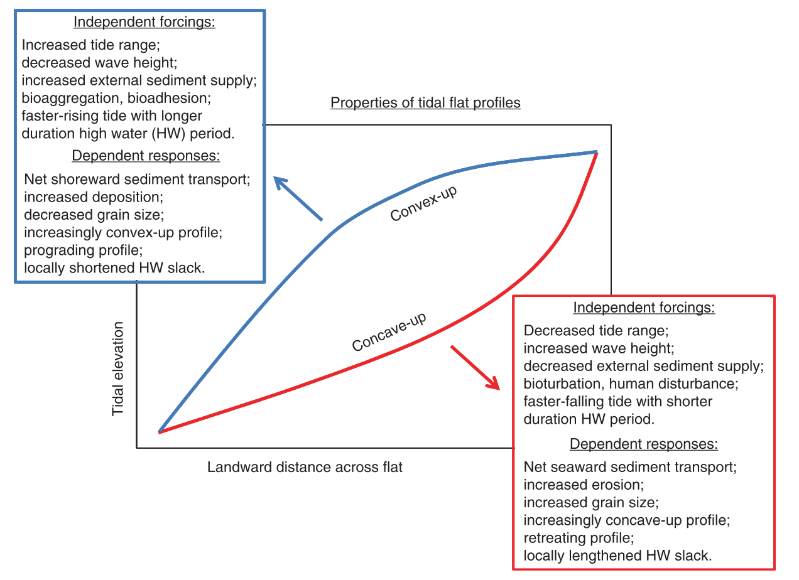{#fig-convex_concave_summary fig-align="center" width="656"}

### Model settings

The exploratory model was run by Delft3D Flexible Mesh, using the D-Flow and D-Morphology module to simulate hydrodynamics and sediment transport. The model was run in a two-dimensional (depth-averaged) domain $2\times 20\ \mathrm{km}$ with an offshore open boundary, using a rectangular grid size of $50 \times 50\ \mathrm{m}$ @fig-idealised-model-domain. The offshore open boundary was driven by tidal constituents, e.g. M2 and M4, and the lateral and offshore boundaries were closed to ensure model stability. The model bathymetry was featured by alongshore uniform slope of 0.07%. An further mild slope of 0.035% on the high intertidal flat was applied to the model for initial bed profile sensitivity test. The initial bed level at the open boundary was set to-7m relative to mean sea level (MSL) to ensure that cross-shore tidal movement would not be obstructed by the landward boundary. Random perturbations of $5\ \mathrm{cm}$ were superimposed on the bathymetry to initiate simulations.

Both sand and mud were considered in the idealised model. Sand transport followed the formulation of [@vanrijn1993], with the median grain size of 0.25mm. Mud transport was computed using the Partheniades' equation [@sanford1993; @JC2007], with settling velocity of 0.25 mm/s and critical erosion shear stress of 0.1Pa. Bed friction was represented by a uniform Manning's friction coefficient of 0.023 $s\ m^{-1/3}$ . A constant mud supply was imposed at the open boundary. To accelerate morphological response to hydrodynamics, a morphological accelerator Morfac of 50 was used in this model.

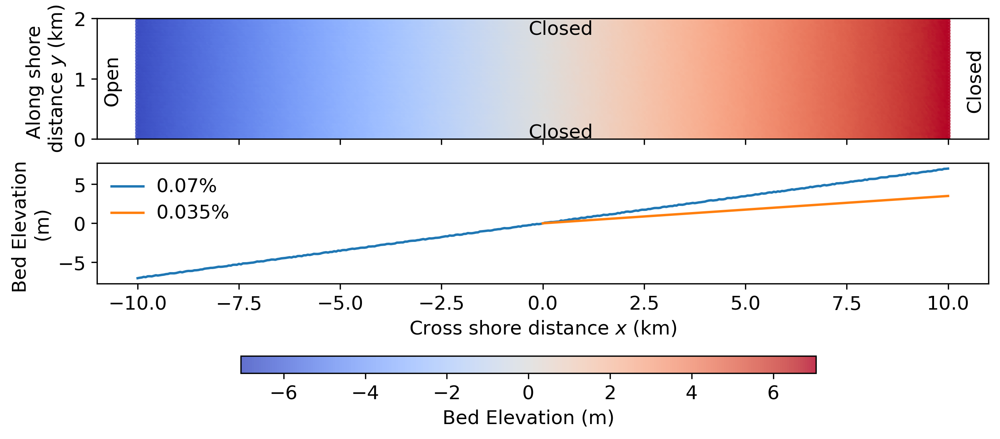{#fig-idealised-model-domain width="707px"}

### Scenarios design

The scenarios were designed to investigate morphological responses to variations in tidal range, tidal asymmetry, initial bed profile, sediment composition, and mud concentration. Runs 1–3 examined tidal ranges of 0.8, 1.5, and 3.0 m, representing microtidal, mesotidal, and macrotidal regimes, respectively. Because the study sites along the Pilbara coast of Western Australia are characterised by a mesotidal regime, a tidal range of 1.5 m was adopted for the subsequent scenarios.

Tidal asymmetry in Runs 4 and 5 was generated by combining the principal lunar semidiurnal constituent, M2, with its first overtide, M4. A relative phase difference of $2\varphi_{M4} - \varphi_{M2}=90 ^\circ$ represented flood-dominant conditions, whereas a phase difference of $270^\circ$ represented ebb-dominant condition. Here, $\varphi_{M4}$ and $\varphi_{M2}$ denote the phases of constituents M4 and M2, respectively. For simplicity, $\varphi_{M2}=0^\circ$ in all scenarios

A gentle upper-intertidal slope of 0.035%, representing a convex-upward profile, was applied to the flood- and ebb-dominated conditions in Runs 6 and 7, respectively. The influence of sediment composition was examined in Runs 8 and 9, in which the mud fraction was increased to 20% and reduced to 0%, respectively. Run 9 therefore represented a purely sandy substrate. In Run 10, the suspended mud concentration at the boundary was increased from 5 to 10 mg L$^{-1}$ to investigate the influence of sediment availability on tidal-flat morphology.

| Run | Tidal Range (m) | Tidal Asymmetry | Bed slope | Mud fraction (Volume) | Mud concentration (mg/l) |
|:----------:|:----------:|:----------:|:----------:|:----------:|:----------:|
| 1 | 1.5 | Symmetric M2 | 0.07% | 10% | 2.5 |
| 2 | 3 | Symmetric M2 | 0.07% | 10% | 2.5 |
| 3 | 4 | Symmetric M2 | 0.07% | 10% | 2.5 |
| 4 | 3 | Flood-dominated M2-M4 | 0.07% | 10% | 2.5 |
| 5 | 3 | Ebb-dominated M2-M4 | 0.07% | 10% | 2.5 |
| 6 | 3 | Flood-dominated M2-M4 | 0.07%+0.35% | 10% | 2.5 |
| 7 | 3 | Ebb-dominated M2-M4 | 0.07%+0.35% | 10% | 2.5 |
| 8 | 3 | Symmetric M2 | 0.07% | 20% | 2.5 |
| 9 | 3 | Symmetric M2 | 0.07% | 0% | 2.5 |
| 10 | 3 | Symmetric M2 | 0.07% | 10% | 5 |

: Parameters for idealised model scenarios {#tbl-idealised-model-scenarios}

### Results

#### Morphology

@fig-ideal-morpho-results presents the morphological changes after 200 years of simulation under different environmental forcing conditions. Panels (a)–(c) of @fig-ideal-morpho-results, together with @fig-ideal-crossprofile a, illustrate the influence of tidal range on morphological evolution and the mean cross-sectional profile. As the tidal range increased, the accretion zone in the upper intertidal area, where the bed elevation was above 0 m, extended farther landward. Both the width and magnitude of deposition also increased with tidal range. In contrast, deposition in the subtidal and lower-intertidal zones, where the bed elevation was below 0 m, gradually diminished. Under a tidal range of 4 m, erosion became more pronounced and braided channels developed within these zones.

When tidal asymmetry was introduced, substantial morphological differences developed despite only minor changes in tidal range. Compared with the tidally symmetric case, flood-dominant conditions produced a broad depositional zone extending across the entire intertidal platform, between low- and high-water levels, and promoted the formation of two distinct channels. In contrast, ebb-dominant conditions caused pronounced erosion in the subtidal zone and generated a more complex, braided channel network. Changes in the mean cross-sectional profiles were also consistent with previous studies [@pritchard2002], which showed that flood dominance accelerates the landward progradation of tidal-flat profiles, whereas ebb dominance promotes their recession.

The initial bathymetry plays a crucial role on morphological evolution. Compared with morphological changes in Run 5, reducing slopes in the upper intertidal results in more significant channel-shoal patterns grown in ebb dominance. However, tidal channels under flood dominance do not become longer with increased depositional extent. This is because when the upper slope becomes milder, the intertidal storage becomes larger. With larger intertidal storage, the filing and draining of intertidal areas will slow the landward propagation of high tide relative to low tide. Low tide will partially catch up with high tide and the temporal transition from high to low water will be shortened, resulting in a quicker falling tide and a tendency towards ebb dominance over the flats. Consequently, channels under flood dominance are shortened while under ebb dominance are enhanced.

Increasing or decreasing the mud fraction of the sediment substrate did not substantially alter the extent of the depositional zone. However, a more mud-rich substrate resulted in slightly greater erosion in the subtidal and lower-intertidal zones. A similar response was observed when the mud supply from the open boundary was varied. Increasing the suspended mud supply produced a wider and more elevated depositional zone in the upper intertidal area, while morphological changes in the subtidal and lower-intertidal zones remained limited.

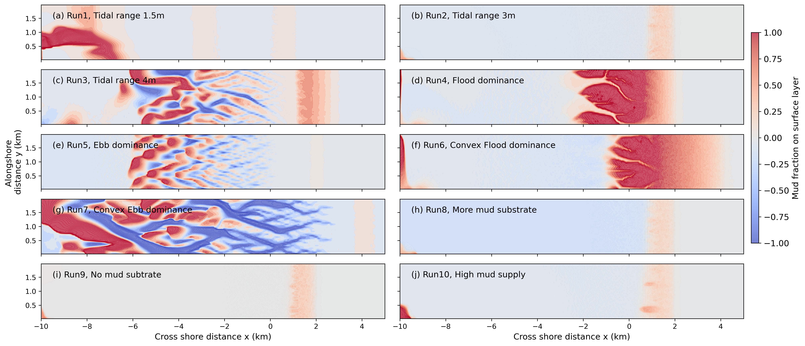{#fig-ideal-morpho-results width="100%"}

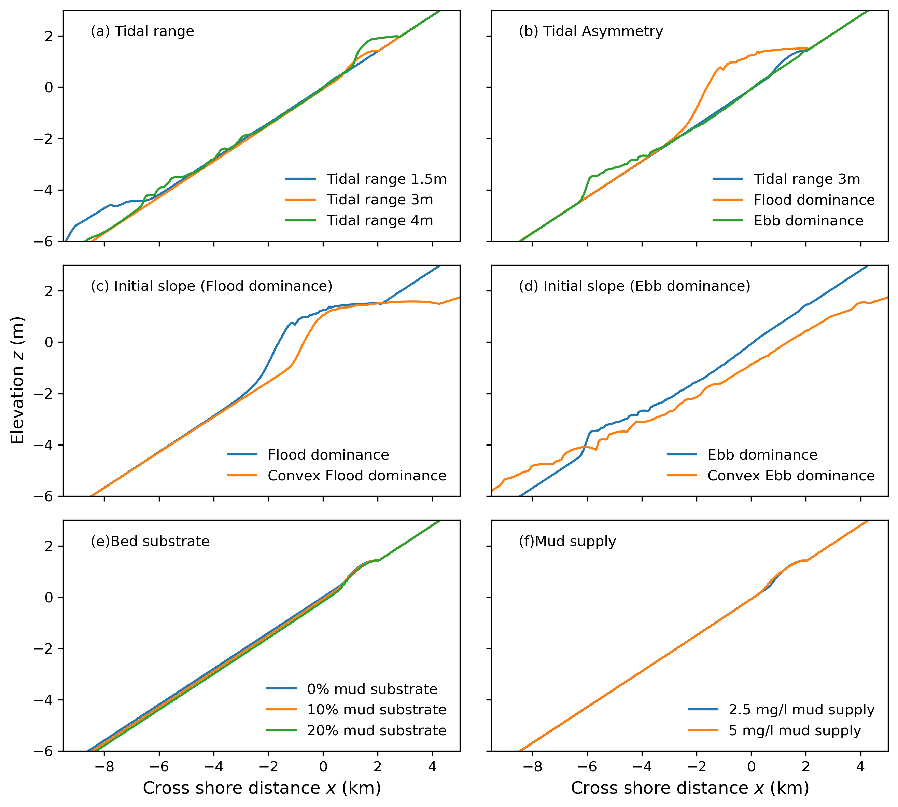{#fig-ideal-crossprofile width="100%"}

#### Sediment redistribution

Muddy zones, defined as areas with a mud fraction greater than 30%, developed primarily in the upper intertidal zone. The only exception was the microtidal case (Run 1), in which weaker tidal currents allowed suspended mud to settle at lower elevations. As tidal range increased, the muddy zones expanded and their mud content generally increased.

Tidal asymmetry strongly influenced sediment redistribution. Under flood-dominant conditions, extensive muddy deposits developed across the upper intertidal zone, and the channels also contained a higher proportion of mud. In contrast, ebb-dominant conditions produced only limited muddy deposits and a more extensive sandy area in the subtidal and lower intertidal zones. The channel–shoal patterns observed in @fig-ideal-morpho-results e were primarily associated with sand erosion. When a gentler initial upper-intertidal slope was applied, mud was transported farther landward, resulting in a broader depositional zone under both flood- and ebb-dominant conditions. However, the gentler slope also enhanced ebb-directed flow. Under ebb-dominant conditions, this caused greater sand erosion and produced the wider and deeper channel networks shown in @fig-ideal-morpho-results g.

Variations in the initial mud fraction of the sediment substrate produced similar muddy-zone distributions across the intertidal platform. This suggests that most of the deposited mud originated from the continuous suspended-sediment supply at the open boundary rather than from the initial bed composition. This interpretation is further supported by the comparison between @fig-ideal-mudfrac-results b and @fig-ideal-mudfrac-results j, in which doubling the mud concentration at the open boundary resulted in a substantially wider muddy zone.

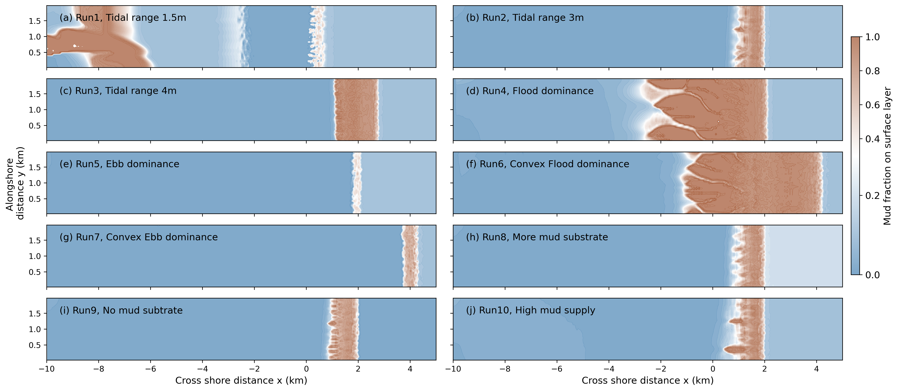{#fig-ideal-mudfrac-results width="100%"}

### Implications for regional hydromorphodynamic modelling

Our sensitivity tests using the schematised idealised model demonstrate that external environmental drivers play a dominant role in controlling morphological evolution and sediment redistribution. The results show that tidal range, tidal asymmetry, and the initial bed profile strongly influence morphological development and mud distribution, whereas the effects of initial substrate sediment composition and mud supply at the open boundary are comparatively limited. Therefore, when applying the morphodynamic model to tide-dominated real-world systems, accurate representation of local tidal conditions and bathymetry should be prioritised. Sediment composition and boundary mud supply can be considered secondary factors in model parameterisation.

From @sec-controls, we know that the Pilbara Coast is a well-sheltered micro- to meso-tidal system, featured with ebb-dominated tides (stronger ebbing tide than flooding tide), and low sediment supply from the open boundary as well as relatively mild bathymetric slopes. These features are similar to settings in Run 7. For regional-scale morphodynamic models in Grialia, Urala and Cape Preston, we incorporated multiple tidal constituents, including M2, S2, O1, and K1, to represent an ebb-dominated tidal asymmetry and to reproduce spring–neap variability, thereby providing a more realistic representation of natural tidal conditions. Here, tidal asymmetry was induced by interaction between M2, O1 and K1 interaction [@song2011]. For further details on the selection and justification of morphodynamic model parameters, readers are referred to @sec-appendix-c.

Biological processes, such as bioturbation and bioadhesion, can further modify these profile shapes by either enhancing or reducing their convexity or concavity. As discussed previously, the Pilbara Coast is a well-sheltered, tide-dominated environment. Extensive mangrove forests occur along the fringing coast and tidal channels, where they act as natural buffers by reducing flow energy and stabilising channel banks. Therefore, biological processes, particularly the effects of mangrove vegetation, need to be properly represented in morphodynamic modelling of the Pilbara Coast.

## Giralia-based Idealised hydromorphological model

### Introduction

The exploratory idealised model presented in the previous section provided insights into the roles of tidal range, tidal asymmetry, and initial bathymetry in shaping tidal-flat morphology. Building on these findings, we developed a more realistic idealised model based on measured bathymetry and tidal conditions from Giralia Bay. Because the spatial distribution of sediment properties is not well constrained, we conducted sensitivity analyses on key sediment parameters, including the critical shear stress for mud erosion and sand–mud interactions. The initial development of this modelling framework was led by our collaborators at Deltares.

### Model settings

To capture the extent of one of the main tidal creeks in the Giralia area, a rectangular computational grid is constructed with a length of 15 km (longshore) and a width of 1.5 km (cross-shore). The grid has a resolution of dx=dy=15 meter, which ensures the main channel is represented by at least one cell (at the landward end) and more than 15 cells at the seaward end. The initial bathymetry is assumed alongshore uniform with a convex profile shape that is associated with muddy coastlines. The following function is used to describe the cross-shore bathymetry:

$$z(y)=a*e^{b-c*y}+d$${#eq-idealised-bathymetry}

here $z(y)$ is the bed level at a certain distance y, and $a=-0.730, b=0.0351, c=-1.65e^{-4}, d=3.50$ derived from Giralia Bay Bathymetry. In this model,the vertical datum of the bathymetry data is 1.45 meter above Mean Sea Level.

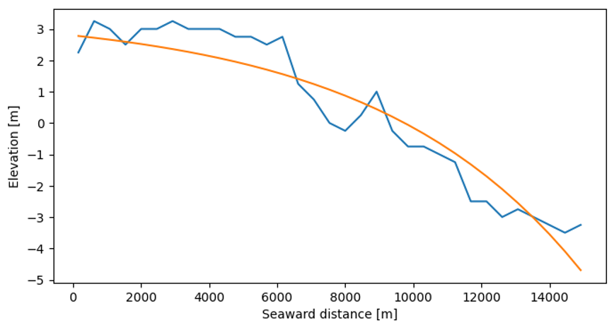{#fig-idealised-bathymetry}

#### Boundary conditions

Tidal forcing is imposed on the seaward end of the domain, other boundaries are closed for model stability. Tidal components are obtained from the TPXO8 global tide database and can be found in the following table. The constituents with amplitude smaller than 0.1m are considered insignificant and therefore neglected, leaving M2, S2, O1, K1. The difference between the bathymetry datum and mean sea level (1.45m) is prescribed as an A0 component.

| Constituent | Amplitude (m) | Phase (deg) |
|-------------|---------------|-------------|
| M2          | 0.94          | 109.3       |
| S2          | 0.35          | -179.7      |
| O1          | 0.13          | -170.5      |
| K1          | 0.20          | -158.8      |
| A0          | 1.45          | \-          |
: Tidal constituents used for the idealised model, obtained from TPXO8 global tide database. {#tbl-idealised-tidal-constituents}

### Scenarios design

The model is run for three hydrodynamic years and a morphological acceleration factor (MorFac) of 50, resulting in 150 years of morphological development. With the aim of first attaining morphological equilibrium, no sea-level rise is imposed. We investigate the model sensitivity to erosion by first evaluating the effect of sand-mud erosion interaction (using $\tau_e=0.5 N/m^2$). Thereafter, the critical bed shear stress for erosion of mud is varied between $0.125N/m^2$ (easily eroded) and $2.0N/m^2$(consolidated mud).

### Results

#### Effect of sand-mud erosion interaction ($\tau_e=0.5 N/m^2$)

The morphological development without sand-mud erosion interaction is gradual in the simulated 150 morphological years. The width-averaged elevation shows erosion between +2 m (y \~ 4000 m) and 0 m (y \~ 10000m) and accretion between 0 m (y\~10000) and – 2.5 m (y\~13000). One main channel has formed in the simulated period. Mud erodes only for $\tau > \tau_e=0.5 N/m^2$, conditions that do not occur often (see later, ). Therefore,mud fraction increases in the erosion zone as mud in the bed is immobile and sand is eroded, whereas mud fraction decreases in the deposition zone as sand is deposited and mud immobile, see @fig-mud_frac_no_interaction. This leads to a stabilization of the eroding zone as the higher mud-content increases the critical bed shear stress for erosion of sand. When channels start forming, higher flow velocities occur in the deeper parts and will exceed the erosion threshold for mud (occasionally). This does not occur on the shallower parts adjacent to the channels and mud accumulates there.

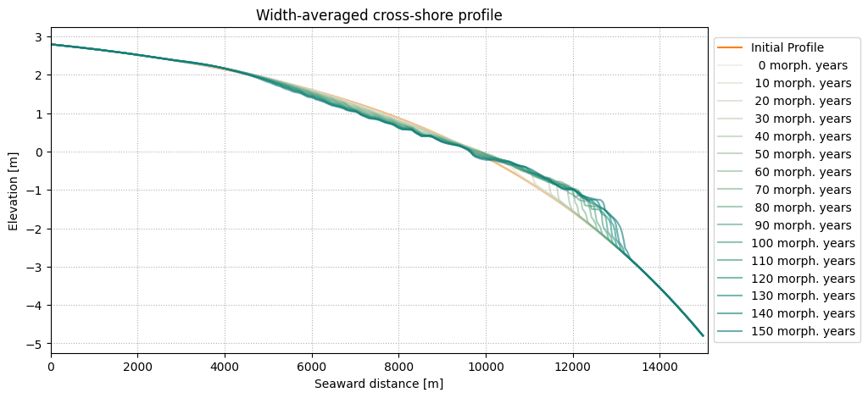{#fig-idealised-profiles-no-interaction fig-align="center" width="655"}

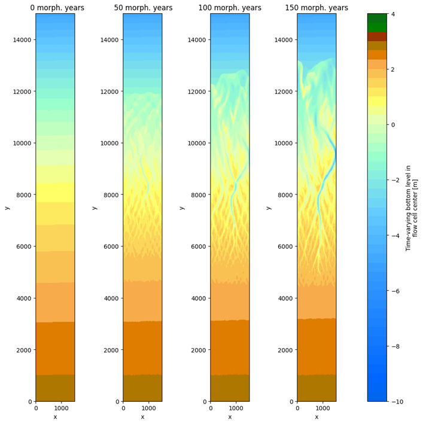{#fig-idealised-bed-level-no-interaction fig-align="center" width="600"}

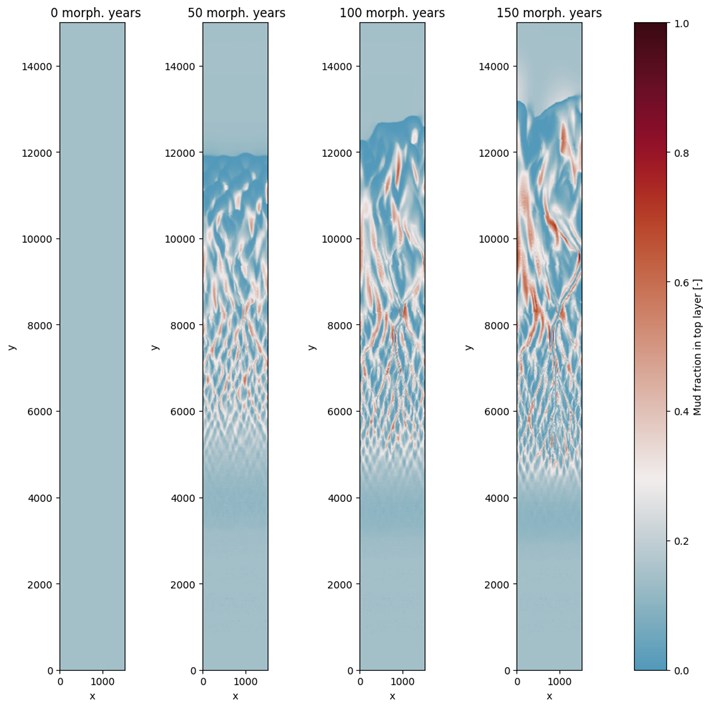{#fig-mud_frac_no_interaction fig-align="center" width="600"}

Significant increase in morphological development occurs when accounting for sand-mud erosion interaction. The erosion and deposition zones, while on similar location, are larger and show greater change compared to the simulation without interaction, see @fig-profiles-with-sm-interaction. Large tidal channels have formed after 50 morphological years which develop until (and after) 150 morphological years, and are flanked by shallower shoals, see @fig-morpho-sm-interaction. Significant bodies of sand are deposited towards the seaward end of the domain that raise the local bed level. The mud-content reflects the channel-shoal dynamics, with muddy zones (red in @fig-mudfrac-sm-interaction) near the landward end and on the channel banks, where flow velocities are small. Furthermore, another muddy zone is at the offshore boundary where mud enters the domain and flow velocities are small. The mixture approach allows for erosion of both sand and mud, even when the critical erosion of (pure) mud $\tau_e=0.5 N/m^2$ is not exceed. The result is a more dynamic channel-shoal system.

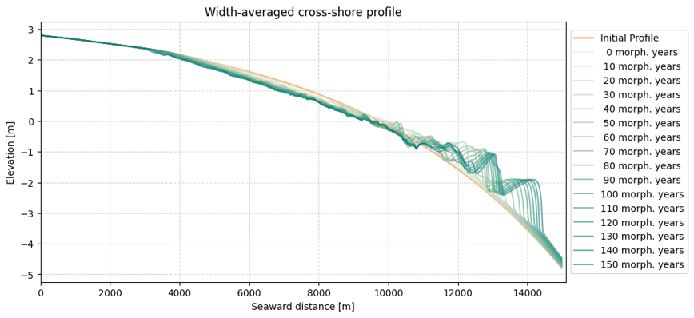{#fig-profiles-with-sm-interaction fig-align="center" width="654"}

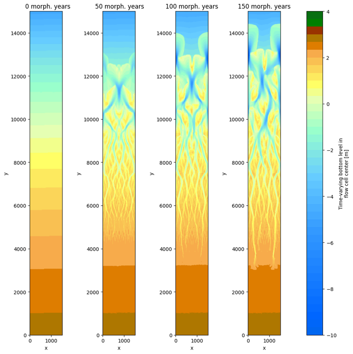{#fig-morpho-sm-interaction fig-align="center" width="600"}

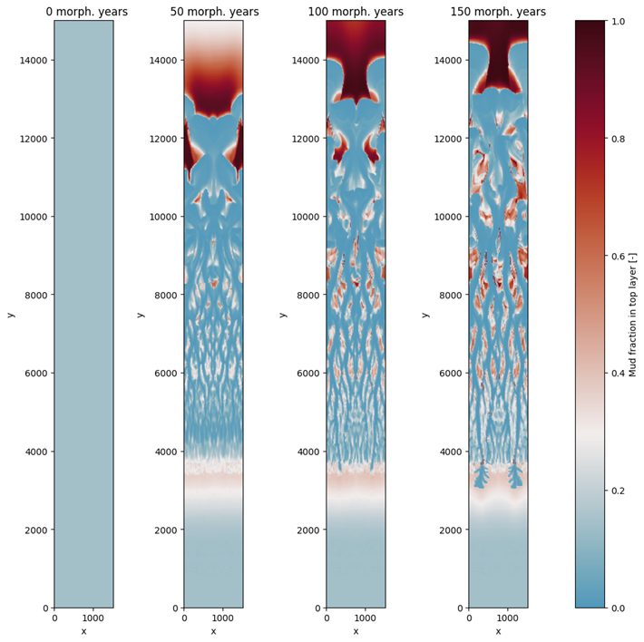{#fig-mudfrac-sm-interaction fig-align="center" width="600"}

#### Sensitivity test on critical bed shear stress for mud erosion

@colinaalonso2023 show the sensitivity of channel-shoal patterns to the critical erosion of mud when applying sand-mud erosion interaction. Due to the absence of waves and generally more milder conditions (lower bed-shear stresses), less profound differences in channel-shoal patterns are found when varying the critical erosion of mud. Channel size and patterns are comparable for $\tau_e=0.125,0.25,0.5,0.75,1,1.5,2 N/m^2$as transport is mainly non-cohesive. More easily erodible mud $\tau _e =0.125,0.25 N/m^2$results in channels that reach less far landward, see @fig-morpho-different-mud-critical-erosion. The most erodible mud $\tau _e =0.125 N/m^2$stands out as the landward-end is more distinctly muddy at greater distance from the sea, and muddy shoals are of smaller size, see @fig-mudfrac-different-critical-erosion. Without further investigation the other cases seem to yield similar results, which can be attributed to the bed shear stresses in this domain not exceeding the respective erosion thresholds.

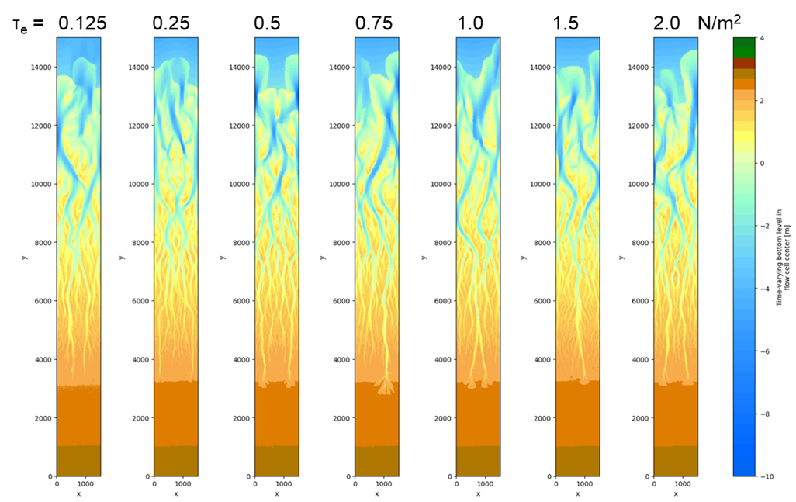{#fig-morpho-different-mud-critical-erosion fig-align="center" width="952"}

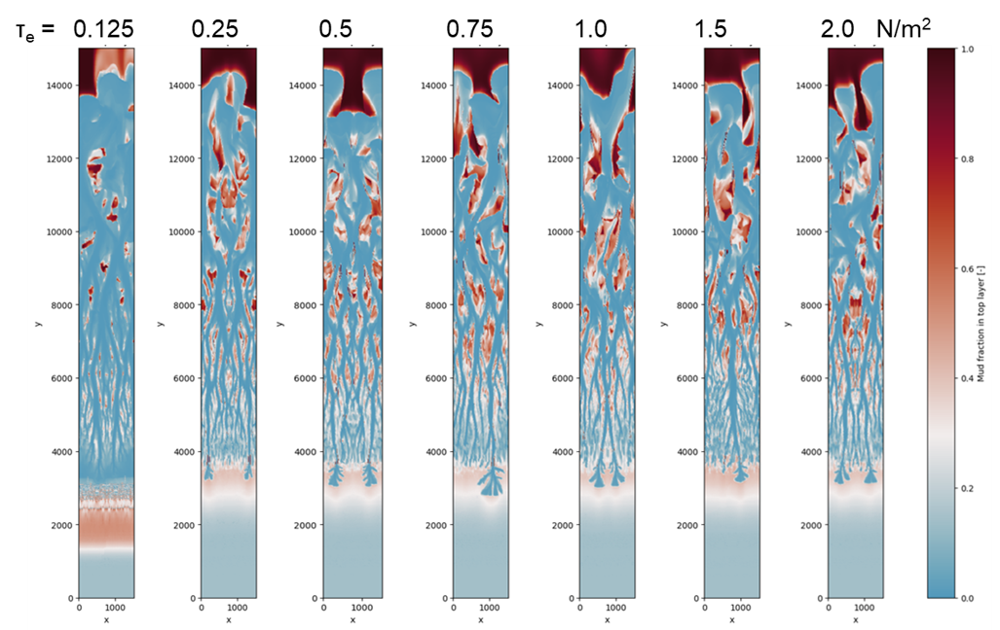{#fig-mudfrac-different-critical-erosion fig-align="center" width="952"}

### Implication for regional hydromorphodynamic modelling

In this Giralia-based idealised morphological model, we investigated how variations in sediment properties influence tidal-flat morphology. Sand–mud interactions produced a more dynamic channel–shoal system and promoted the development of additional channels across the tidal platform. The critical shear stress for mud erosion exerted a strong influence on mud redistribution, but had a comparatively smaller effect on the overall channel–shoal morphology. These results highlight the importance of appropriately representing sand–mud interactions and sediment erodibility in regional-scale morphodynamic models.

## Giralia-based ecomorphological model

### Introduction

Compared with those in tropical humid climates, mangroves in arid regions exhibit greater tolerance to climatic extremes (low precipitation and high temperature) but have shorter tree stature and lower diversity. Different from tall and dense mangrove forests in tropical humid climates, mangroves in arid climates like the Pilbara coast are usually sparse and lower, with small stem size, slow growth rate, and low reproduction rate [@Adame2021; @Santini2013]. Operating near their physiological limits and lacking riverine sediment supply, arid mangrove forest were thought to be more sensitive to global warming and sea-level rise. Therefore, in this exploratory model, we systematically analyzed different mangrove tree properties (stem diameter, growth rate and density) on morphological evolution using the frame work proposed in @sec-approach.

### Model settings

The Idealised model domain was configured to represent a gently sloping tide-dominated mangrove system, applicable to Giralia Bay, Western Australia. The model was run in a two-dimensional domain with an offshore open boundary, using a gradually fining rectangular grid size, from 200\*20m to 20\*20m. An alongshore uniform convex profile $z=2.2-8.5e^{-0.165(y-8.19)}$ ,derived from the mean bed profile in Giralia Bay, was used as the initial profile with a funnel-shaped channel in the middle @fig-ideal-channel-domain. The funnel-shaped channel followed the bathymetric characteristics measured in Giralia Bay – channel width (mouth width $B_0=0.6 km$) decreased exponentially towards landward and disappeared when it became smaller than the grid width (20 m). Channle thalweg elevation increased linearly from subtidal and remained constant on the platform. The open boundary conditions were based on primary constituents (M2, S2, O1, K1) extracted from TPXO10.

Both sand (90% in volume) and mud (10% in volume) were considered in the sediment substrate, and their transport was resolved by the formulation of [@vanrijn1993] and the equations of Partheniades and Krone [@partheniades1965], respectively. Following previous studies on dynamic mangrove modelling [@Xie2022], the critical shear stress for mud erosion was set to $0.2 N/m^2$. 

{#fig-ideal-channel-domain fig-align="center" width="620"}

### Scenarios design

Scenarios started from bare tidal flats without any mangrove forest (Run 0). Different mangrove biological properties were listed in the following table. Parameters in Run 1 were adopted from [@Xie2022], which represent relatively large, fast-growing, and dense mangrove forest. In Run 2, the maximum growth rate of stem diameter was decreased to 0.3 cm per year to understand the impact of growth rate. Later, the maximum tree stem diameter decreased to 10 cm in Run 3, with unchanged growth parameters (G, b~2~, and b~3~) and Run 4, with unchanged maximum rate. For Run 1 to Run 4, the inundation fitness curve was designed that mangrove growth quality reaches an optimal at inundation frequency P=0.25 and decrease on both sides.

| Run | Max stem diameter $D_{max}$ | Growth Parameter G | Growth Parameter $b_2$ | Growth Parameter $b_3$ | Max growth rate (cm/year) | Max height $H_{max}$(cm) | Density (stems/$m^2$) | Inundation fitness |
|--------|--------|--------|--------|--------|--------|--------|--------|--------|
| 1 | 40 | 12.68 | 43 | 0.536 | 1 | 1000 | 0.3 | -8P^2^+4P+0.5 |
| 2 | 40 | 3.81 | 43 | 0.536 | 0.3 | 1000 | 0.3 | -8P^2^+4P+0.5 |
| 3 | 10 | 3.81 | 43 | 0.536 | 0.18 | 1000 | 0.3 | -8P^2^+4P+0.5 |
| 4 | 10 | 4.39 | 21.3 | 0.2 | 0.3 | 330 | 0.3 | -8P^2^+4P+0.5 |

: Mangrove model parameters for different scenarios

### Results

The following figures show the spatial distributions of mangrove vegetation, morphological change, and mud redistribution after the system reached ecological equilibrium following 120 years of coupled simulation. Compared with the unvegetated case, all vegetated scenarios exhibited enhanced erosion within the central channel and greater sediment accretion across the tidal platform. Higher mud fractions were also observed along channel banks and the coastal fringe. In addition, the presence of mangroves promoted the development of a denser and more highly branched tidal-creek network. These results suggest that mangrove vegetation enhances channel incision, promotes tidal-creek formation and branching, and promotes sediment accumulation on the intertidal platform, consistent with findings reported in previous studies [@DAlpaos2006; @Fagherazzi2012; @mariotti2018; @mariotti2014].

Comparisons between simulations with different tree growth rates (Run 1 vs. Run 2 and Run 3 vs. Run 4) show that the faster-growing cases (Runs 1 and 4) develop higher biomass throughout the upper intertidal zone (y \> 0 km). This greater biomass is associated with a higher proportion of mud-dominated cells, larger cross-sectional channel areas, and greater channel depths along the cross-shore direction.

Comparisons between simulations with different stem diameters (Run 2 vs. Run 4) reveal a different response. Although the smaller-stem case (Run 4) exhibits lower biomass throughout the upper intertidal zone, it develops a greater proportion of muddy cells, a denser and more highly branched tidal-creek network, larger channel cross-sectional areas, and a deeper central channel.

This response can be attributed to the higher stem density associated with smaller individual stem diameters and the earlier attainment of mature vegetation densities. Despite the lower biomass, the increased stem density enhances the cumulative vegetation-induced drag exerted on the flow, thereby strengthening vegetation–flow interactions and promoting more pronounced patterns of channel erosion and platform sediment accretion.

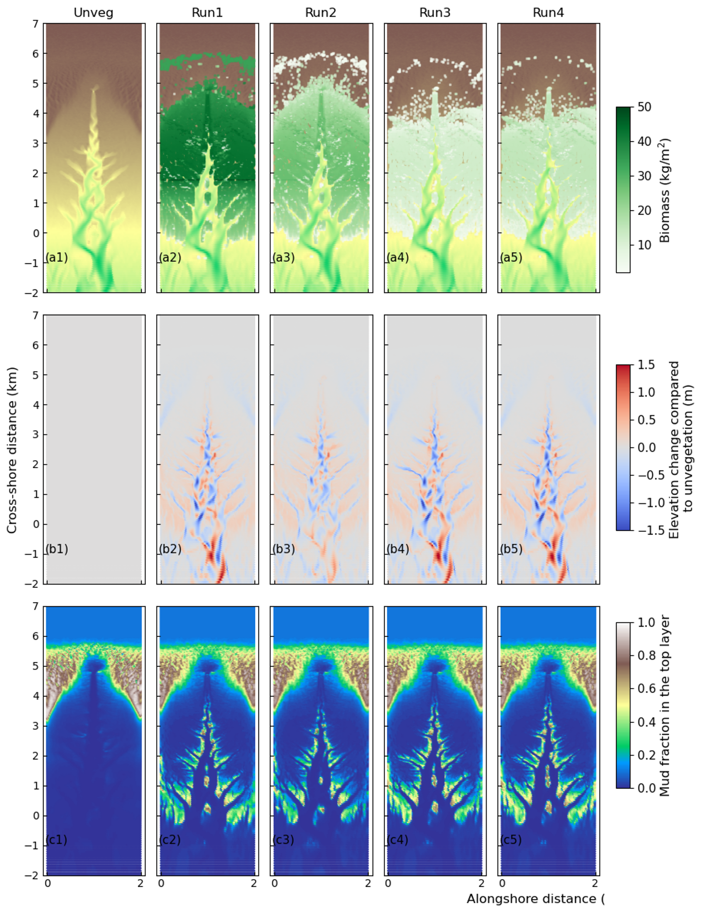{#Ideal-Biomass-morpho-mud fig-align="center" width="534"}

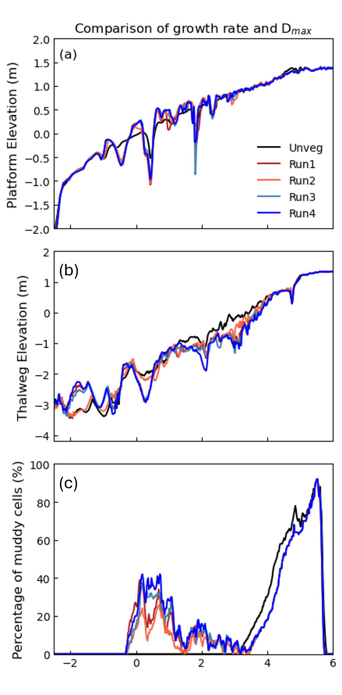{fig-align="center" width="400" height="716"}

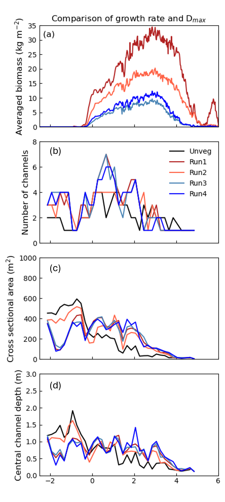{fig-align="center" width="400"}

## Summary of idealised models and key findings

The exploratory idealised models provide an efficient framework for isolating and understanding the long-term effects of key environmental drivers on tidal-flat morphological evolution. By systematically testing variables in a controlled environment without site-specific bathymetric noise, these simulations offer critical insight into evolutionary responses and establish a practical physical basis for parameterisation in site specific models.

### Findings
- **Tidal Forcing:** Increased tidal range extends the upper-intertidal accretion zone landward, while macro-tidal regimes ($4\text{ m}$) trigger greater subtidal erosion and braided channel formation.
- **Tidal Asymmetry:** Flood-dominant conditions promote broad intertidal deposition and channel formation, whereas ebb-dominant conditions drive pronounced subtidal erosion and deeper, complex channel networks.
- **Sediment Dynamics & Sand-Mud Interactions:** Accounting for sand-mud erosion interactions creates a significantly more dynamic channel-shoal system compared to non-interactive runs. While the critical shear stress for mud erosion strongly influences mud redistribution, it has a secondary effect on overall channel-shoal morphology.
- **Mangrove Vegetation:** Incorporating mangrove forests acts as a natural buffer, enhancing platform sediment accretion while intensifying central-channel incision and tidal-creek branching. Variations in biological traits (such as stem diameter and growth rate) exert a smaller overall influence than the presence or absence of vegetation itself, though smaller stem diameters enhance channel incision through higher cumulative drag.

### Implications for Regional-Scale Modelling
Our sensitivity tests demonstrate that external environmental drivers—specifically local tidal range, ebb-dominant asymmetry, and initial mild bathymetric slopes—play a dominant role in controlling morphological evolution. For regional-scale morphodynamic models along the Pilbara coast (including Giralia, Urala, and Cape Preston), these insights justify:
1. **Multi-Constituent Tidal Forcing:** Incorporating primary constituents ($M_2, S_2, O_1, K_1$) to capture ebb-dominant asymmetry and spring-neap variability (following @song2011).
2. **Vegetation Representation:** Adopting arid-adapted mangrove parameterisations (such as Run 4 settings, featuring relatively small stem diameters and slow growth rates) to accurately simulate mangrove properties, sediment retention and creek incision.
3. **Parameter Prioritisation:** Prioritising accurate representation of local tidal conditions and bathymetry over secondary factors like initial substrate sediment composition or open-boundary mud supply.

We show the site-specific model development and calibrations in @sec-hydro-overview.