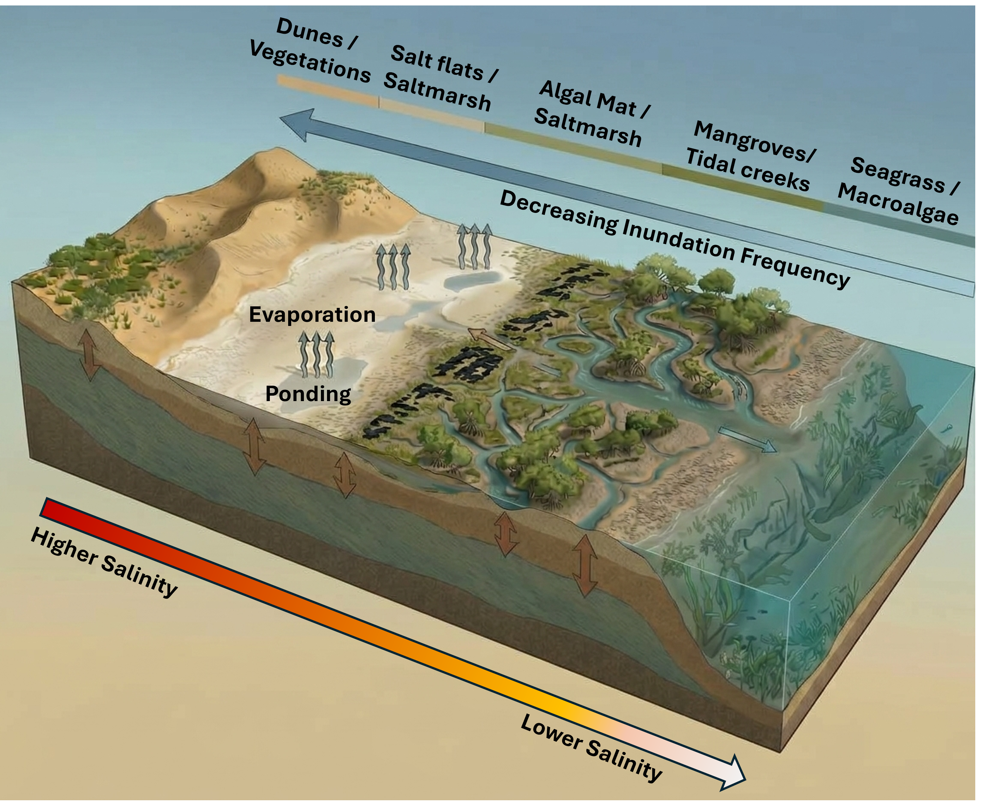
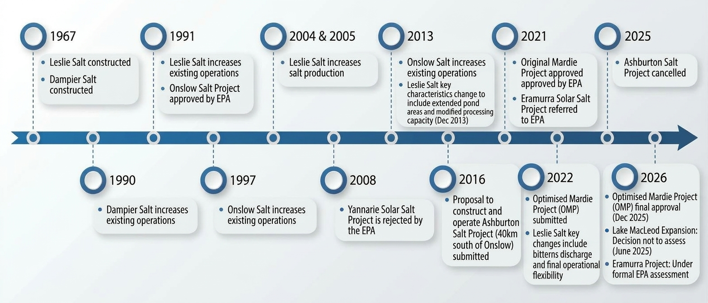
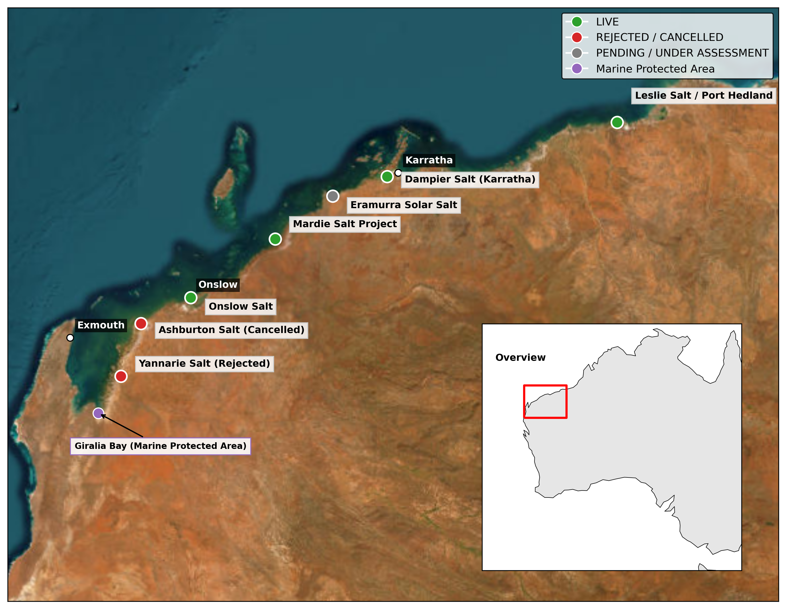
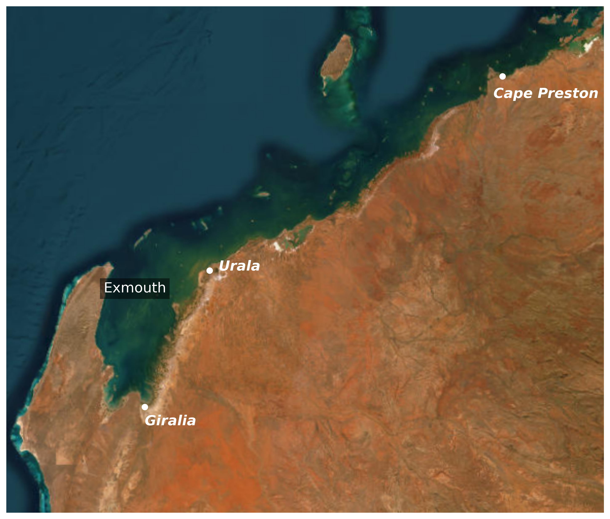
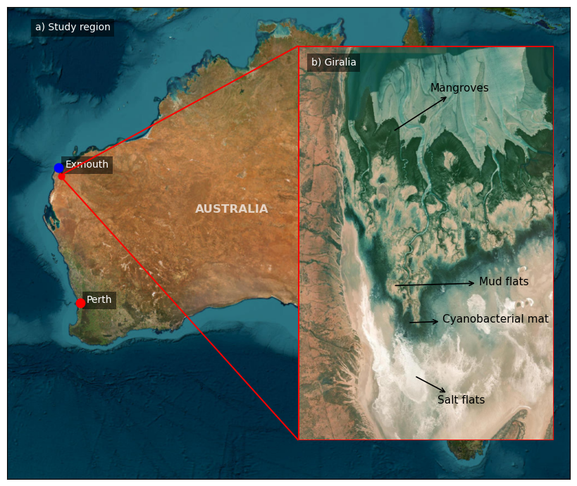
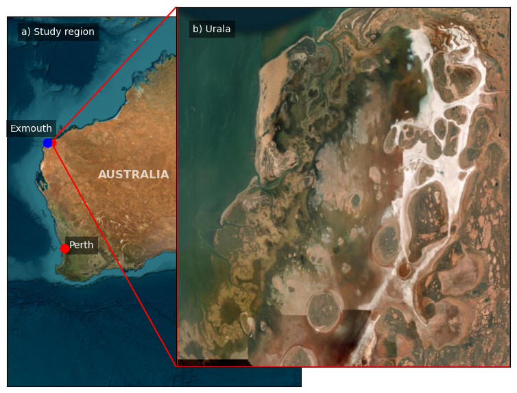
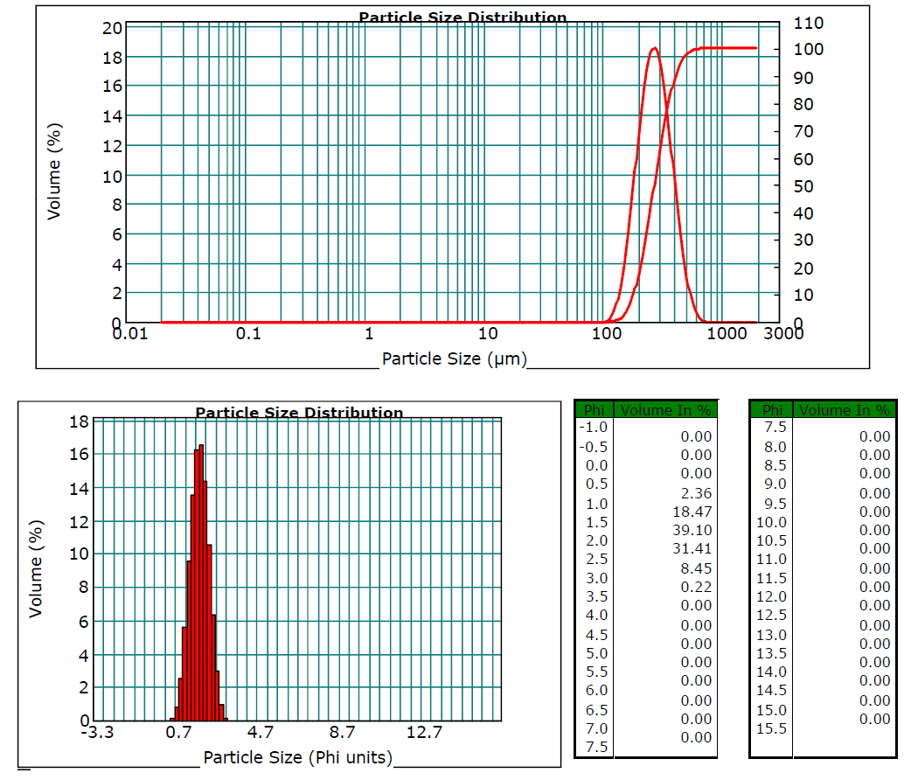
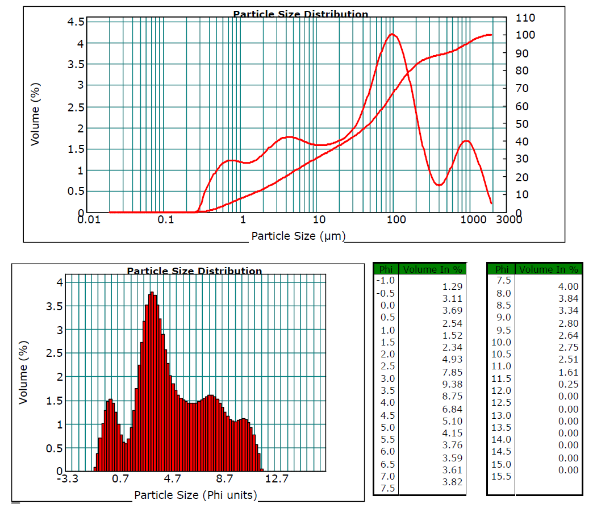
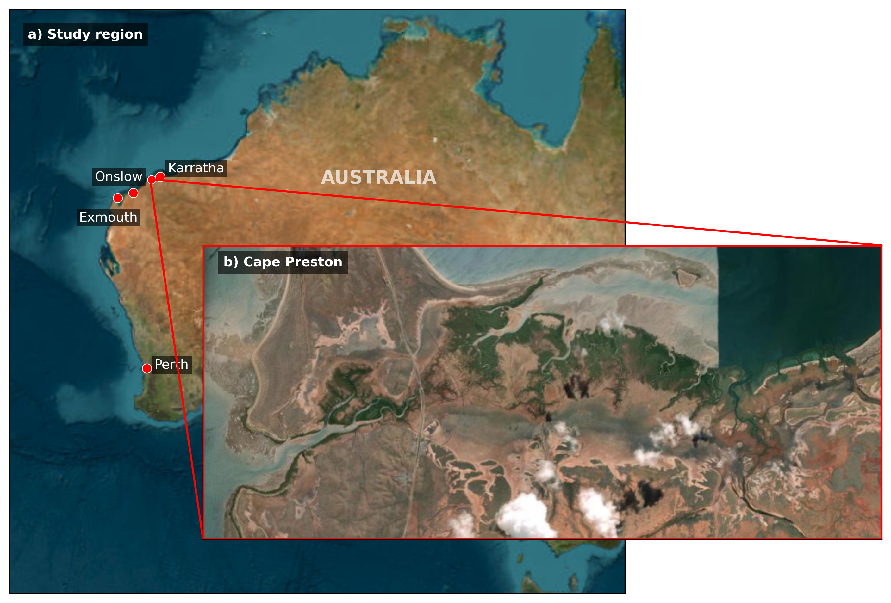
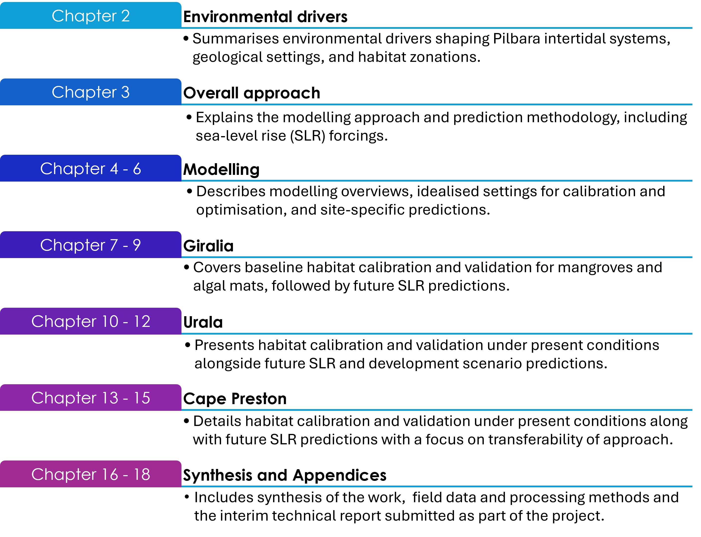

# Introduction {#sec-intro}

## Coastal Habitats and How They Change

Coastal intertidal habitats including mangroves, saltmarshes (samphires), cyanobacterial (algal) mats, and saltflats are dynamic eco-geomorphic systems shaped by continuous feedbacks between hydrodynamic forcing, sediment dynamics, and biological processes [@Mazda2002; @Rodriguez2017; @Sandi2018; @Willemsen2022]. Globally, complex eco-hydrodynamic interactions govern how intertidal vegetation and landforms adapt to shifting sea levels, wave exposure, inundation frequencies, and salinity regimes [@Cohen2003; @Saintilan2018; @Wimmler2021]. Biological feedbacks also strongly modulate physical processes, for example, variations in canopy structure attenuate flow velocity and dissipate wave energy, while tidal inundation frequency directly dictates soil salinity within the root zone, thereby regulating plant growth, structural health, species competition, and spatial distribution [@Wimmler2021; @Dittmann2022].

{#fig-conceptual-zonation}

While @fig-conceptual-zonation illustrates a canonical cross-section typical of hyper-arid coastal settings, where evapotranspiration generates an inverted landward hypersalinity gradient, similar intertidal habitat zonation occurs across tropical and subtropical coastlines worldwide [@Cohen2003; @Saintilan2018]. However, the expression of these habitats varies substantially along climatic gradients because the balance between freshwater inputs and evaporative losses strongly influences salinity regimes and vegetation structure. In humid tropical environments, such as the Amazon Delta and Atlantic coast of South America, high river discharge and rainfall maintain relatively low root-zone salinities, supporting species-rich, high-biomass mangrove forests with canopy heights commonly exceeding $20\text{-}30\ \mathrm{m}$ [@Cohen2003; @Reis2019]. 
In contrast, arid and semi-arid coastlines experience limited rainfall, intense solar radiation, and high evaporative demand, conditions that favour salt accumulation in intertidal sediments. Climatic aridity can be characterised using the Aridity Index (AI), commonly defined as the ratio of mean annual precipitation ($P$) to mean annual potential evapotranspiration ($PET$):

$$
\mathrm{AI}=\frac{P}{PET}
$$

The index expresses the balance between water supplied by precipitation and the atmosphere's potential demand for water through evapotranspiration. Lower AI values indicate increasingly arid conditions, in which precipitation is insufficient to meet potential evaporative demand; higher values indicate progressively more humid climates. Under a widely used classification, AI values below $0.05$ indicate hyper-arid conditions, $0.05$–$0.20$ indicate arid conditions, $0.20$–$0.50$ indicate semi-arid conditions, and $0.50$–$0.65$ indicate dry sub-humid conditions, with values above $0.65$ generally representing humid climates [@Zomer2022;@Adame2021]. Thus, an AI below $0.20$ identifies arid climatic conditions in which persistent water deficits are likely, although local hydrological conditions may differ substantially where river discharge, groundwater inputs, tidal exchange, or episodic flooding provide additional water.

In intertidal environments, low AI values provide an indication of the climatic conditions that can promote hypersalinity, particularly in upper-intertidal flats where tidal flushing is infrequent and evaporation exceeds freshwater replenishment. Elevated sediment and porewater salinity can impose physiological stress on mangroves, contributing to reduced growth, canopy stature, productivity, and species diversity relative to humid tropical systems [@Blanco-Sacristn2022]. Nevertheless, AI is a regional climatic indicator rather than a direct measure of sediment salinity: actual salinity patterns also depend on tidal inundation, drainage, groundwater exchange, sediment properties, and local freshwater inputs. Consequently, the effects of aridity on mangrove distribution and structure must be interpreted in conjunction with site-specific hydrogeomorphic conditions.

Despite differences in climatic and hydrological conditions, arid and tropical intertidal environments commonly exhibit biological zonation associated with elevation, inundation frequency, salinity, and substrate conditions (@fig-conceptual-zonation). Typical patterns include:

* **Subtidal to Lower Intertidal Zone:** Subtidal seagrass meadows and macroalgal communities may occur adjacent to fringing mangrove forests along sheltered tidal channels and lower intertidal shorelines. Mangrove distribution is influenced by inundation frequency, substrate stability, and salinity, while tidal exchange can facilitate salt export and influence soil salinity [@Semeniuk1994; @Cohen2003; @Saintilan2018].

* **Mid- to Upper Intertidal Zone:** Landward of, or interspersed with, mangrove forests, saltmarsh and succulent halophyte communities, including *Tecticornia* spp., may occupy areas subject to less frequent tidal inundation and variable soil salinity. The distribution of these communities depends on local elevation, hydroperiod, substrate properties, and hydrological conditions [@Saintilan2018; @Yando2023].

* **Upper Intertidal to Supratidal Zone:** Saltflats, including hypersaline flats sometimes described as *sabkhas*, and cyanobacterial mats commonly occur in upper-intertidal and supratidal environments. Infrequent inundation, high evaporation, and restricted drainage can promote salt accumulation, creating conditions that limit the establishment of vascular plants. These habitats may form mosaics or transitional zones between vegetated intertidal communities and terrestrial vegetation or coastal dunes (@fig-conceptual-zonation) [@Semeniuk1994; @Eliot2013; @Blanco-Sacristn2022].

The spatial arrangement of these habitats varies geographically according to climate, tidal regime, geomorphology, and local hydrological conditions. In some tropical and humid subtropical systems, saltmarshes occur along the landward margins of mangrove forests, while in other settings they may extend towards the seaward margin or form mosaics with mangroves [@Reis2019]. In arid regions of Australia, mangroves commonly occupy lower intertidal creek margins, whereas saltmarshes, succulent samphire communities, and cyanobacterial mats may occupy higher and less frequently inundated areas [@Saintilan2018]. In some hyper-arid coastal environments, where saltmarsh vegetation is sparse or absent, mangroves may transition directly into unvegetated saline flats [@Cohen2020; @Blanco-Sacristn2022]. These patterns highlight that intertidal zonation is not a universal sequence, but a spatial organisation shaped by the interaction of physical conditions and habitat-specific ecological tolerances.

## The Pilbara Setting

### Regional Climate and Hydroclimatic Setting {.unnumbered}

The Exmouth–Pilbara region of Western Australia represents a distinctive arid coastal environment in which extensive tidal creeks, hypersaline supratidal mudflats, and low-lying coastal landforms interact with a macro-tidal regime [@Semeniuk1994; @Eliot2013]. The regional climate is arid to semi-arid and tropical, characterised by high temperatures and low, highly variable rainfall. Summer maximum temperatures frequently exceed 32 °C along the coast and may surpass 45 °C inland, while winter coastal temperatures rarely fall below 10 °C [@Sudmeyer2016]. Mean annual precipitation is generally low, approximately 200–350 mm in parts of the region, and is strongly seasonal and spatially variable. Most rainfall occurs during the warmer months, particularly through episodic thunderstorms and tropical cyclone events. The Pilbara coast is also exposed to tropical cyclones, which can deliver substantial rainfall, generate extreme water levels, and drive episodic sediment transport [@BOM2009tropical]. In contrast, the cooler months are typically characterised by lower rainfall and high evaporation. Consequently, river discharge and terrestrial sediment delivery to the coast are highly episodic, with substantial inputs often associated with major rainfall and flood events (see @sec-controls for a detailed assessment of hydroclimatic drivers).

### Intertidal Geomorphology and Habitat Zonation {.unnumbered}

Intertidal benthic coastal habitat (BCH) communities across the West Pilbara exhibit pronounced spatial zonation associated with elevation, inundation frequency, salinity, and local geomorphological conditions [@Semeniuk1994;@Hickey2022]. Along many sheltered tidal creeks and coastal embayments, mangrove forests, dominated by *Avicennia marina*, occupy lower intertidal margins. These may transition landward into succulent samphire communities, including *Tecticornia* spp., followed by extensive cyanobacterial mats and hypersaline saltflats, sometimes referred to as *sabkhas* [@Hickey2025]. Although this sequence is characteristic of many arid coastal settings, the distribution and continuity of individual habitats vary with local topography, hydrodynamics, sediment characteristics, drainage, and surface–groundwater interactions.

Mangroves in the region commonly fringe tidal creeks and occupy elevations subject to regular tidal inundation. In contrast, samphire communities and cyanobacterial mats may occupy higher intertidal and supratidal surfaces that experience less frequent inundation, high evaporative water loss, and variable soil salinity. Saltflats occur in areas where limited drainage and strong evaporation favour salt accumulation and restrict the establishment of vegetation. The resulting habitat mosaic reflects the interaction between tidal exchange, freshwater inputs, sediment dynamics, and groundwater processes. These intertidal communities contribute to sediment stabilisation, nutrient cycling, and primary production, supporting ecological connections between coastal, marine, and terrestrial food webs [@Eliot2013;@SeashoreEngineering2022;@Dee2026;@Hickey2023].

## Knowledge Gaps: Predicting Arid Intertidal Dynamics Under Sea-Level Rise and Coastal Development {#sec-knowledge-gaps}

As relative sea level rises, changes in tidal inundation can alter the elevation range suitable for different habitats, while sediment accretion and erosion determine whether intertidal surfaces can maintain their position within the tidal frame. Although coastal wetlands can respond to these changes through vertical accretion, ecological adjustment, and landward migration, their capacity to persist depends on local geomorphology, sediment availability, hydrological connectivity, and the availability of suitable accommodation space [@Woodroffe2016; @Krauss2014; @Schuerch2018]. Where development restricts landward migration or modifies sediment and water flows, these processes may be insufficient to prevent habitat loss and redistribution [@Leo2019; @Day2024].

However, the processes governing these responses are not uniform across climatic settings. Much of the established understanding of coastal wetland responses to SLR is derived from research in temperate wetlands, humid tropical mangroves, and sediment-rich river deltas [@Kirwan2013; @Woodroffe2016; @Schuerch2018; @Saintilan2020; @Nienhuis2023]. Although this literature provides important insights into inundation stress, sediment accumulation, and coastal habitat migration, its direct application to hyper-arid coastlines requires caution. Arid intertidal environments are characterised by limited and episodic freshwater inputs, high evaporative demand, and strong spatial variation in sediment and salinity conditions. Groundwater discharge, infrequent rainfall events, and episodic catchment flows may exert disproportionate influences on local hydrology, while restricted freshwater replenishment and infrequent tidal flushing can promote hypersalinity in elevated intertidal areas. These conditions influence vegetation stature, ecosystem productivity, and the distribution of habitats across the tidal frame, potentially producing responses that differ from those observed in more humid environments [@Adame2021; @Woodroffe2016].

These characteristics introduce substantial uncertainty into projections of arid intertidal change under future SLR. Increasing inundation does not necessarily result in uniform landward migration or the expansion of mangrove forests. Depending on local elevation, tidal connectivity, sediment supply, and substrate stability, rising sea levels may create new habitat opportunities in some locations while increasing inundation stress, erosion, or habitat loss in others. The balance between these outcomes is particularly difficult to predict where sediment delivery is episodic and the capacity of intertidal surfaces to accrete vertically is poorly constrained. Furthermore, changes in inundation interact with salinity and freshwater availability, meaning that a location becoming more frequently inundated may not necessarily become more suitable for vegetation if other environmental constraints persist [@Woodroffe2016; @Lovelock2015; @Saintilan2020]. Consequently, projections based solely on changes in sea level or habitat elevation may overlook important constraints on ecosystem persistence in arid coastal settings.

Coastal development adds another dimension to this uncertainty. Infrastructure, land reclamation, industrial activities, and changes to drainage or sediment pathways can modify the physical conditions that sustain intertidal habitats. Development may also restrict the landward migration of habitats as sea level rises, creating coastal squeeze where suitable habitat is progressively lost between rising water levels and fixed landward barriers [@Leo2019; @Day2024]. In arid regions, where suitable habitat may depend on specific combinations of elevation, salinity, freshwater availability, and sediment characteristics, such alterations can affect not only total habitat area but also the spatial arrangement and connectivity of different habitat types. Predicting future change therefore requires consideration of sea level rise and development together, rather than treating either pressure in isolation.

The northwestern coast of Western Australia has attracted growing interest in the development of large scale solar salt farms. This intense industrial interest is driven by the region's extensive natural salt flats, high evaporative demand, and substantial tidal range, which together provide optimal environmental conditions for solar salt extraction. Along this coastline, industrial production has expanded progressively over several decades. Historical project timelines illustrate a trajectory from early facility constructions in the late 1960s such as the Leslie and Dampier salt operations through to continuous operational increases, modern plant optimisations, and recent project milestones like the cancellation of the Ashburton project and the approval of the Optimised Mardie Project @fig-salt-timeline.

::: {#fig-salt-timeline}

{fig-align="center" width="95%"}

Timeline of several salt projects within the northwestern region of Western Australia from 1966 to 2026.

:::

The spatial footprint and current regulatory status of these developments vary significantly across the region, ranging from long standing active operations and pending assessments such as Eramurra to projects rejected or situated near ecologically sensitive areas, including the marine protected environments around Giralia Bay @fig-salt-projects-map. Because these industrial footprints intersect directly with hyper arid intertidal habitats, including mangrove fringes, salt flats, and cyanobacterial mats, mapping their spatial distribution and operational status is critical for assessing cumulative pressures, managing coastal squeeze, and evaluating habitat connectivity under future environmental change.

::: {#fig-salt-projects-map}

{fig-align="center" width="95%"}

Spatial distribution, operational status, and key regional locations of solar salt projects across the Pilbara and Gascoyne coasts.

:::

These knowledge gaps are particularly relevant to the hyper arid coast of the West Pilbara, northwestern Australia. The region supports extensive mangrove forests, cyanobacterial mats, salt flats, and other intertidal habitats across a coastline characterised by strong tidal forcing, high evaporative demand, and episodic freshwater and sediment inputs. Recent regional scale mapping provides an important baseline for understanding the historical extent and dynamics of these habitats, but further work is needed to translate this understanding into forward looking assessments of habitat persistence and redistribution under future environmental change [@Hickey2025]. In particular, there is a need to investigate how changes in tidal inundation and coastal development may alter the suitability and spatial availability of habitat, while accounting for the distinct environmental constraints experienced by different intertidal communities.

In this study, we focus primarily on mangrove forests and cyanobacterial mats as two ecologically distinct but potentially interacting components of the West Pilbara intertidal landscape. By investigating their potential responses to sea level rise and coastal development, we aim to improve understanding of where these habitats may persist, expand, contract, or redistribute under future scenarios. This provides a basis for assessing the potential consequences of coastal change for arid intertidal ecosystems and for identifying the environmental constraints and spatial trade offs that may shape their future distribution.

### Predicting Mangrove Responses to Sea-Level Rise

Mangroves have been extensively studied in relation to sea-level rise (SLR) through satellite mapping, field observations, and numerical modelling. Satellite time series have been used to quantify changes in mangrove extent and distribution over decadal timescales, while comparisons with water-level and sea-level observations have helped investigate the environmental drivers of these changes [@Thomas2017; @Thomas2018; @Lovelock2017]. Field measurements of surface-elevation change, sediment accumulation, and mangrove responses across different inundation and salinity conditions have further established that forest persistence depends on the balance between rising sea levels, sediment supply, and local ecological tolerances [@Krauss2014; @Woodroffe2016; @Lovelock2015].

Numerous numerical modelling efforts have extended these observations towards future projections. Existing approaches include landscape-scale habitat-transition models, such as SLAMM, used to project future mangrove extent [@Payo2016]; global coastal-wetland models that assess the effects of SLR and sediment availability [@Schuerch2018]; and bio-morphodynamic models investigating vegetation–sediment feedbacks, coastal conditions, and mangrove vulnerability [@Xie2020; @Xie2022]. More recent developments, such as the Mangrove Lifecycle Ecosystem Analysis and Forecasting (LEAF) model, explicitly represent mangrove growth and mortality across different life stages and couple these processes with hydrodynamic and morphological modelling [@Dunlop2025]. Collectively, these approaches demonstrate that future mangrove distribution can be projected, but that the outcomes depend on model structure, environmental forcing, and the processes represented.

Predicting mangrove responses requires particular attention to climatic and geographical context. Mangroves in humid tropical environments may experience different freshwater availability, salinity regimes, and sediment conditions from those in hyper-arid coastlines. Consequently, model relationships and ecological parameters developed for one setting may not transfer directly to another. This is particularly important when projecting future changes in the West Pilbara, where episodic freshwater inputs, hypersalinity, and spatially variable sediment supply can constrain mangrove establishment and persistence.

A major challenge is representing the feedbacks between mangrove development and coastal morphology over long timescales. Sediment transport, erosion and accretion, tidal inundation, and vegetation establishment and mortality can interact to determine whether mangroves persist, migrate landward, or retreat. Explicitly representing these processes alongside the different stages of the mangrove life cycle can be computationally demanding and data-intensive. Some bio-morphodynamic studies have therefore used idealised domains to isolate key mechanisms [@Xie2020; @Xie2022], while other developments, including LEAF, have focused on detailed modelling over shorter projection periods [@Dunlop2025] and some focussed on relatively small sites [@Beselly2023]. For additional details, readers are referred to @sec-approach-review. These approaches provide important advances, but they do not yet establish a general capability for predicting mangrove redistribution across an entire, geomorphically heterogeneous coastline over centennial timescales.

Furthermore, the response predicted for one location cannot necessarily be transferred to another, even where the hydrodynamic conditions appear similar. Differences in coastal slope, sediment availability, substrate characteristics, freshwater supply, and the initial distribution of vegetation can produce different trajectories of habitat change. Coastal-scale predictions therefore require spatially explicit environmental conditions and sufficient representation of the processes governing mangrove establishment, persistence, and migration. **Developing a modelling capability that can predict mangrove responses to future SLR across coastal-scale domains and centennial timescales, while representing the processes most relevant to habitat redistribution, is a key gap addressed by this project.**

### Cyanobacterial Mats: From Ecological Research to Future Habitat Prediction

Research on cyanobacterial mats has largely focused on their microbial ecology, physiological functioning, and biogeochemical roles. Nitrogen fixation has been a major research theme, with studies examining the organisms responsible, variations in nitrogenase activity, and the environmental controls on this process within microbial mats [@Stal2010]. These studies improve understanding of mat functioning but do not directly predict changes in the spatial extent of intertidal mats under future environmental conditions.

A separate body of research has investigated cyanobacterial growth and transport in rivers, using mathematical models that combine biological processes with hydraulic transport to predict the movement and development of planktonic cyanobacteria [@GuvenHoward2006]. In lakes and reservoirs, process-based and data-driven models have been developed to forecast cyanobacterial blooms from environmental variables such as water temperature, nutrient availability, and hydrological conditions [@Rousso2020]. Satellite remote sensing has also been widely used to detect and monitor aquatic cyanobacterial blooms, providing information about their occurrence, extent, and temporal variability [@Shi2019]. However, these studies generally concern planktonic or water-column blooms rather than benthic microbial mats attached to intertidal surfaces. Their methods and assumptions therefore cannot be directly transferred to predicting the migration of intertidal mats.

Research directly addressing cyanobacterial mats in arid intertidal environments has increasingly focused on habitat mapping and historical change. The Exmouth Gulf mapping study by Hickey et al. (2023) used satellite imagery and supervised classification to map cyanobacterial mats and associated salt-flat habitats, while subsequent multidecadal mapping has documented the dynamic distribution of intertidal habitat classes along the north-western Australian coastline [@Hickey2023; @Hickey2025]. These studies provide essential baseline information on habitat extent and variability, but historical mapping alone does not establish how mat-covered surfaces will respond to future SLR or coastal development.

**Based on the literature identified for this review, a predictive framework for long-term migration of arid intertidal cyanobacterial mats under future SLR and coastal development has not been established.** In particular, there is no identified approach that can be directly applied to project their future spatial redistribution across the West Pilbara coastline. Unlike mangroves, for which several ecological and bio-morphodynamic modelling approaches already exist, cyanobacterial mats require the development of a habitat-specific predictive approach. Such an approach must establish how changes in inundation, surface elevation, salinity, and substrate conditions influence the persistence and spatial distribution of mat-covered surfaces, while accounting for the removal or modification of habitat by coastal development.

### Modelling Gap and Project Objectives {#sec-modelling-gap}

The literature highlights different but related challenges for the two habitats considered in this study. For mangroves, the key challenge is extending existing modelling capabilities towards spatially explicit, coastal-scale projections over centennial timescales in hyper-arid environments. For cyanobacterial mats, the more fundamental challenge is developing a suitable predictive approach, because existing research is concentrated on microbial processes, aquatic blooms, and historical habitat mapping rather than long-term intertidal habitat migration.

This project addresses these gaps by developing and applying a modelling framework to investigate the potential redistribution of mangrove forests and cyanobacterial mats along the West Pilbara coast under future SLR and coastal development scenarios. The aim is to predict where these habitats may persist, expand, contract, or be lost over centennial timescales, and to identify locations where development may constrain their potential migration. The framework is intended to support coastal-scale assessment of future habitat change while making explicit the processes represented, the assumptions required, and the limitations that remain.

---

## Research Aims and Study-Site Strategy {#sec-aims_and_study_sites}

The overall aim of this research is to improve understanding of intertidal habitats in hyper-arid coastal environments and to develop predictive tools for assessing how these habitats may change under future environmental conditions and coastal development. Achieving this aim requires an understanding of the environmental processes that regulate habitat distribution, as well as a modelling framework capable of translating these processes into projections of potential future change. However, predicting the long-term responses of arid intertidal ecosystems is challenging because habitat persistence and redistribution depend on interactions between sea-level variability, tidal inundation, climatic conditions, salinity, sediment dynamics, geomorphology, and biological processes. The environmental controls considered in this study, including sea-level variability and climatic drivers, are described in [@sec-controls].

{#fig-sites-interest width="100%"}

To address these challenges, the research adopts a staged approach based on three study sites along the West Pilbara coast: **Giralia, Urala, and Cape Preston** (@fig-sites-interest). The sites represent slightly different coastal environments and have distinct roles within the research design. Giralia provides the primary domain for model development, Urala provides a setting in which to investigate the implications of coastal development, and Cape Preston serves as a demonstration of the approach's potential transferability to a different coastal setting. This staged strategy allows the modelling approach to be developed and evaluated in a relatively well-studied environment before being applied to sites with different environmental characteristics and development constraints.

### Giralia: Environmental Understanding and Model Development

Giralia Bay is located in the eastern portion of Exmouth Gulf, Western Australia ($22.4^{\circ}\text{S}$, $114.3^{\circ}\text{E}$). Exmouth Gulf is a shallow, semi-enclosed embayment approximately $75\text{ km}$ long and less than $20\text{ m}$ deep, bordered by low-relief peninsulas to the west and south. The bay lies within the onshore portion of the Carnarvon Basin and is underlain by calcarenitic rock units and sedimentary deposits, overlain by unconsolidated Quaternary sediments. The surrounding coastal plain comprises Holocene and late Pleistocene deposits, including relict beach ridges, coral reefs, aeolian sands, and supratidal sabkha flats with extensive evaporite crusts [@Riera2023].

::: {#fig-giralia-site}

{fig-align="center" width="95%"}

Study site at Giralia Bay within Exmouth Gulf, north-western Western Australia. **(a)** Regional setting. **(b)** Cross-shore intertidal zonation, showing mangroves, mudflats, cyanobacterial mats, and high-elevation salt flats.

:::

Giralia is the principal site for developing the modelling approach because the wider Exmouth Gulf region is one of the better-studied examples of arid intertidal ecosystems in north-western Australia. Previous research has investigated mangrove growth and wood properties [@Santini2013], the ecological functioning and productivity of cyanobacterial mats [@Dee2026; @Lovelock2010], nutrient exchange between mats and inundating waters [@Adame2012], and the influence of intense storms and associated freshwater and sediment inputs on mangrove nutrient status [@Lovelock2011]. Experimental studies have also examined the rapid reactivation of cyanobacterial mats following rehydration [@Chennu2015], while remote-sensing research has documented the spatial and temporal variability of high-intertidal habitats across Exmouth Gulf [@Hickey2023]. Collectively, these studies provide an empirical foundation for investigating the environmental controls on habitat distribution, although translating this knowledge into quantitative predictions of long-term habitat change remains challenging.

The region experiences a warm, hyper-arid climate, with a mean annual air temperature of $25,^{\circ}\text{C}$, a mean minimum temperature of $17,^{\circ}\text{C}$, and a mean maximum temperature of $32,^{\circ}\text{C}$. Summer temperatures can reach $47,^{\circ}\text{C}$, while mean annual rainfall is approximately $250\text{ mm yr}^{-1}$. Despite these dry conditions, the region is periodically affected by severe tropical cyclones, which can generate extreme winds and rainfall and deliver episodic freshwater and sediment inputs to the coastal environment [@Santini2013]. The interplay between persistent aridity, regular tidal forcing, and episodic climatic disturbances provides an important context for understanding the distribution and persistence of intertidal habitats.

The area is also of conservation significance. The Western Australian Government has pursued protection of the Exmouth Gulf region through the *Plan for Our Parks* initiative, including arrangements involving the Nganhurra Thanardi Garrbu Aboriginal Corporation and the establishment of Giralia National Park and the adjoining Boologooro Nature Reserve. This conservation context reinforces the importance of understanding how environmental change and coastal development may affect the region's intertidal ecosystems.

#### Intertidal Habitat Zonation

Giralia Bay contains a cross-shore sequence of intertidal habitats associated with differences in surface elevation, tidal inundation frequency, and local environmental conditions (@fig-giralia-site). From the seaward margin towards the land, four principal habitat zones can be distinguished:

1. **Seaward mangrove fringe:** Predominantly composed of *Avicennia marina*, occupying the lower-to-middle intertidal zone, where regular tidal inundation and flushing occur.

2. **Mudflats:** Generally unvegetated, low-gradient intertidal surfaces that are exposed during low tide and provide a transition between the mangrove fringe and higher intertidal habitats.

3. **Cyanobacterial mats:** Microbial communities occupying parts of the middle-to-upper intertidal flats, where periodic inundation alternates with prolonged exposure and desiccation.

4. **High-elevation salt flats:** Supratidal sabkha environments characterised by high salinity, evaporite accumulation, and sparse or absent vegetation.

This spatial organisation, together with the broad intertidal flats and relatively distinct habitat zones, provides a useful basis for deriving an idealised representation of the system. By simplifying the landscape into characteristic cross-shore zones, the model-development process can focus on the fundamental relationships between environmental forcing, surface elevation, inundation, and habitat distribution before considering the additional complexity of individual sites. Giralia therefore serves not only as an ecologically informed study site but also as a conceptual basis for developing and testing the idealised model described in [@sec-idealised-model]. The resulting framework can then support subsequent applications that incorporate more complex environmental conditions and development-related constraints.

### Urala: Application Under Coastal Development Constraints

Urala, on the Onslow coast, is the second study site and provides an opportunity to apply the modelling approach developed at Giralia under different geomorphic conditions and with explicit representation of coastal development constraints. The area is of interest in the context of potential industrial development, including solar salt production. In this study, the focus is specifically on how development-related bund walls may modify hydrodynamic conditions and, consequently, influence the potential redistribution of intertidal habitats under future sea-level scenarios. Applying the framework at Urala therefore provides a means of examining how physical infrastructure interacts with environmental change to influence habitat persistence and spatial reorganisation.

#### Overview of the Urala Study Site

The Urala study site is located approximately $40\text{ km}$ south-east of Onslow, along the eastern coast of the Pilbara region near the mouth of Exmouth Gulf. Unlike Giralia Bay, Urala does not exhibit a uniformly ordered cross-shore sequence of intertidal habitats. Although distinct shore-normal zonation occurs in the southern part of the study area, the northern domain has a more complex morphology, where North Creek and South Creek converge and interconnect through a network of smaller tidal channels (@fig-urala-site).

::: {#fig-urala-site}

{fig-align="center" width="95%"}

Study site at Urala on the West Pilbara coast, north-western Western Australia. **(a)** Regional setting. **(b)** Morphological overview showing intertidal habitat distribution, interconnected tidal-creek systems, barrier spits, and extensive landward salt flats.

:::

The site is characterised by subtle topographic gradients typical of low-relief, arid coastal environments. Elevation generally increases landward from the open water and tidal-creek margins, across a sequence of intertidal and supratidal environments:

* **Intertidal zone:** Low-lying areas influenced by tidal inundation, including vegetated margins and surfaces dissected by tidal channels.
* **High-intertidal to supratidal zone:** Broad, low-gradient platforms landward of the mangrove fringe, including salt flats and other sparsely vegetated surfaces.
* **Upper salt flats and dunes:** Inland areas comprising relict salt pans, evaporite-rich surfaces, and terrestrial coastal vegetation and dune systems at higher elevations.

The combination of low relief, interconnected tidal channels, barrier spits, and extensive landward salt flats makes Urala a useful setting for examining how changes in hydrodynamic connectivity may affect habitat distribution. In particular, modifications to the pathways through which tides propagate across the landscape may alter inundation patterns and the spatial conditions under which intertidal habitats persist.

#### Sediment Characteristics and Particle-Size Distributions

Sediment samples from Urala represent two contrasting substrate types: relatively sandy environments associated with channels and more exposed coastal surfaces, and finer-grained sediments characteristic of sheltered mudflats (@fig-psd-urala and @fig-psd-urala-mud). These differences provide context for interpreting the site's sedimentary environment and potential variation in sediment mobility across the intertidal landscape.

::: {#fig-psd-urala}

{fig-align="center" width="90%"}

Particle-size distribution (PSD) representative of the general sandy substrate at Urala, showing a narrow, predominantly unimodal distribution dominated by medium-to-fine sand fractions ($100$–$500,\mu\text{m}$; $\Phi \approx 1.0$–$2.5$).

:::

::: {#fig-psd-urala-mud}

{fig-align="center" width="90%"}

Particle-size distribution (PSD) representative of Urala mudflat sediments, showing a broad, polymodal distribution extending from fine silts and clays ($<10,\mu\text{m}$) through fine sand ($\sim100,\mu\text{m}$) to coarse biogenic fragments ($800$–$1000,\mu\text{m}$).

:::

The sandy substrate exhibits a relatively narrow, well-defined grain-size distribution, with much of the material concentrated in the fine-to-medium sand range ($150$–$300,\mu\text{m}$). This distribution is consistent with sediment sorting in environments where tidal currents and wave action can transport finer particles away from exposed surfaces and channels. In contrast, the mudflat samples exhibit a broader distribution, with a principal peak near the fine-sand and coarse-silt boundary ($\sim80$–$100,\mu\text{m}$), a fine-grained component extending into silts and clays ($<10,\mu\text{m}$), and secondary coarse fractions around $800$–$1000,\mu\text{m}$ that may include shell fragments and other biogenic material.

These contrasting sediment distributions are consistent with spatial differences in depositional conditions, from relatively energetic sandy environments to more sheltered settings where fine particles can settle. They provide useful environmental context for interpreting the potential response of the coastal landscape to changes in hydrodynamic forcing. However, the sediment measurements are used here to characterise the study site; they should not be interpreted as direct validation of sediment transport or morphological change unless those processes are explicitly represented and evaluated in the model.

#### Geomorphology and Environmental Drivers

Urala's geomorphology is defined by extensive barrier spits, dynamic creek mouths, interconnected tidal channels, and broad landward salt flats. The North Creek and South Creek systems provide important pathways for tidal exchange across the landscape, while their geometry and connectivity influence how water reaches adjacent intertidal surfaces. These features are particularly relevant when assessing the potential hydrodynamic consequences of infrastructure that intersects or constrains existing flow pathways.

Hydrodynamic conditions are influenced by the regional tidal regime, with semi-diurnal tides driving regular inundation and currents within the principal creek channels. Tidal currents (predominantly) anextreme events with wave action contribute to sediment redistribution, while the relative sheltering of adjacent mudflats and mangrove margins favours the retention of finer material. Tropical cyclones and other intense weather events can temporarily increase wave energy and freshwater discharge, potentially altering creek mouths, barrier spits, and sediment distribution. The importance of these episodic processes varies spatially and through time.

The region's hyper-arid climate and high evaporative demand further distinguish Urala from more humid coastal environments. Rainfall is highly variable, and major rainfall events may produce short-lived freshwater and sediment inputs against a background of prolonged dry conditions. These climatic and hydrodynamic drivers provide the environmental context for interpreting potential habitat responses, as outlined in [@sec-controls].

#### Application to Development Scenarios

Urala provides the next step in the staged modelling strategy by extending the framework developed at Giralia to a landscape with more complex tidal-channel connectivity and explicit development constraints. The modelling will examine how bund walls associated with potential coastal development may modify hydrodynamic pathways and inundation patterns, and how these changes may influence the potential distribution of mangroves  and cyanobacterial mats under sea-level-rise scenarios.

The emphasis is on the **physical effects of bund walls on hydrodynamics and the resulting habitat changes**, rather than on industrial processes such as salt-brine discharge or their associated water-quality effects. By comparing scenarios with and without development-related barriers, the study can investigate the extent to which infrastructure-induced changes in water movement alter the spatial distribution of suitable intertidal habitat. The results will help distinguish potential changes associated with regional sea-level rise from those arising from the configuration of physical barriers within the coastal landscape.

Urala therefore provides an important application site for assessing the interaction between environmental change and development-related modifications to coastal connectivity. It also allows the modelling framework to be examined under geomorphic conditions that differ from those at Giralia, helping to identify which aspects of the approach may be transferable and which require site-specific representation.

### Cape Preston: Demonstration and Transferability

Cape Preston is the third study site and provides an opportunity to demonstrate the application of the modelling framework beyond the initial model-development site at Giralia and the development-focused application at Urala. Its contrasting coastal morphology and tidal conditions provide a useful setting in which to examine the potential transferability of the approach to a different arid coastal environment. In particular, Cape Preston has a narrower intertidal zone and a more spatially variable shoreline than the extensive intertidal flats of Giralia and Urala. These differences provide an opportunity to explore how the framework represents habitat distribution under contrasting geomorphic and hydrodynamic conditions.

#### Study Site: Cape Preston

Cape Preston is located approximately $55\text{ km}$ west-southwest of Karratha in the Pilbara region of Western Australia (@fig-cape-preston). A sandy beach coastline extends eastward from Cape Preston towards an intertidal sandbar connecting Great Sandy Island. Behind this sandbar, the shoreline comprises tidal creeks, mangrove habitats, and extensive cyanobacterial mats. The coastal landscape is subject to tropical cyclones and associated extreme water levels, wave action, and freshwater discharge, which can contribute to coastal geomorphic change [@Stevens2025].

{#fig-cape-preston width="100%"}

#### Hydrodynamic and Geomorphic Setting

Water levels along the Pilbara coast are dominated by semidiurnal lunisolar tides, although tidal range varies regionally with bathymetry and coastal configuration. The eastern Pilbara is slightly towards macrotidal, whereas parts of the western Pilbara are mesotidal. Cape Preston exhibits close to a macrotidal regime, with a Highest Astronomical Tide (HAT) of $2.25\text{ m}$ relative to mean sea level (MSL), a mean spring tidal range exceeding $3\text{ m}$, and a maximum astronomical tidal range of approximately $4.5\text{ m}$ (See also Table @tbl-water-levels). In comparison, Onslow exhibits a smaller tidal range, with a HAT of $1.29\text{ m}$ MSL (@tbl-water-levels). Regional tidal dynamics are influenced by local bathymetry, including Barrow Island and the shallow waters to its south, which affect the propagation of semidiurnal and diurnal tidal energy and contribute to spatial variability in tidal conditions.

The extent of the intertidal zone at Cape Preston also differs substantially from that at Giralia and Urala. At Cape Preston, intertidal flats extend approximately $2.5\text{ km}$ on average from the high-water line, compared with approximately $8\text{ km}$ at Giralia and between $7\text{ km}$ and $10\text{ km}$ at Urala, depending on the location within the northern and southern domains. These differences in intertidal width, together with the contrasting tidal regimes and shoreline morphology, are important when considering the spatial extent of habitat redistribution under sea-level rise. The relative availability of landward accommodation space and the arrangement of existing habitats may influence the potential pathways through which mangroves, samphires, and cyanobacterial mats could shift as inundation conditions change.

#### Demonstration and Transferability of the Modelling Framework

Cape Preston provides a demonstration site for applying the modelling tools developed through this research to a coastal environment that differs from the initial development and application sites. The framework will be used to explore potential habitat changes under sea-level-rise scenarios and, where represented in the model, development-related spatial constraints. This will help demonstrate how the approach can be used to investigate potential habitat redistribution in a landscape characterised by a narrower intertidal zone, different tidal conditions, and spatially variable geomorphology.

Unlike the Giralia model-development stage, the Cape Preston application is not intended to provide an independently hydrodynamically validated prediction. Its outputs should therefore be interpreted as scenario-based assessments of potential habitat change, conditional on the environmental data, boundary conditions, and processes represented in the model. The application can demonstrate the framework's practical use while highlighting the additional site-specific observations and hydrodynamic validation that would be needed for more robust local predictions.

A further objective is to develop modelling tools that can be made openly available and adapted for use beyond the three study sites. Cape Preston therefore serves as a demonstration of the potential transferability of the approach to other arid and/or humid coastlines, while illustrating the importance of accounting for differences in geomorphology, tidal conditions, and habitat configuration when applying a common modelling framework across locations.

### Integrated Research Objectives

The three sites form a staged research strategy that links environmental understanding, model development, application under development constraints, and demonstration of transferability. Across these sites, the research aims to:

1. **Characterise environmental controls** on intertidal habitat distribution and change, including sea-level variability, tidal inundation, climatic conditions, salinity, geomorphology, and sediment dynamics, as described in [@sec-controls].

2. **Develop a predictive modelling framework** for investigating potential changes in the distribution of mangroves, samphires, and cyanobacterial mats under future environmental scenarios, using Giralia as the principal model-development site.

3. **Assess potential development impacts** by applying the framework at Urala to investigate how proposed infrastructure and associated spatial constraints may influence habitat persistence and redistribution under sea-level rise.

4. **Demonstrate transferability and wider applicability** by applying the approach at Cape Preston, while distinguishing scenario-based demonstrations from predictions supported by site-specific hydrodynamic validation.

5. **Provide accessible modelling tools** that can support future research and contribute to environmental assessment, coastal planning, and the evaluation of development scenarios in hyper-arid coastal environments.

Through this approach, the research seeks to establish a practical basis for assessing how environmental change and coastal development may jointly influence the future distribution of arid intertidal habitats. Rather than assuming that a single model configuration will represent every coastal setting equally well, the study uses the three sites to develop, apply, and demonstrate a framework whose assumptions, data requirements, and limitations can be made explicit.

### Organisation of the Report

The report is structured to provide a comprehensive overview of the research context, methods, results, and implications. Following this introduction, the report is organised into the key sections illustrated in @fig-report-organisation and detailed below:

::: {#fig-report-organisation}

Structural overview and chapter breakdown of the report.
:::
