# Cyanobacterial mat Response to Sea Level Rise {#sec-urala-algalmat}

Following the mangrove response to sea level rise predictions as described in @sec-urala-mangrove, we carried out additional only hydrodynamic simulations with various discrete time steps representing the 50 and 100-Year for different sea level rise scenarios. In these simulations, the bed level changes and mangrove distributions were fixed to the predicted values at the corresponding time steps. The hydrodynamic outputs were then used to predict the potential distribution of persistent algal mats under future sea level rise scenarios. 

## Projected Impact of Sea-Level Rise on Algal Mat Redistribution {#sec-algal-projections}

To evaluate the long-term response of algal mats under climate change, numerical simulations were carried out across three IPCC Shared Socioeconomic Pathways: **SSP119** (low emissions / low SLR), **SSP370** (medium-to-high emissions / moderate SLR), and **SSP585** (high emissions / extreme SLR). @fig-urala-algal-ssp119 - @fig-urala-algal-ssp585 shows the predicted algal mat response to different SLR scenarios using the threshold based approach. Similary, @fig-urala-algal-ssp119-ml - @fig-urala-algal-ssp585-ml shows the predicted algal mat response to different SLR scenarios using Random Forest (RF) approach. 

::: {.panel-tabset}

### SSP119

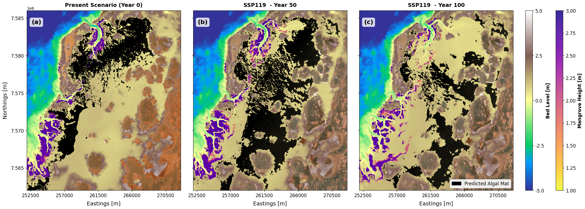{#fig-urala-algal-ssp119 width="100%"}

### SSP370

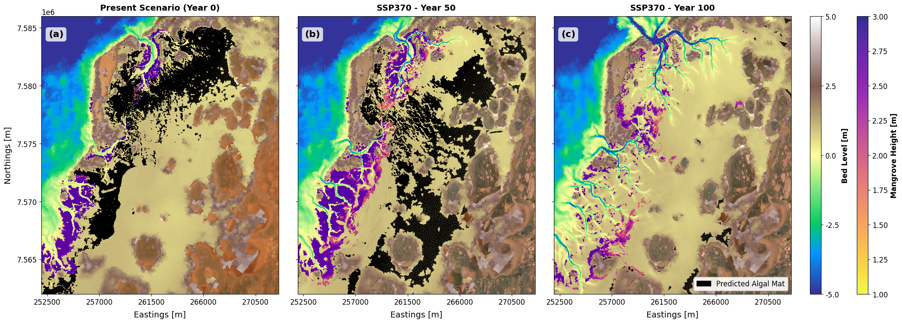{#fig-urala-algal-ssp370 width="100%"}

### SSP585

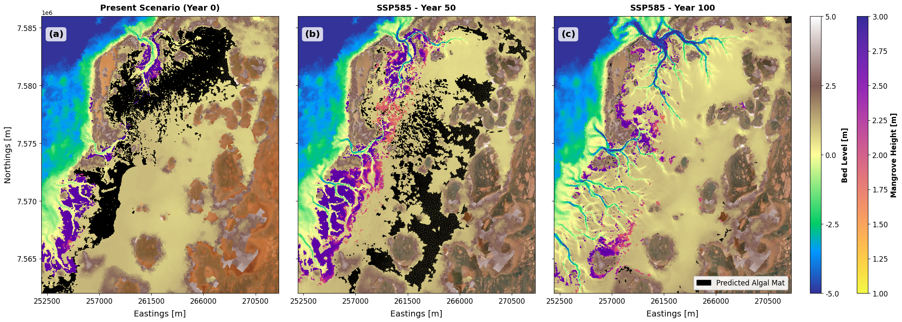{#fig-urala-algal-ssp585 width="100%"}

:::

::: {.panel-tabset}

### SSP119

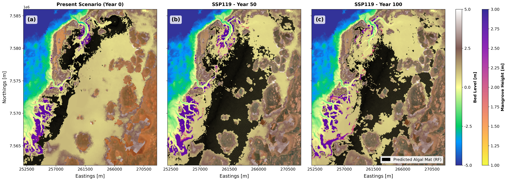{#fig-urala-algal-ssp119-ml width="100%"}

### SSP370

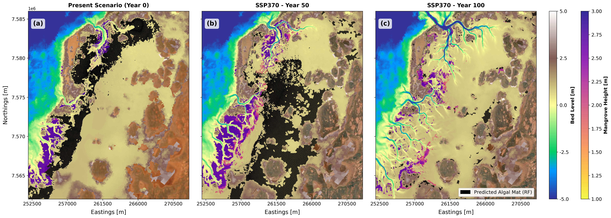{#fig-urala-algal-ssp370-ml width="100%"}

### SSP585

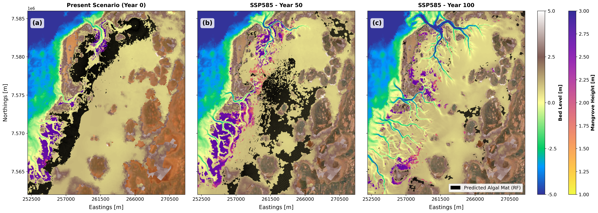{#fig-urala-algal-ssp585-ml width="100%"}

:::

The threshold based and RF approaches produced broadly similar trajectories of habitat change, including the progressive fragmentation and landward redistribution of algal mats under increasing SLR. Mangrove distributions were identical between the two approaches because mangrove suitability was determined using the same underlying hydrodynamic and elevation criteria. Differences between the approaches therefore reflect their respective representations of algal mat suitability. Both approaches predicted a significant loss of algal mat area for SSP370 and the worst SLR scenario tested (SSP585) by Year 100. SSP119 showed clear habitat migration as expected with mild SLR; the hydrodynamic suitability zones tend to shift, which is clearly reflected in this scenario. Furthermore, to illustrate the distributional changes of algal mats and mangroves across the three SLR scenarios, we present a comparative analysis of the predicted spatial extent at Year 0, Year 50, and Year 100 for each scenario. The following sections provide a detailed description of the predicted trends and ecological implications associated with each SLR pathway. 

## Overview of Spatial and Cross-Shore Patterns

Spatial distribution maps and cross-shore transects were used to assess projected changes in mangrove and persistent algal mat distributions under three SLR scenarios (SSP119, SSP370 and SSP585). Spatial maps @fig-urala-ssp119-ml - @fig-urala-ssp585-thresh (Panel a) show the predicted distributions at Year 100, with algal mats and mangroves overlaid on bed elevation. A representative seaward-to-landward transect is indicated by a light green line. Alongshore-averaged cross-shore profiles @fig-urala-ssp119-ml - @fig-urala-ssp585-thresh (Panels b–d) summarise habitat coverage at Present (Year 0), Year 50 and Year 100, respectively. These profiles express the fraction of locations occupied by each habitat along the cross-shore distance, thereby integrating spatial variability across the modelled coastline. Furthermore, to isolate the differences in the approaches, we extracted the persistent algal distribution from both approaches across different SLR scenarios and compared in @fig-urala-threshold-vs-rf.

::: {.panel-tabset}

### Random Forest (RF) Approach

::: {.panel-tabset}

#### SSP119
![Spatial distribution and cross-shore profile analysis of mangroves and algal mats across the Urala study site under scenario SSP119 (Random Forest approach). (a) Spatial map showing predicted distribution of combined persistent algal mats (red) and mangroves (purple) overlaid on bed elevation at Year 100, with a representative seaward-to-landward transect line (light green). (b–d) Along-shore averaged cross-shore profiles for Present Scenario (Year 0), Year 50, and Year 100, respectively. Solid black lines depict mean bed elevation ($\pm 1$ standard deviation shaded in tan), while secondary right axes display the spatial coverage fraction of mangrove density (green) and algal mat density (red) along the cross-shore continuum.](./images/Urala_combined_dist_mang_algal_pred_ssp119_ML.png){#fig-urala-ssp119-ml width=100%}

#### SSP370
![Spatial distribution and cross-shore profile analysis of mangroves and algal mats across the Urala study site under scenario SSP370 (Random Forest approach). (a) Spatial map showing predicted distribution of combined persistent algal mats (red) and mangroves (purple) overlaid on bed elevation at Year 100, with a representative seaward-to-landward transect line (light green). (b–d) Along-shore averaged cross-shore profiles for Present Scenario (Year 0), Year 50, and Year 100, respectively. Solid black lines depict mean bed elevation ($\pm 1$ standard deviation shaded in tan), while secondary right axes display the spatial coverage fraction of mangrove density (green) and algal mat density (red) along the cross-shore continuum.](./images/Urala_combined_dist_mang_algal_pred_ssp370_ML.png){#fig-urala-ssp370-ml width=100%}

#### SSP585
![Spatial distribution and cross-shore profile analysis of mangroves and algal mats across the Urala study site under scenario SSP585 (Random Forest approach). (a) Spatial map showing predicted distribution of combined persistent algal mats (red) and mangroves (purple) overlaid on bed elevation at Year 100, with a representative seaward-to-landward transect line (light green). (b–d) Along-shore averaged cross-shore profiles for Present Scenario (Year 0), Year 50, and Year 100, respectively. Solid black lines depict mean bed elevation ($\pm 1$ standard deviation shaded in tan), while secondary right axes display the spatial coverage fraction of mangrove density (green) and algal mat density (red) along the cross-shore continuum.](./images/Urala_combined_dist_mang_algal_pred_ssp585_ML.png){#fig-urala-ssp585-ml width=100%}

:::

### Threshold-Based Optimisation Approach

::: {.panel-tabset}

#### SSP119
![Spatial distribution and cross-shore profile analysis of mangroves and algal mats across the Urala study site under scenario SSP119 (Threshold-based approach). (a) Spatial map showing predicted distribution of combined persistent algal mats (red) and mangroves (purple) overlaid on bed elevation at Year 100, with a representative seaward-to-landward transect line (light green). (b–d) Along-shore averaged cross-shore profiles for Present Scenario (Year 0), Year 50, and Year 100, respectively. Solid black lines depict mean bed elevation ($\pm 1$ standard deviation shaded in tan), while secondary right axes display the spatial coverage fraction of mangrove density (green) and algal mat density (red) along the cross-shore continuum.](./images/Urala_combined_dist_mang_algal_pred_ssp119.png){#fig-urala-ssp119-thresh width=100%}

#### SSP370
![Spatial distribution and cross-shore profile analysis of mangroves and algal mats across the Urala study site under scenario SSP370 (Threshold-based approach). (a) Spatial map showing predicted distribution of combined persistent algal mats (red) and mangroves (purple) overlaid on bed elevation at Year 100, with a representative seaward-to-landward transect line (light green). (b–d) Along-shore averaged cross-shore profiles for Present Scenario (Year 0), Year 50, and Year 100, respectively. Solid black lines depict mean bed elevation ($\pm 1$ standard deviation shaded in tan), while secondary right axes display the spatial coverage fraction of mangrove density (green) and algal mat density (red) along the cross-shore continuum.](./images/Urala_combined_dist_mang_algal_pred_ssp370.png){#fig-urala-ssp370-thresh width=100%}

#### SSP585
![Spatial distribution and cross-shore profile analysis of mangroves and algal mats across the Urala study site under scenario SSP585 (Threshold-based approach). (a) Spatial map showing predicted distribution of combined persistent algal mats (red) and mangroves (purple) overlaid on bed elevation at Year 100, with a representative seaward-to-landward transect line (light green). (b–d) Along-shore averaged cross-shore profiles for Present Scenario (Year 0), Year 50, and Year 100, respectively. Solid black lines depict mean bed elevation ($\pm 1$ standard deviation shaded in tan), while secondary right axes display the spatial coverage fraction of mangrove density (green) and algal mat density (red) along the cross-shore continuum.](./images/Urala_combined_dist_mang_algal_pred_ssp585.png){#fig-urala-ssp585-thresh width=100%}

:::

:::

{#fig-urala-threshold-vs-rf width=100%}

### Threshold-Based versus Random Forest Approaches

#### Baseline Habitat Distribution

At Present (Year 0; black curves in @fig-urala-threshold-vs-rf), the threshold-based approach (solid line) predicted a relatively broad, continuous distribution of algal mats between approximately 6,000 and 11,000 m along the cross-shore profile, with peak coverage fractions exceeding 0.60–0.70. In comparison, the Random Forest (RF) approach (dashed line) predicted a slighly narrower distribution, concentrated between approximately 5,000 and 9,500 m, with peak coverage of approximately 0.60–0.65.

These differences reflect a slighly different representations of habitat suitability in the two approaches. The threshold-based model classifies locations according to predefined environmental criteria, whereas the RF model estimates habitat occurrence from relationships among environmental predictors and observed distributions. The differences in predicted extent and peak coverage indicate that the representation of algal mat suitability influences the estimated baseline distribution, particularly near habitat boundaries.

#### Responses to Increasing Sea-Level Rise

Differences between the approaches become more apparent in their projections for Year 50 (green curves) and Year 100 (red curves; @fig-urala-threshold-vs-rf). The threshold-based model (solid lines) generally produces sharper transitions in algal mat coverage, reflecting the discrete classification of locations according to predefined suitability criteria. As environmental conditions move beyond these criteria, locations become unsuitable, resulting in abrupt reductions in predicted coverage.

In contrast, the RF model (dashed lines) produces more gradual spatial transitions and retains low predicted coverage in some landward areas beyond 12,000 m under moderate-to-high SLR (Panels b and c in @fig-urala-threshold-vs-rf). This broader distribution of residual habitat reflects differences in how the two approaches represent environmental suitability. However, the persistence of predicted algal mat occurrence does not necessarily indicate the presence of viable ecological refugia, which would require further validation against environmental conditions and observed habitat distributions.

Despite these differences, both approaches project a progressive decline in algal mat coverage as SLR intensifies. Their agreement in the overall direction of change indicates that the predicted loss of algal mat habitat is consistent across modelling approaches, although the spatial extent and continuity of the remaining habitat differ.

### Scenario-Specific Projections

#### SSP119

**Present (Year 0).** Both approaches predict distinct habitat zonation (black curves in Panel a of @fig-urala-threshold-vs-rf), with mangroves occupying the lower intertidal zone (3,000–8,000 m) and algal mats distributed farther landward across supratidal flats at elevations of approximately 0.5–1.8 m.

**Year 50.** Algal mat distributions remain relatively stable, although some fragmentation occurs near the seaward margin (6,000–8,000 m). Coverage remains approximately 0.40–0.60 across the central and landward flats (10,000–14,000 m; green curves in Panel a).

**Year 100.** Both approaches predict persistent algal mat coverage of approximately 0.20–0.40 between 10,000 and 16,000 m, while mangrove distributions remain comparatively stable along tidal channels and their margins (red curves in Panel a).

#### SSP370

**Year 50.** Algal mats become increasingly fragmented near tidal channels and lower-lying areas, with peak coverage declining from baseline values above 0.60 to approximately 0.30–0.50. The main coverage band shifts landward towards 10,000–14,000 m (green curves in Panel b). Mangrove coverage increases locally along creek margins.

**Year 100.** Algal mat coverage declines substantially in both models (red curves in Panel b). The threshold-based approach predicts small, fragmented patches predominantly beyond 12,000 m, with coverage below 0.10. In contrast, the RF approach retains a more continuous, low-coverage distribution between approximately 6,000 and 16,000 m, with fractions of 0.10–0.15.

Mangroves extend across a broader cross-shore range (2,000–12,000 m), but coverage generally remains below 0.15–0.20, indicating a dispersed distribution rather than extensive, continuous forest cover.

#### SSP585

**Year 50.** Both approaches predict substantial reductions in algal mat coverage across the intertidal and supratidal flats, with peak coverage falling below 0.50 and the main distribution shifting towards 10,000–14,000 m (green curves in Panel c). Mangrove coverage temporarily increases between approximately 5,000 and 9,000 m, reaching around 0.40. This pattern suggests a potential expansion of suitable inundation conditions, although increased modelled coverage does not establish successful mangrove colonisation.

**Year 100.** Persistent algal mat habitat approaches complete loss across the profile (red curves in Panel c). The threshold-based model predicts coverage below 0.05 across almost the entire transect, whereas the RF model retains small residual peaks of approximately 0.10–0.15 between 11,000 and 17,000 m.

Mangroves extend across approximately 2,000–15,000 m but remain below 0.15 coverage across most of the profile, indicating a dispersed distribution rather than extensive forest development.

### Synthesis Across Sea-Level Rise Scenarios

The projected changes in habitat distribution become progressively more pronounced from SSP119 to SSP585. Under SSP119, substantial algal mat coverage persists across the higher flats, whereas SSP370 produces greater fragmentation and contraction. Under SSP585, both approaches predict near-complete loss of persistent algal mat habitat by Year 100. Mangroves exhibit temporary increases in coverage in some areas but remain relatively sparse under the more severe scenarios.

The two modelling approaches agree on the overall direction of change but differ in the predicted extent of residual algal mat habitat. The threshold-based model generally produces more restricted distributions with sharper spatial boundaries, while the RF model retains low coverage across a broader range of locations. These differences are most evident under SSP370 and SSP585, highlighting uncertainty in the spatial distribution of remaining habitat under increasing SLR. Overall, the results indicate substantial scenario-dependent restructuring of coastal wetland habitats, with the greatest losses of persistent algal mats under high SLR scenarios.

## Impact of Development Bund Walls on Habitat Redistribution

To evaluate the cumulative effects of coastal development and climate change, additional simulations incorporated the Ashburton Salt Project bund walls (modelled as thin dam walls within Delft3D FM). These structural barriers significantly modify local hydrodynamics, tidal propagation, and inundation patterns compared to the non development scenarios driven solely by sea level rise (SLR) (@fig-urala-algal-ssp119 through @fig-urala-ssp585-thresh versus their development counterparts). Panel (a) in all development figures displays the predicted Year 100 spatial distributions, while panels (b) through (d) illustrate the scenario-wise cross-shore profiles for Present (Year 0), Year 50, and Year 100, respectively.

::: {.panel-tabset}

### SSP119

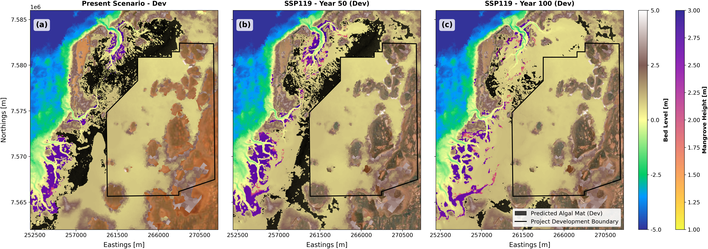{#fig-urala-algal-dev-ssp119 width="100%"}

### SSP370

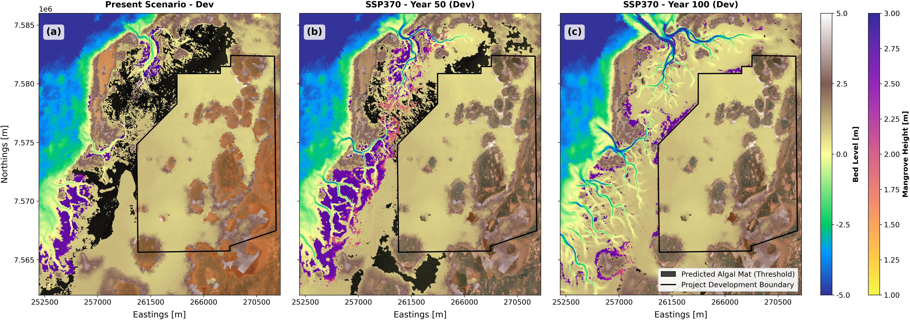{#fig-urala-algal-dev-ssp370 width="100%"}

### SSP585

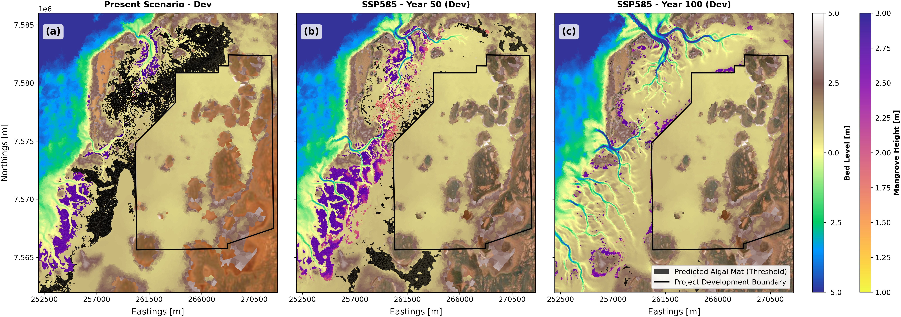{#fig-urala-algal-dev-ssp585 width="100%"}

:::

::: {.panel-tabset}

### SSP119

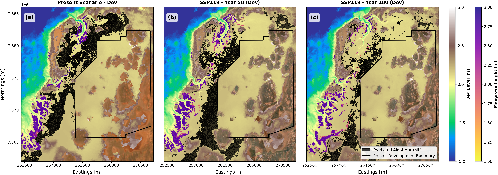{#fig-urala-algal-dev-ml-ssp119 width="100%"}

### SSP370

{#fig-urala-algal-dev-ml-ssp370 width="100%"}

### SSP585

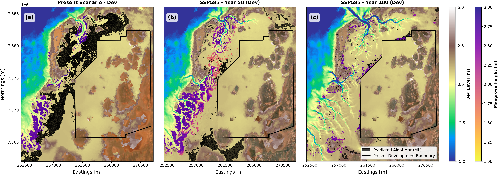{#fig-urala-algal-dev-ml-ssp585 width="100%"}

:::

::: {.panel-tabset}

### Random Forest (RF) Approach

::: {.panel-tabset}

#### SSP119
![Spatial distribution and cross-shore profile analysis of mangroves and algal mats across the Urala study site under scenario SSP119 (Random Forest development approach). (a) Spatial map showing predicted distribution of combined persistent algal mats (red), mangroves (purple), and the Ashburton Salt Project development boundary (black line) overlaid on bed elevation at Year 100, with a representative seaward-to-landward transect line (light green). (b–d) Along-shore averaged cross-shore profiles for Present Scenario (Year 0), Year 50, and Year 100, respectively. Solid black lines depict mean bed elevation ($\pm 1$ standard deviation shaded in tan), while secondary right axes display the spatial coverage fraction of mangrove density (green) and algal mat density (red) along the cross-shore continuum.](./images/Urala_combined_dist_mang_algal_pred_ssp119_ML_dev.png){#fig-urala-ssp119-ml-dev width=100%}

#### SSP370
![Spatial distribution and cross-shore profile analysis of mangroves and algal mats across the Urala study site under scenario SSP370 (Random Forest development approach). (a) Spatial map showing predicted distribution of combined persistent algal mats (red), mangroves (purple), and the Ashburton Salt Project development boundary (black line) overlaid on bed elevation at Year 100, with a representative seaward-to-landward transect line (light green). (b–d) Along-shore averaged cross-shore profiles for Present Scenario (Year 0), Year 50, and Year 100, respectively. Solid black lines depict mean bed elevation ($\pm 1$ standard deviation shaded in tan), while secondary right axes display the spatial coverage fraction of mangrove density (green) and algal mat density (red) along the cross-shore continuum.](./images/Urala_combined_dist_mang_algal_pred_ssp370_ML_dev.png){#fig-urala-ssp370-ml-dev width=100%}

#### SSP585
![Spatial distribution and cross-shore profile analysis of mangroves and algal mats across the Urala study site under scenario SSP585 (Random Forest development approach). (a) Spatial map showing predicted distribution of combined persistent algal mats (red), mangroves (purple), and the Ashburton Salt Project development boundary (black line) overlaid on bed elevation at Year 100, with a representative seaward-to-landward transect line (light green). (b–d) Along-shore averaged cross-shore profiles for Present Scenario (Year 0), Year 50, and Year 100, respectively. Solid black lines depict mean bed elevation ($\pm 1$ standard deviation shaded in tan), while secondary right axes display the spatial coverage fraction of mangrove density (green) and algal mat density (red) along the cross-shore continuum.](./images/Urala_combined_dist_mang_algal_pred_ssp585_ML_dev.png){#fig-urala-ssp585-ml-dev width=100%}

:::

### Threshold-Based Optimisation Approach

::: {.panel-tabset}

#### SSP119
![Spatial distribution and cross-shore profile analysis of mangroves and algal mats across the Urala study site under scenario SSP119 (Threshold-based development approach). (a) Spatial map showing predicted distribution of combined persistent algal mats (red), mangroves (purple), and the Ashburton Salt Project development boundary (black line) overlaid on bed elevation at Year 100, with a representative seaward-to-landward transect line (light green). (b–d) Along-shore averaged cross-shore profiles for Present Scenario (Year 0), Year 50, and Year 100, respectively. Solid black lines depict mean bed elevation ($\pm 1$ standard deviation shaded in tan), while secondary right axes display the spatial coverage fraction of mangrove density (green) and algal mat density (red) along the cross-shore continuum.](./images/Urala_combined_dist_mang_algal_pred_ssp119_threshold_dev.png){#fig-urala-ssp119-thresh-dev width=100%}

#### SSP370
![Spatial distribution and cross-shore profile analysis of mangroves and algal mats across the Urala study site under scenario SSP370 (Threshold-based development approach). (a) Spatial map showing predicted distribution of combined persistent algal mats (red), mangroves (purple), and the Ashburton Salt Project development boundary (black line) overlaid on bed elevation at Year 100, with a representative seaward-to-landward transect line (light green). (b–d) Along-shore averaged cross-shore profiles for Present Scenario (Year 0), Year 50, and Year 100, respectively. Solid black lines depict mean bed elevation ($\pm 1$ standard deviation shaded in tan), while secondary right axes display the spatial coverage fraction of mangrove density (green) and algal mat density (red) along the cross-shore continuum.](./images/Urala_combined_dist_mang_algal_pred_ssp370_threshold_dev.png){#fig-urala-ssp370-thresh-dev width=100%}

#### SSP585
![Spatial distribution and cross-shore profile analysis of mangroves and algal mats across the Urala study site under scenario SSP585 (Threshold-based development approach). (a) Spatial map showing predicted distribution of combined persistent algal mats (red), mangroves (purple), and the Ashburton Salt Project development boundary (black line) overlaid on bed elevation at Year 100, with a representative seaward-to-landward transect line (light green). (b–d) Along-shore averaged cross-shore profiles for Present Scenario (Year 0), Year 50, and Year 100, respectively. Solid black lines depict mean bed elevation ($\pm 1$ standard deviation shaded in tan), while secondary right axes display the spatial coverage fraction of mangrove density (green) and algal mat density (red) along the cross-shore continuum.](./images/Urala_combined_dist_mang_algal_pred_ssp585_threshold_dev.png){#fig-urala-ssp585-thresh-dev width=100%}

:::

:::

### Algal Mat Responses Under Development Scenarios

The inclusion of developmental bund walls imposes a profound constraint on algal mat distribution, primarily by blocking tidal flows and altering inundation frequencies within the project footprint (spanning approximately 10,000 to 16,000 m along the cross-shore profile). 

* **SSP119** Without bund walls, SSP119 maintains a robust and widespread band of algal mats across the higher supratidal flats. However, with the bund walls in place, algal mat coverage within the impoundment zone experiences a substantial reduction, losing an estimated 30% to 50% of its prospective high elevation habitat area as direct tidal connectivity is restricted.
  
* **SSP370** The combined pressure of moderate SLR and hydrodynamic blockage leads to severe fragmentation. Algal mat coverage is largely restricted to narrow exterior fringes outside the bund walls, accelerating habitat loss compared to the unconstrained baseline.
  
* **SSP585** Under extreme SLR, both the non development and development simulations show severe declines, resulting in a near complete collapse of persistent algal mats by Year 100. Consequently, SSP585 exhibits the most similar trajectory between with and without bund wall conditions, as extreme sea level rise and inundation overwhelm both natural and modified hydrodynamic niches.

### Influence of Bund Walls on Mangrove Distributions

Mangrove distributions exhibit distinct shifts due to the modified hydrodynamic regime imposed by the bund walls. Because mangroves rely heavily on tidal channel networks and intertidal inundation (typically occupying the lower to mid intertidal zone between 2,000 and 9,000 m), the physical obstruction of flow paths by the bund walls restricts their inland expansion potential. While unconstrained scenarios show temporary landward migration of mangroves under rising sea levels, the bund walls impede lateral tidal propagation, forcing mangroves to concentrate more densely along unblocked seaward channels and creek margins. This results in a more constrained and compartmentalised mangrove distribution with lower overall cross-shore dispersion compared to the unconstrained SLR projections.

For comparative purposes, @fig-urala-rf-nodev-vs-dev and @fig-urala-threshold-nodev-vs-dev illustrate the direct scenario-wise cross shore profile comparisons between unconstrained (without development, solid lines) and bund wall constrained (with development, dashed lines) model runs across Present, Year 50, and Year 100 timeframes. 

::: {.panel-tabset}

### Random Forest Approach

{#fig-urala-rf-nodev-vs-dev width="100%"}

### Threshold Based Approach

{#fig-urala-threshold-nodev-vs-dev width="100%"}

:::

The comparative profiles reveal that the magnitude of deviation caused by the developmental bund walls varies distinctly across SLR scenarios as well as different modelling approaches:

* **SSP119:** The most prominent divergence occurs across the central plateau (7,000 to 11,000 m). Without development, unconstrained hydrodynamic conditions allow robust algal mat coverage fractions to reach 0.50 to 0.65. With development, the restricted tidal exchange within the impoundment zone suppresses coverage fractions, creating a noticeable gap between solid and dashed curves during Year 50 and Year 100.
  
* **SSP370:** Moderate SLR combined with structural blockage induces pronounced vertical and spatial compression. The threshold based approach exhibits sharper drop offs in suitability boundaries, whereas the RF model displays more gradual tapering, yet both models highlight a marked reduction in peak coverage within the mid profile region.
  
* **SSP585:** Under extreme SLR, the difference between development and non development profiles narrows significantly. Because extreme sea level rise inundates and overwhelms the low lying coastal margins regardless of local bund structures, both modelling approaches project near identical, severely depressed coverage trajectories by Year 100.

::: {.callout-note icon=false}
## Summary: Trajectories of Algal Mats in Urala Under SLR and Development Scenarios

Synthesising multi-decadal predictions from our data driven frameworks (Random Forest vs. Threshold Based Optimisation) under the Salt Project development scenario reveals critical insights into how structural bund walls and modified hydrodynamics alter cyanobacterial mat communities across emission pathways:

---

## Scenario Profiles & Ecosystem Trajectories

-   **SSP119 (Low SLR – 0.5 m): Impoundment Suppression & Restricted Supratidal Extent**
    *   *Ecosystem Regime:* Constrained and compartmentalised.
    *   *Trajectory:* Unlike the unconstrained baseline where  algal mats expand freely across higher supratidal flats, the presence of developmental bund walls restricts direct tidal connectivity. Algal mat coverage within the impoundment zone experiences a substantial reduction, losing an estimated 30% to 50% of its prospective high elevation habitat area as internal wetting is impeded.

-   **SSP370 (Intermediate SLR – 0.9 m): Structural Fragmentation & Marginal Restriction**
    *   *Ecosystem Regime:* High structural stress and severe spatial fragmentation.
    *   *Trajectory:* The combined pressures of moderate sea level rise and hydrodynamic blockage accelerate habitat loss. Continuous mat sheets are heavily broken up, with survival restricted largely to narrow exterior fringes outside the bund walls as inundation patterns are fundamentally altered.

-   **SSP585 (High SLR – 1.25 m): Severe Drowning & Convergence with Baseline**
    *   *Ecosystem Regime:* Catastrophic habitat collapse.
    *   *Trajectory:* Extreme sea level rise and rapid inundation overwhelm both natural and modified hydrodynamic niches. By Year 100, both development and non development simulations show near total collapse and severe contraction of persistent algal mats, resulting in highly similar trajectories between constrained and unconstrained runs.

---

> **Insight:** Developmental bund walls fundamentally reshape local hydrodynamics, imposing severe constraints on algal mat persistence within the project footprint by restricting tidal exchange. While low to moderate scenarios (SSP119 and SSP370) exhibit pronounced divergence from unconstrained baselines due to structural blockage, extreme sea level rise (SSP585) overrides these engineering constraints as widespread drowning overwhelms the entire coastal system.
:::