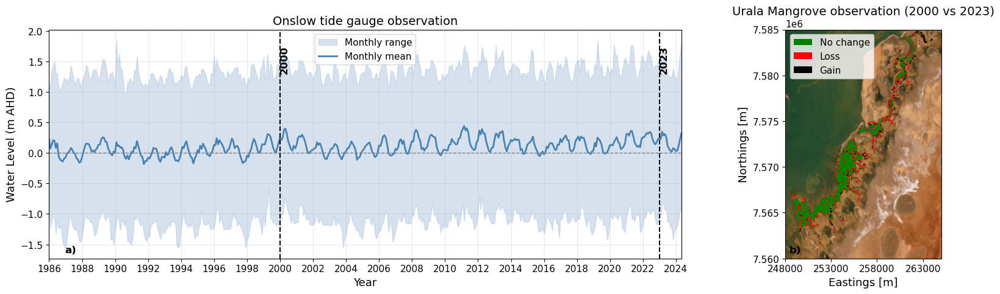
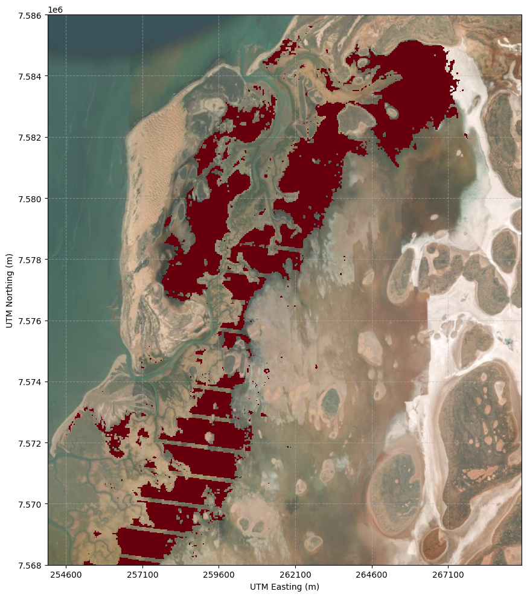
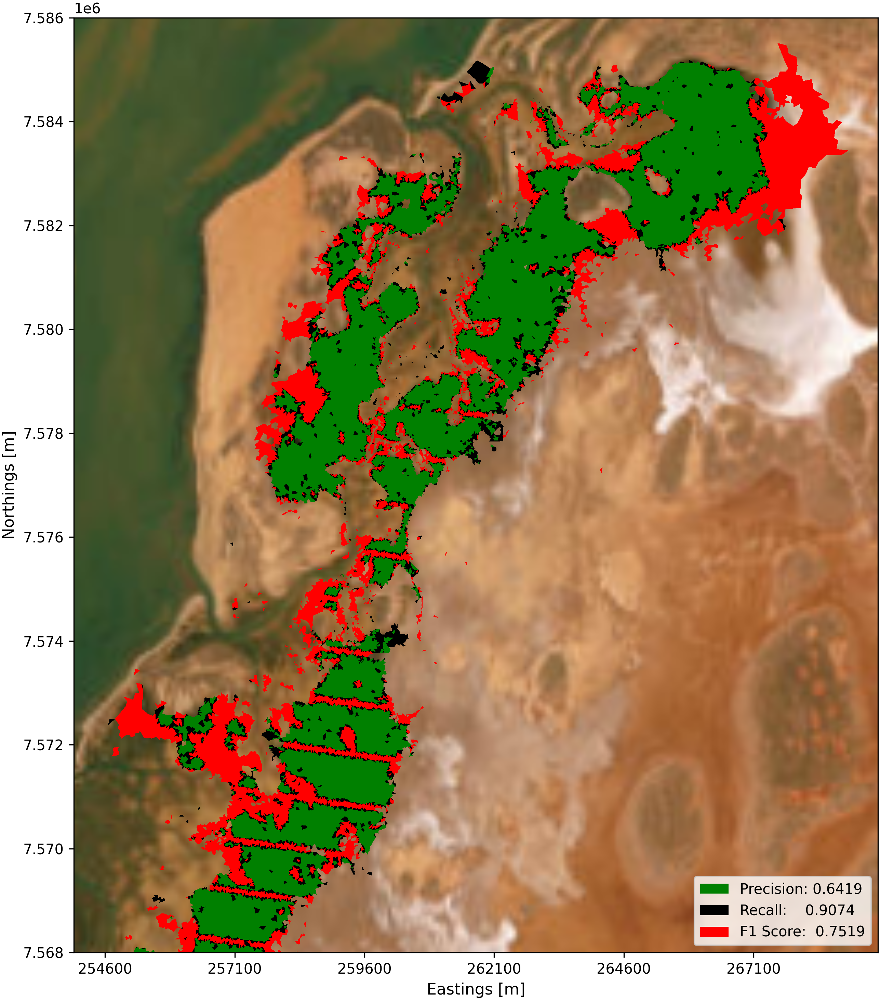

# Calibration and Validation {#sec-urala-calibration}

This chapter presents a comprehensive calibration and validation of the high-resolution Urala domain model. The approach largely follows that adopted for Giralia in @sec-giralia-calibration, with Urala-specific adjustments described below. Three physical and ecological components are evaluated:

1. **Hydrodynamic Calibration and Validation:** Evaluating simulated water levels and inundation dynamics against continuous field gauge observations.
2. **Mangrove Model Validation:** Comparing modelled mangrove extent with historical satellite-derived distributions (2000-2023), with predicted canopy attributes described separately.
3. **Cyanobacterial (Algal) Mat Validation:** Using a data-driven approach to calibrate and validate the persistent zone as outlined in @sec-approach and @sec-model-overview.

## Hydrodynamic Calibration and Validation {#sec-urala-hydro-calibration}

As highlighted in @sec-intro, we focus our effort on the salt project development aspect of the constraints. Nevertheless, hydrodynamics serve as the primary physical driver shaping intertidal habitats in Urala, much like other study sites. Achieving accurate hydrodynamic predictions is crucial for assessing baseline conditions, potential future environmental changes, and developmental constraints. 

Hydrodynamic calibration was conducted by comparing simulated water surface elevations against field-measured water level time series across key monitoring locations (readers are referred to @sec-appendixA for more details about monitoring) representing diverse habitat zones, including:

- **Urala Creek North Mouth**
- **Lower Creek**
- **Mud Flat**
- **Mid Mat (Lower Algal Mat)**
- **Upper Mat (Upper Algal Mat)**

Calibration involved adjusting bottom roughness using spatially variable Manning’s n coefficients assigned to the habitat bed types (@tbl-roughness). Other parameters and numerical settings examined included turbulence/eddy viscosity, wind drag coefficients, bathymetry/bed smoothing and wetting/drying depth thresholds.

The animation below illustrates the dynamic water depth variations, tidal propagation, and wetting/drying cycles across the specified monitoring locations within the Urala domain during the calibration period.

::: {#fig-urala-anim}

  

Dynamic hydrodynamic simulation of water depth across Urala intertidal habitat zones.
:::

The model achieved a strong overall agreement between measured and simulated water level time series:

* **Mouth & Lower Creek:** The model exhibited excellent agreement with field measurements, achieving an RMSE of $\approx 0.068\text{ m}$, a bias of $-0.07\text{ m}$, a slope of $0.99$, a scatter index of $\approx 0.17$, and a correlation coefficient ($R$) of $\approx 0.98$.
* **Lower & Upper Algal Mats / Mud Flats:** Surface water levels showed moderate accuracy in amplitude; however, the model demonstrated robust performance when analyzing the amplitude and frequency of inundation capturing approximately **70% of observed inundation events**.
* **Spatial Inundation:** Comparisons between simulated inundation extent and satellite-derived water coverage during representative high and low tides showed a strong spatial match (@sec-appendixA), reinforcing confidence in the model's ability to accurately simulate hydrodynamic processes and provide a reliable foundation for predicting future Habitat changes under differnt SLR scenarios (@sec-approach).

## Mangrove Model Validation {#sec-urala-mangrove-val}

To establish a baseline for present environmental conditions and evaluate future mangrove redistribution, we assessed the performance of the mangrove dynamic model across the Urala region. Following the approach used for the Giralia calibration and validation, our primary focus is on long-term changes; thus, we considered only the dominant tidal constituents (M2, S2, K1 and O1; see @sec-modelling-approach) for predicting both present-day conditions and future sea-level rise (SLR) scenarios.

### Historical Mangrove Observations (2000–2023)

To examine the temporal variability in mangrove distribution across the Urala domain, monthly mangrove maps derived from Landsat imagery by @Hickey2025 were analysed. The mangrove extents between 2000 and 2023 are compared in @fig-urala-obs to illustrate multi-decadal dynamics alongside long-term water-level variability recorded at the Onslow tide station—the closest operational tide gauge to the Urala domain.

While historical satellite observations reveal a overall stable mangrove footprint similar to the Giralia region over recent decades, key localised structural differences emerge upon spatial inspection (@fig-urala-obs b). Unlike the core interior stability seen in Giralia, Urala displays more active dynamic shifts along its complex creek network and seaward fringes:

- **Fringing Loss and Retreat:** Notable localised mangrove dieback and retreat (indicated in red) are concentrated along the narrow, highly exposed tidal channels and seaward creek boundaries. This localised dieback aligns with regional observations of upper intertidal stress triggered during extended El Niño–Southern Oscillation (ENSO) low water-level anomalies [@Lovelock2017].
- **Seaward Expansion and Colonisation:** Concurrently, minor localised seaward expansion and gain (indicated in black) occur in sheltered intertidal zones, indicating ongoing localized geomorphic adjustments and dynamic colonisation.

Despite these minor spatial fluctuations along the fringe boundaries, the core mangrove extent in Urala has remained largely resilient over the ~23-year observation window. This consistent baseline provides a reliable present-day benchmark against which future hydrodynamic modifications and climate-driven sea-level shifts can be evaluated.

::: {#fig-urala-obs}
{fig-align="center" width="95%"}

Water level observations and historical mangrove extent in the Urala region. **(a)** Water level recorded at the Onslow tide station ([WA Data Catalogue](https://catalogue.data.wa.gov.au/dataset/tide-stations)) displaying monthly range and monthly mean. **(b)** Comparison of Landsat-derived mangrove extents between 2000 and 2023 [@Hickey2025], highlighting areas of stability (no change), loss, and gain.
:::

## Initial Model Transferability & Overprediction Issues

As a first attempt, we evaluated model transferability by applying the calibrated mangrove model coefficients directly from Giralia to Urala. However, this preliminary setup resulted in a **spatial overprediction** of mangrove extent, with the model predicting mangrove establishment across vast stretches of the high intertidal and supratidal salt flats where no mangroves exist.

This overprediction highlighted a key limitation: the initial model framework did not resolve substrate-level abiotic stressors specifically, **groundwater and surface salinity dynamics**. In hyper-arid systems like Urala, extreme evaporation across shallow salt flats that are infrequently inundated generates hypersaline conditions ($> 60–80\text{ PSU}$) that severely constrain mangrove seedling establishment and survival. Without an explicit salinity stress mechanism, the hydro-morphological suitability criteria alone proved insufficient to constrain mangrove boundaries.

---

### Proxy Salinity Model Formulation

To address this limitation and improve spatial precision, we implemented a **proxy salinity mass-balance module**. This module dynamically tracks salinity accumulation, evaporation, and ocean flushing across each model cell based on inundation depth and tidal exchange frequency.

#### Water & Salt Mass Balance Equations

For each grid cell, the water depth $h(t)$ determines the active wetting state based on a minimum depth threshold $h_{\text{min}}$ (e.g., $0.05\text{ m}$). 

When a dry cell becomes inundated ($h(t) > h_{\text{min}}$ and $h(t-\Delta t) \le h_{\text{min}}$), the initial salt mass $M(t)$ is calculated from incoming seawater at ambient concentration $S_0$ ($35\text{ PPT}$), plus any residual salt mass $M_{\text{res}}$ left behind from previous drying cycles:

$$
M(t) = h(t) \cdot S_0 + M_{\text{res}}
$$ {#eq-inundation-salt}

For continuously wet cells ($h(t) > h_{\text{min}}$ and $h(t-\Delta t) > h_{\text{min}}$), changes in water depth $\Delta h = h(t) - h(t-\Delta t)$ dictate salt flux and evaporative concentration:

* **Rising Tide ($\Delta h > 0$):** Additional marine water enters the cell, increasing salt mass:
  $$
  M(t) = M(t-\Delta t) + \Delta h \cdot S_0
  $$ {#eq-rising-tide}

* **Falling Tide ($\Delta h \le 0$):** Total water loss equals $-\Delta h$. Water loss is partitioned into evaporative loss ($E_{\text{evap}}$) driven by the pan evaporation rate $E$, and physical drainage/outflow loss ($L_{\text{drain}}$):
  $$
  E_{\text{evap}} = \min(E \cdot \Delta t, -\Delta h)
  $$ {#eq-evap-loss}

  $$
  L_{\text{drain}} = -\Delta h - E_{\text{evap}}
  $$ {#eq-drain-loss}

  Drainage removes salt proportional to the instantaneous ambient concentration $S_{\text{now}} = \frac{M(t-\Delta t)}{\max(h(t-\Delta t), h_{\text{min}})}$, while evaporation concentrates the remaining salt mass:
  $$
  M(t) = M(t-\Delta t) - L_{\text{drain}} \cdot S_{\text{now}}
  $$ {#eq-falling-tide-mass}

#### Concentration Limits and Desiccation Accumulation

The instantaneous surface water salinity $S(t)$ is computed from the remaining salt mass and bounded by a physical capping limit $S_{\text{cap}}$ ($250\text{ PSU}$):

$$
S(t) = \min\left( \frac{M(t)}{\max(h(t), h_{\text{min}})}, S_{\text{cap}} \right)
$$ {#eq-salinity-cap}

When a cell completely dries out ($h(t) \le h_{\text{min}}$), all remaining salt mass accumulates as residual deposit $M_{\text{res}}$ to be dissolved upon the next wetting cycle:

$$
M_{\text{res}} \leftarrow M_{\text{res}} + M(t)
$$ {#eq-residual-salt}

#### Salinity Stress Function

The resulting 90th percentile salinity ($S_{p90}$) drives the non-dimensional vegetation stress coefficient $S_{\text{sal}} \in [0, 1]$:

$$
S_{\text{sal}} = \operatorname{clip}\left( \frac{S_{p90} - S_{\text{thres}}}{S_{\text{lethal}} - S_{\text{thres}}}, 0, 1 \right)
$$ {#eq-salinity-stress}

where $S_{\text{thres}}$ is the salinity threshold above which stress begins to impact growth, and $S_{\text{lethal}}$ is the upper lethal limit causing complete vegetation mortality.

### Model Initialisation & Performance Evaluation

@fig-urala-val shows the modelled mangrove distribution across the Urala region under present environmental conditions. Because the objective was to reproduce the representative baseline mangrove extent, the model simulations were forced with dominant tidal constituents (M2, S2, K1 and O1; see @sec-modelling-approach) for the prediction of present-day conditions. 

The spatial agreement between the modelled and observed mangrove extents was evaluated by categorising grid cells:
* **True Positives (Green):** Correctly predicted mangrove areas.
* **False Negatives (Black):** Observed mangrove areas missed by the model.
* **False Positives (Red):** Areas predicted as mangrove where none were observed.

To quantitatively evaluate spatial performance within the core analysis domain, precision, recall, and the $F_1$ score were computed:

| Statistic | Definition | Formula | Model Performance |
| :--- | :--- | :--- | :--- |
| **Precision** | Proportion of modeled mangrove cells corresponding to true observed mangroves | $\text{Precision} = \frac{TP}{TP + FP}$ | $0.680$ |
| **Recall** | Proportion of observed mangrove cells correctly reproduced by the model | $\text{Recall} = \frac{TP}{TP + FN}$ | $0.534$ |
| **$F_1$ Score** | Harmonic mean of precision and recall | $F_1 = 2 \cdot \frac{\text{Precision} \cdot \text{Recall}}{\text{Precision} + \text{Recall}}$ | $0.598$ |

The model achieved precision of 0.680, recall of 0.534 and an F1 score of 0.598. Precision indicates that 68.0% of predicted mangrove cells corresponded to observed mangroves, while recall indicates that 53.4% of observed mangrove cells were reproduced. Missed areas include narrow fringing strips along smaller tidal channels; the extent to which these discrepancies reflect model resolution, elevation data or other process representations requires further evaluation.

---

### Modelled Vegetation Structural Parameters

In addition to spatial extent, the model captures key structural attributes of the mangrove canopy across the Urala domain:

* **Stem Diameter ($d$):** Predicted spatial distributions (@fig-urala-val b) range between $0.03\text{ m}$ and $0.07\text{ m}$. Larger diameters ($>0.05\text{ m}$) are concentrated within the well-established, sheltered tidal creek network, indicating that mature mangroves are forming in the true observed locations relatively well.
* **Stem Height ($h$):** Corresponding spatial distributions (@fig-urala-val c) show heights ranging predominantly between $1.8\text{ m}$ and $2.6\text{ m}$, displaying a clear structural gradient: taller, mature trees occupy the sheltered, frequently inundated main creek channels, while smaller, shorter trees ($<2.0\text{ m}$) form along the landward transitions and peripheral fringes.

The predicted stem diameter and height distributions provide a model-based description of canopy structure. Their spatial correspondence with observed mangrove occurrence does not constitute quantitative validation of these attributes or of internal vegetation dynamics. Independent structural observations would be needed to evaluate those predictions.

::: {#fig-urala-val}
{fig-align="center" width="100%"}

Mangrove validation and vegetation structural parameter distributions across the Urala study area. **(a)** Spatial confusion map highlighting true positives, false negatives, and false positives alongside bounded performance metrics ($F_1$ score, precision, recall). **(b)** Spatial distribution of modelled stem diameter ($d$). **(c)** Spatial distribution of modelled stem height ($h$).
:::

## Algal Mat Calibration and Validation {#sec-algal-calibration}

Using the calibrated hydrodynamic and mangrove model outputs, the algal mat module was subsequently calibrated to predict present-day distributions across the Urala domain. 

Algal mats are highly dynamic ecosystems that undergo rapid temporal fluctuations, even within single spring–neap tidal cycles. Algal spores are widely distributed throughout the intertidal zone; under favorable environmental conditions, they actively photosynthesize and expand, whereas under stress, they remain dormant. When suitable conditions persist for extended periods, they develop into thick, contiguous mats, as observed across several intertidal zones in Urala.

Due to this highly dynamic behaviour, implementing a fully mechanistic growth approach—similar to that used in the mangrove model—presents significant challenges. However, because this study focuses primarily on long-term spatial trajectories, we utilized satellite-derived probability maps from @Hickey2025 to isolate persistent algal mat distributions. A threshold of annual probability $> 25\%$ was applied across 2019 to define the baseline stable algal mat coverage (@fig-urala-alagl-presistence). 

::: {#fig-urala-alagl-presistence}
{fig-align="center" width="100%"}

Algal mat persistence map based on @Hickey2025 for 2019.
:::

Hydrodynamic simulations were conducted for the 2019 calibration period to evaluate the governing environmental drivers. By integrating key hydrodynamic indicators—namely maximum bed shear stress ($\tau_{\text{max}}$), inundation frequency, and the 98th percentile water depth ($d_{98}$)—we established the following environmental suitability thresholds for algal mat persistence at Urala:

- **Maximum Bed Shear Stress:** $0.2 \le \tau_{\text{max}} \le 0.7\text{ N m}^{-2}$
- **Inundation Frequency:** $0.0001 \le \text{Inundation Frequency} \le 0.95$
- **98th Percentile Water Depth:** $0.01 \le d_{98} \le 0.55\text{ m}$

To capture complex, non-linear environmental interactions, a Machine Learning framework using a Random Forest (RF) classifier was also implemented. The ML model was trained and evaluated using a 50/50 train-test split to ensure robust out-of-sample generalisation, and the resulting calibrations were further validated against independent hydrodynamic metrics from an alternate simulation year.

The spatial validation results comparing both approaches across the Urala domain are presented below:

::: {.panel-tabset}

### Machine-Learning Approach (Random Forest)

{#fig-urala-ml width=85%}

### Threshold-Based Optimisation Approach

{#fig-urala-threshold width=85%}

:::

## Chapter Summary {#sec-urala-summary}

The calibration and validation provide a basis for evaluating present-day conditions at Urala, with performance differing among the hydrodynamic and habitat components.

- **Hydrodynamics:** Agreement was strongest at the creek mouth and lower creek, with correlation of approximately 0.98. Water-level amplitudes were less accurately reproduced on the intertidal flats and mat habitats, where the model captured approximately 70% of observed inundation events. These differences remain relevant when interpreting habitat predictions.
- **Mangroves:** Transferring the Giralia mangrove parameterisation to Urala initially resulted in an overprediction of mangrove extent. To address this, a proxy salinity mass-balance module was introduced to represent the additional constraint imposed by hypersalinity on mangrove establishment across infrequently inundated salt flats. This modification improved the spatial representation of mangrove extent, achieving a precision of $0.680$, recall of $0.534$ and an F1 score of $0.598$. These results indicate a better balance between the identification of existing mangrove areas and the limitation of overpredicted extent. However, independent validation of predicted vegetation structural attributes, including stem diameter and height, is not reported here.
- 
- **Cyanobacterial Mat Multi-Approach Performance:** Threshold optimisation and Random Forest classification were evaluated as separate approaches for predicting persistent mat distributions from modelled bed shear stress, inundation frequency and water depth. 

**Implications for model application:** The Urala results show why transfer between sites requires evaluation against local observations and consideration of site-specific habitat controls. The introduction of the salinity proxy addresses a limitation of using hydro-morphological suitability alone. Present-day agreement supports using the framework to explore future responses, while the projections remain conditional on the elevation data, boundary forcing, salinity representation and ecological parameterisation. Agreement in present-day habitat extent does not independently validate future habitat migration or vegetation structural dynamics.

Building upon this validated framework, the long-term responses and future trajectories of these intertidal ecosystems under various climate-driven sea-level rise (SLR) scenarios are presented in @sec-urala-mangrove and @sec-urala-algalmat.