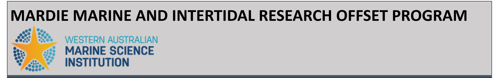
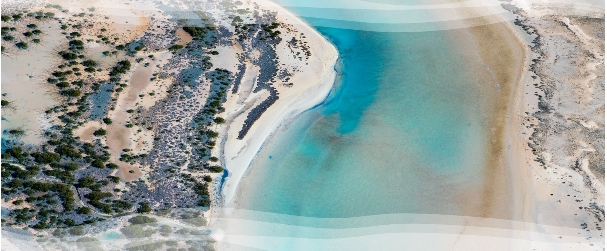
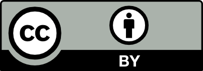

---
format:
  html:
    toc: true
    toc-depth: 3
    toc-expand: true
    number-sections: false
---

# About {.unnumbered}

  

  

 

## About the Mardie Project

The Mardie Marine and Intertidal Research Offset Program, which is led by the Western Australian Marine Science Institution, was established to develop an understanding of the West Pilbara’s intertidal habitats, with a focus on mangroves, cyanobacterial (algal) mats and, their ecological role and the changes these habitats may face in the future due to climate change and salt project developments. The program includes five major research components on the west Pilbara coast which are being delivered by more than 20 scientists from the WAMSI partnership.

 

## Ownership of Intellectual Property Rights
Unless otherwise noted, any intellectual property rights in this publication are owned by the State of Western Australia.

Unless otherwise noted, all material in this publication is provided under a [Creative Commons Attribution 4.0 Australia License](https://creativecommons.org/licenses/by/4.0/deed.en).

{width="25%"}

## Funding Sources
The Mardie Marine and Intertidal Research Offset Program is supported by BCI Minerals as part of Ministerial conditions, with additional contributions from WAMSI partners.

## Data
Finalised datasets will be released as open data, and data and/or metadata will be discoverable through Data WA and the Shared Land Information Platform (SLIP).

## Year of Publication
October 2026

## Acknowledgements
We acknowledge the Traditional Custodians of the land, and their connections to the land, sea and community. We pay our respects to their Elders past and present. Approval was granted for field access by Buurabalayji Thalanyji Aboriginal Corporation, Wirrawandi Aboriginal Corporation and Nganhurra Thanardi Garrbu Aboriginal Corporation as part the Mardie Project Marine and Intertidal Research Offsets Program administered by WAMSI. We thank Kelly Waples for assistance with permits and project organisation. We acknowledge the contributions at various stages of the project, including Peisheng Huang, Yvette Wong, Brendan D. Busch, Santiago Gil Escudero, Toby Brown, Mick O'Leary, Michael Cuttler, Camille Grimaldi and Catherine Lovelock. We also acknowledge the contributions of other WAMSI project Teams - poject A and Project C part of the Mardie Marine and Intertidal Research Offset Program for their contributions.

## Legal Notice
The Western Australian Marine Science Institution advises that the information contained in this publication comprises general statements based on scientific research. The reader is advised and needs to be aware that such information may be incomplete or unable to be used in any specific situation. This information should therefore not solely be relied on when making commercial or other decisions. WAMSI and its partner organisations take no responsibility for the outcome of decisions based on information contained in this, or related, publications.

## Contributing Authors
Project B of the Mardie Marine and Intertidal Research Offset Program was delivered by a collaborative research team, with project leadership provided by Prof. Matthew Hipsey1,2 and Prof. Ryan Lowe3. The contributing research team included:

* Daniel Raj David3
* Xiaoya Luo3
* Arnold Van Rooijen3
* Jasper Dijkstra4
* Bas van Maren4
* Jan Boersma4
* Jeff Hansen3
* Kerry Bardot1,2

<small>
1 Aquatic Ecodynamics, The University of Western Australia, Crawley WA 6009, Australia  
2 Centre for Water and Spatial Sciences, The University of Western Australia, Crawley WA 6009, Australia  
3 School of Earth and Oceans, The University of Western Australia, Crawley WA 6009, Australia  
4 Deltares, Delft, The Netherlands  
</small>

## Citation
David, D. R., Hipsey, M., Lowe, R., Luo, X., Van Rooijen, A., Dijkstra, J., van Maren, B., Boersma, J., Hansen, J., Bardot, K. (2026). Future of Intertidal Habitats in the Pilbara, Australia. Prepared for the Ministerial Statement 1175. Western Australian Marine Science Institution, Perth, Western Australia.

## Front Cover Image
Photo courtesy of [Mardie Project - Western Australian Marine Science Institution](https://wamsi.org.au/projects/mardie-project/).

## Document Version History

The key development and review milestones for this documentation are summarised below.

| Milestone | Date |
|:---|:---|
| Draft documentation | 30/10/2026 |