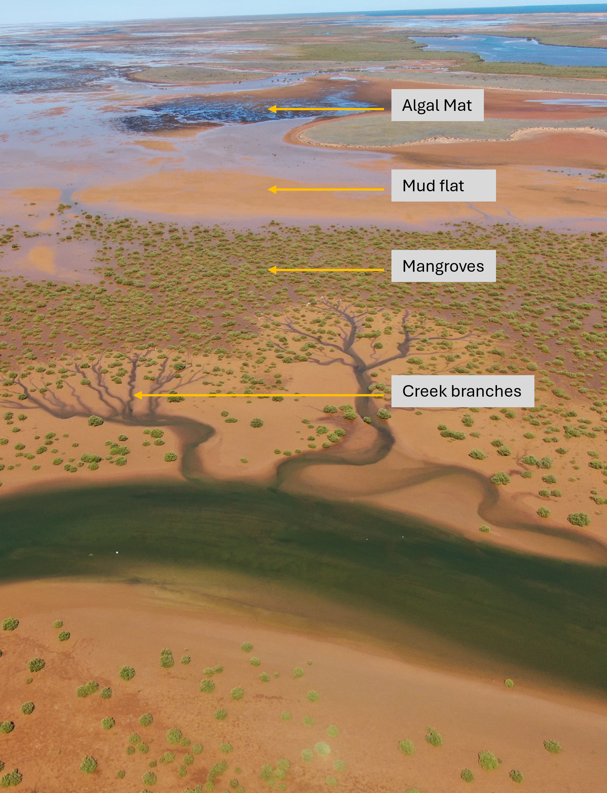

# Overview {.unnumbered}

## Scope of the Project {.unnumbered}

::: columns

::: {.column width="50%"}

Project B of the [WAMSI Mardie Offset Marine and Intertidal Research Program](https://wamsi.org.au/projects/mardie-project/) aims to improve understanding of how intertidal habitats along the West Pilbara coast function and may respond to future environmental change and coastal development. The project develops scientific knowledge and predictive tools to support environmental assessment, coastal management and decision making, with particular attention to mangroves and cyanobacterial mats.

The research combines field observations, habitat information and numerical modelling to investigate the interactions between tidal inundation, sediment transport, coastal morphology and habitat dynamics. It examines how these processes influence habitat persistence and redistribution under sea-level rise, including the capacity and limits of habitats to migrate landward where coastal development may constrain their movement.

:::

::: {.column width="50%"}

{#fig-background width="100%"}

:::

:::

 

## Project Motivation and Context {.unnumbered}

Much of the West Pilbara coastline has remained relatively undeveloped, but proposals for coastal and industrial development, including large-scale solar salt production, create potential pressures on its extensive intertidal habitats. These pressures coincide with climate change, particularly rising sea levels. Understanding how habitats may respond to these interacting changes is needed to assess future development proposals and inform coastal planning.

The long-term behaviour of these arid intertidal systems remains comparatively poorly understood. Much of the established understanding of coastal wetland responses comes from humid tropical mangroves, temperate wetlands and sediment-rich river deltas. The West Pilbara differs through its limited and episodic freshwater inputs, strong evaporation, variable salinity and extensive low-gradient intertidal landscapes. Research is therefore needed to establish how these conditions influence habitat responses and the feedbacks between vegetation, water movement, sediment transport and changing land elevations. Of particular importance is understanding the capacity and limits of habitats to adjust vertically or migrate landward as sea levels rise, and how future development could restrict migration pathways or alter tidal connectivity.

In response to these challenges, the Western Australian Marine Science Institution (WAMSI) initiated a collaborative research program to investigate the potential environmental implications of salt-farm development along the West Pilbara coast. The initiative brings together government regulators, environmental management agencies, research institutions, and industry stakeholders, including the Department of Water and Environmental Regulation (DWER), the Department of Biodiversity, Conservation and Attractions (DBCA), the Department of Primary Industries and Regional Development (DPIRD), the Department of Climate Change, Energy, the Environment and Water (DCCEEW), and BCI Minerals.

Within this program, the University of Western Australia undertook an integrated investigation of the physical and ecological processes governing intertidal habitats and their potential responses to environmental change and coastal development. The research combines field observations, analysis of environmental conditions and habitat distributions, and the development and application of predictive models. Together, these components improve understanding of an understudied coastal setting and provide a basis for assessing potential habitat change under future sea-level-rise scenarios and development-related constraints.

## Major Findings {.unnumbered}

### Modelling Capability & Framework Advancement {.unnumbered}

One of the key outcomes of this project is the development of a coupled eco-geomorphic modelling framework capable of simulating across coastal scales $O(\text{km})$. 

* **Advancement Over Existing Approaches:** Previous studies have demonstrated the importance of feedbacks between mangroves, hydrodynamics and coastal morphology, including applications to idealised domains, individual sites and shorter projection periods. This project extends these capabilities towards spatially extensive simulations of heterogeneous arid intertidal landscapes over decadal and centennial timescales. The framework dynamically links mangrove establishment, growth and mortality with tidal hydrodynamics, sediment transport and changing bed elevations. A computational implementation designed for high-performance computing supports these larger simulations. Complementary data-driven methods use the resulting environmental conditions to assess potential cyanobacterial-mat distributions. Together, these developments provide tools for investigating habitat redistribution and development-related constraints across contrasting coastal settings.
* **Transferability:** The framework has particular relevance to other Australian intertidal systems, especially across northern Australia, where climate change and coastal development may affect mangroves and associated habitats. Its modular structure also provides opportunities for application internationally. Transfer to another setting requires suitable environmental and habitat data, adaptation to local conditions and ecological characteristics, and site-specific calibration and evaluation. The transferable contribution is the modelling framework and process-based approach; individual site predictions require local assessment.

The modelling results highlight the critical importance of evaluating coupled physical-ecological interactions when assessing future coastal change. While coastal infrastructure and development footprints may restrict local habitat migration pathways, these insights provide a broader understanding of long-term habitat trajectories to support improved spatial planning and management strategies across Pilbara coastal ecosystems.

{#fig-urala-drone width="100%"}

### Modelling Outcomes {.unnumbered}
Intertidal habitat responses to sea-level rise depend on how water movement, sediment transport, land elevations and ecological communities change together. A simple bathtub assessment that raises water levels over fixed topography and assumes static habitats cannot represent these feedbacks. Sediment erosion and deposition alter inundation conditions, while changing mangrove distributions modify flow resistance and sediment transport. These interactions can influence where habitats persist, establish, migrate or contract, and whether development restricts their adjustment. The coupled modelling approach provides a means of investigating these evolving responses and their implications for future habitat distributions, beyond the areas potentially inundated by higher water levels alone.

::: {.callout-important}
## Key Question: How Do Specific Intertidal Habitats Adapt to Rising Sea Levels?

**Do Mangroves Survive Sea-Level Rise (SLR)?**

Mangroves can persist under some sea-level-rise scenarios, but their capacity to adjust depends on the rate of rise, sediment and morphological responses, and the availability of suitable landward migration space. Coastal development that restricts this space can increase coastal squeeze and habitat loss. Under high SLR scenarios, mangroves initially expand landward rather than immediately retreating. This follows a non-monotonic **"expansion followed by drowning"** trajectory:

1. **Phase 1 (Landward Expansion):** Mangroves encroach landward into higher bed elevations (shifting upward from ~1.0 m to 2.5 m elevation).
2. **Phase 2 (Drowning & Die-back):** Once the rate of SLR outpaces the rate of sediment accretion, severe drowning and tree mortality occur.

---

**Do Algal Mats Survive Sea-Level Rise (SLR)?**

Cyanobacterial mats may persist under rising sea levels by redistributing towards higher elevation areas, but they are unlikely to maintain their original spatial footprint under substantial SLR. Their persistence depends on the availability of suitable inundation and exposure conditions, the capacity to occupy newly suitable areas, and competition with expanding mangrove communities. Under higher SLR scenarios, this response can be characterised as a non monotonic trajectory of landward redistribution followed by spatial compression:
1. **Landward Encroachment:** Rising sea levels alter inundation frequency and duration, shifting the zones suitable for cyanobacterial mats towards higher elevations. However, expanding mangroves may colonise parts of the existing mat distribution, further modifying the availability of suitable areas.
2. **Spatial Compression and Fragmentation:** As suitable intertidal space becomes increasingly restricted, cyanobacterial mats may become concentrated in narrower landward fringe areas. Their overall extent and spatial continuity decline where suitable elevations are limited or where mangrove expansion and changing inundation conditions reduce the area available for persistence.
:::

::: {.callout-note}
## Key Question: Do Intertidal Habitats Survive Future Sea-Level Rise?

**Overview of Trajectories and Coastal Squeezing**

The modelling assessment indicates that rising sea levels will drive significant shifts in the distribution and extent of intertidal habitats through altered inundation regimes. While response trajectories vary sharply by habitat type based on their specific elevation thresholds and adaptive limits, the overarching result across the profile is a shift from species die-off at seaward boundaries to migration and spatial squeeze at landward margins.
:::

